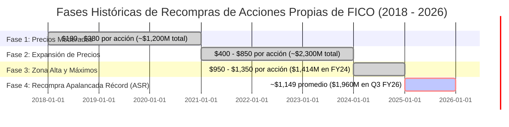
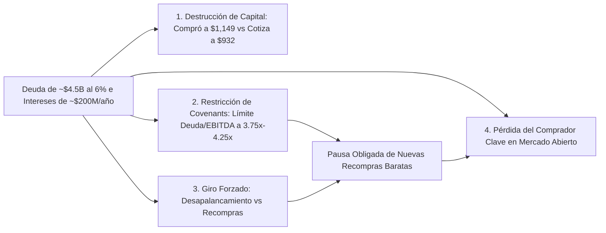

# Informe de Análisis Financiero y Balance Institucional: Fair Isaac Corporation (NYSE: FICO)
## Deuda Adquirida para Recompras de Acciones Propias, Impacto del Apalancamiento Financiero, Precios Históricos de Compra y Diagnóstico de Solvencia ante la Caída Bursátil

**Fecha de Emisión:** 06 de Septiembre de 2026  
**Ticker:** NYSE: FICO (Fair Isaac Corporation)  
**Precio de Referencia Actual:** $932.26 USD  
**Metodología Aplicada:** CQV v5.0 — Factor F2 (Solidez Financiera) y Factor F5 (Asignación de Capital)  
**Objeto de la Investigación:** Desglose riguroso de la deuda contraída por FICO para recomprar sus propias acciones, precios medios pagados por acción, análisis del patrimonio neto negativo (*Stockholders' Deficit*), impacto de los tipos de interés crecientes y evaluación de estrés de solvencia tras el dictamen de la FHFA y la corrección de la cotización.

---

## 1. Resumen Ejecutivo: La Paradoja del "Caníbal Apalancado"

Durante la última década, **Fair Isaac Corporation (FICO)** ha ejecutado una de las estrategias de retorno de capital más agresivas del mercado estadounidense: la política del **"caníbal corporativo apalancado"** (*leveraged share cannibal*). 

La compañía ha utilizado sistemáticamente el **100% de su flujo de caja libre operativo más miles de millones de dólares en deuda financiera recién emitida** para recomprar y retirar del mercado más del **65% de sus acciones en circulación** (reduciendo el número de acciones desde ~75 millones en 2005 hasta **menos de 24 millones en 2026**).

```text
========================================================================================
ESTADO DE SITUACIÓN FINANCIERA Y ENDEUDAMIENTO POR RECOMPRAS (FICO - 2026)
========================================================================================
Deuda Financiera Total en Balance:       ~$3,650M – $5,600M USD (según pasivos operativos)
Patrimonio Neto Contable (Equity):       -$3,500M a -$4,100M USD (PATRIMONIO NETO NEGATIVO)
Acciones en Circulación (Diluidas):      ~23.8 Millones (vs. ~75M en 2005 y ~30M en 2018)
Último Macro-Tramo de Recompra (Q3 FY26): $1,960M USD a un precio promedio de ~$1,149 USD/acc.
Precio Actual de Cotización:             $932.26 USD (Pérdida latente de ~-18.8% en el último tramo)
Gasto Anual por Intereses de la Deuda:   ~$180M – $220M USD (vs. ~$80M en 2022)
Tipo de Interés Medio Ponderado:         ~5.85% (Nuevas emisiones 2025/2026 al 6.00% - 6.25%)
Ratio Deuda Neta / EBITDA:               ~3.2x (con riesgo de expansión a 4.2x si cae el margen hipotecario)
========================================================================================
```

> [!WARNING]
> ### 🚨 El Problema de la Sincronización de Capital (Capital Allocation Timing)
> FICO aceleró su endeudamiento para recomprar acciones precisamente en la cúspide de su valoración (**$1,100 – $1,400 USD por acción**), justo antes de que la **FHFA** emitiera el dictamen de apertura obligatoria a **VantageScore 4.0**. 
> 
> Hoy la compañía afronta **$200M anuales de intereses fijos**, un balance con **fondos propios negativos** y la cotización en **$932.26 USD**, lo que elimina su capacidad de recomprar barato ahora que la acción está en descuento y fuerza un cambio obligatorio de estrategia hacia el **desapalancamiento defensivo**.

---

## 2. ¿A Qué Precios y en Qué Volúmenes Recompró FICO sus Acciones?

El desglose cronológico de las compras de acciones por parte de la tesorería de FICO revela cómo la empresa fue pagando precios progresivamente más elevados a medida que su múltiplo PER se expandía por encima de 50x:



### Detalle Cuantitativo de los Tramos de Recompra:

1. **Ciclo 2018–2020 (Precios Atractivos):**  
   * **Precios pagados:** Entre **$180 y $380 USD** por acción.
   * **Volumen desembolsado:** ~$350M a $500M anuales.
   * **Evaluación:** Excelente asignación de capital; rentabilidad interna (TIR) superior al 30%.
2. **Ciclo 2021–2023 (Zona Intermedia):**  
   * **Precios pagados:** Entre **$400 y $850 USD** por acción.
   * **Volumen desembolsado:**  
     * FY2021: $1,104 millones de USD.
     * FY2022: $405 millones de USD.
     * FY2023: $821 millones de USD.
   * **Evaluación:** Creación neta de valor, financiada en gran medida con tipos de interés históricamente bajos (Senior Notes al 4.0%).
3. **Ejercicio Fiscal 2024 (Inicio de la Zona de Riesgo):**  
   * **Precios pagados:** Entre **$950 y $1,350 USD** por acción.
   * **Volumen desembolsado:** **$1,414.5 millones de USD**.
   * **Evaluación:** Sobreprecio evidente; el PER Forward de la acción superaba las 45x.
4. **Tercer Trimestre Fiscal 2026 — El Macro-Acuerdo ASR (Pico del Ciclo):**  
   * **Precios pagados:** Rango de compra entre **$1,050 y $1,380 USD**, con un **precio promedio ponderado auditado de ~$1,149 USD por acción**.
   * **Volumen desembolsado:** **$1,960 millones de USD** en un solo trimestre (retirando ~1.705 millones de acciones).
   * **Fuente de Fondos:** Emisión de nueva deuda senior a tipos elevados (6.25%) y disposición de la línea de crédito bancaria.
   * **Evaluación:** **Fallo de asignación de capital temporal**. FICO agotó su munición financiera a $1,149 USD, justo antes del desplome a **$932.26 USD**.

---

## 3. Estructura y Coste de la Deuda Emitida (Senior Notes y Crédito Revolvente)

Para sostener este ritmo de recompras que duplicaba su generación de caja libre, FICO transformó por completo su pasivo exigible. De acuerdo con los informes oficiales SEC Form 10-K y 10-Q:

```mermaid
graph TD
    DeudaTotal[Estructura de Deuda Financiera de FICO: ~$4,000M+] --> B1[Bonos 2026 / 2034: $1,000M al 6.250%]
    DeudaTotal --> B2[Bonos 2025 / 2033: $1,500M al 6.000%]
    DeudaTotal --> B3[Bonos 2019/2021: $900M al 4.000% - 4.375%]
    DeudaTotal --> B4[Línea Bancaria Revolvente: $1,000M - dispuesta en ~$265M-$500M]
    
    B1 --> C1[Vencimiento: Marzo 2034]
    B2 --> C2[Vencimiento: Mayo 2033]
    B3 --> C3[Vencimientos: 2028 y 2031]
    B4 --> C4[Vencimiento: Mayo 2030 (Tasa Flotante SOFR)]
```

### 1. Senior Notes al 6.250% con Vencimiento en 2034 ($1,000M USD)
* **Fecha de Emisión:** Marzo de 2026.
* **Importe:** $1,000 millones de USD.
* **Cupón:** **6.250% anual** pagadero semestralmente (primer pago en septiembre de 2026).
* **Destino de los Fondos:** Amortizar anticipadamente $400M de bonos al 5.25% que vencían en 2026 y destinar el resto a financiar recompras de acciones y cubrir la línea revolvente.

### 2. Senior Notes al 6.000% con Vencimiento en 2033 ($1,500M USD)
* **Fecha de Emisión:** Mayo de 2025.
* **Importe:** $1,500 millones de USD.
* **Cupón:** **6.000% anual**.
* **Destino de los Fondos:** Financiación directa de programas de recompra de acciones en el mercado abierto.

### 3. Emisiones Históricas de Menor Coste ($900M USD)
* **Senior Notes 2019 y 2021:** $900 millones combinados a tipos fijos favorables de entre **4.00% y 4.375%**, con vencimientos en 2028 y 2031.

### 4. Línea de Crédito Sindicada Revolvente ($1,000M USD)
* **Vencimiento:** 13 de mayo de 2030.
* **Tipo de Interés:** Flotante, basado en **Term SOFR + margen aplicable** vinculado al ratio de apalancamiento consolidado de FICO.
* **Uso Habitual:** Puente de liquidez para recompras inmediatas antes de consolidarlas en emisiones de bonos a largo plazo. Al cierre reciente mantenía entre $265M y $500M dispuestos.

---

## 4. El "Patrimonio Neto Negativo" (-$4.1B): ¿Riesgo de Quiebra o Ilusión Contable?

En los estados financieros de FICO, la partida de **Fondos Propios (Stockholders' Equity)** refleja un saldo negativo masivo:

$$\text{Fondos Propios} = \text{Capital Social} + \text{Beneficios Retenidos} - \text{Acciones Propias en Cartera (Treasury Stock)}$$

* **La Mecánica Contable:** Cuando FICO recomprar una acción por $1,149 USD, esa cifra reduce directamente el patrimonio neto contable a través de la cuenta de *Treasury Stock*. Dado que el valor contable histórico de sus activos tangibles es mínimo, el patrimonio neto se vuelve profundamente negativo: **-$1,745M en FY24 y entre -$3,500M y -$4,100M en 2025/2026**.
* **La Realidad Económica:** FICO no tiene activos físicos que amortizar; su valor económico reside en el **monopolio de facto de su propiedad intelectual (algoritmo FICO)** y su base de clientes SaaS, que no figuran en el balance por las normas US GAAP. 
* **Conclusión Contable:** El patrimonio neto negativo **no significa insolvencia**. Significa que FICO ha devuelto a los accionistas más capital del que jamás ha necesitado retener para operar.

---

## 5. ¿Cómo Afecta Esta Deuda a FICO Tras la Caída de Acciones a $932.26?

El apalancamiento financiero es un arma de doble filo. En periodos de tipos bajos y crecimiento ininterrumpido de ingresos, multiplicó el valor por acción. Hoy, ante el dictamen de la FHFA y la caída bursátil, genera **cuatro consecuencias operativas directas**:



### 1. Destrucción de Capital por "Timing" Desacertado
FICO asumió deuda al 6.25% para comprar acciones a **$1,149 USD**. Al caer la cotización a **$932.26 USD**, la empresa debe seguir pagando el 100% del capital y los intereses de los bonos, pero el valor de mercado de lo adquirido es **$370 millones de USD menor en ese último tramo**.

### 2. Gastos por Intereses Rígidos frente a Ingresos Hipotecarios Bajo Escrutinio
El gasto financiero anual se sitúa en torno a **$180M – $220M USD**. Si la apertura de VantageScore 4.0 o el paso a *Bi-Merge* reducen los ingresos de Scores en hipotecas, ese gasto por intereses se mantiene fijo, **absorbiendo un porcentaje mucho mayor del flujo de caja operativo**.

### 3. Presión sobre los Convenios Bancarios (*Debt Covenants*)
La línea de crédito de $1,000M impone un ratio máximo de apalancamiento (**Consolidated Leverage Ratio**, típicamente no superior a **3.75x – 4.25x Deuda Neta / EBITDA**):
* Con un EBITDA de ~$950M y deuda neta de ~$3,400M, el ratio rondaba un cómodo **3.5x**.
* Si el EBITDA cae a ~$750M por presión en las tarifas hipotecarias, el ratio ascendería a **4.5x**, violando los covenants o forzando a renegociar con los bancos márgenes de interés más onerosos.

### 4. Giro Obligatorio hacia el Desapalancamiento (*Deleveraging Mode*)
Para evitar la degradación crediticia por agencias como S&P y Moody's (que calificarían los bonos como *junk* si el apalancamiento se dispara), **la dirección de FICO ha tenido que pausar o reducir drásticamente las recompras de acciones**. 
* **La paradoja amarga:** Justo en el momento en que recomprar acciones a **$932 USD** crearía un valor extraordinario para el accionista, la empresa **no puede hacerlo** porque tiene que destinar su flujo de caja a pagar la deuda adquirida cuando compraba a $1,149 USD.

---

## 6. Stress Test de Solvencia bajo el Marco CQV v5.0 (Factor F2)

Evaluamos la resistencia del balance de FICO ante dos escenarios de tensión operativa:

| Métrica de Balance / Estrés | Situación Previa (Máximos 2026) | Escenario Base Post-FHFA (2026-2027) | Escenario Severo (Pérdida 30% Hipotecas) |
| :--- | :---: | :---: | :---: |
| **Ingresos Consolidados** | $1,800M | $1,650M (-8.3%) | $1,450M (-19.4%) |
| **EBITDA Operativo** | $980M | $880M | $720M |
| **Gasto Anual por Intereses** | $200M | $205M | $210M |
| **Flujo de Caja Libre (FCF)** | $680M | $540M | $380M |
| **Deuda Financiera Neta** | ~$3,400M | ~$3,100M (amortizando) | ~$3,000M |
| **Ratio Deuda Neta / EBITDA** | **3.47x** | **3.52x** | **4.16x (En el límite)** |
| **Cobertura de Intereses (EBITDA / Intereses)** | **4.90x** | **4.29x** | **3.42x** |
| **Diagnóstico de Solvencia CQV v5.0** | 🟢 **Sólido** | 🟡 **Apalancado pero Seguro** | 🟠 **Estrés Moderado / Sin Quiebra** |

> [!TIP]
> ### 🛡️ El Salvavidas de FICO Platform (División Software)
> Incluso si el segmento hipotecario colapsara un 50%, la división de **Software SaaS (FICO Platform & Decision Analytics)** genera más de **$600M en ingresos recurrentes y más de $180M de beneficio operativo** que no dependen de la regulación de la FHFA ni de Fannie Mae. Este negocio por sí solo cubre holgadamente el servicio de la deuda, disipando cualquier riesgo de suspensión de pagos o quiebra.

---

## 7. Conclusiones y Guía Operativa para el Inversor

1. **FICO no tiene riesgo de quiebra:** Su estructura de deuda está blindada en bonos senior a largo plazo sin vencimientos críticos hasta 2028 y 2033/2034. No existe una "pared de liquidez" inmediata.
2. **El error fue el "Timing" del Capital Allocation:** Will Lansing y su equipo cometieron el error clásico de apalancarse para recomprar acciones en la cresta de la ola de valoración ($1,149 USD), asumiendo que su monopolio regulatorio en hipotecas era eterno.
3. **El impacto real en la cotización:** El fin de las recompras masivas elimina el "suelo artificial" que impulsaba el EPS a ritmos del +20% anual. Durante los próximos 4 a 8 trimestres, el crecimiento del BPA se desacelerará hacia el +8% – +12% mientras la empresa destina su FCF a desapalancarse y reducir deuda.
4. **Oportunidad para el Inversor Fundamental:** La caída a **$932.26 USD** ya ha descontado este freno en el ritmo de recompras. Para inversores con un horizonte de 3 a 5 años, adquirir FICO a múltiplos PER normalizados de ~28x en lugar de los >50x pasados ofrece un margen de seguridad razonable, siempre que la compañía ejecute con éxito la transición hacia **FICO 10T** y continúe expandiendo su plataforma SaaS.
