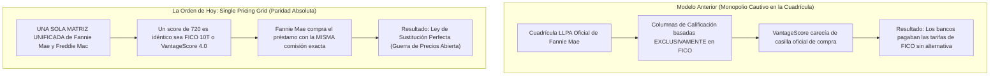
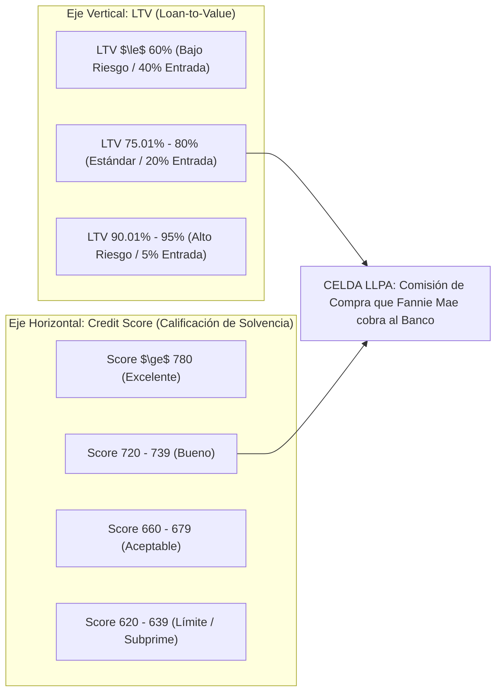
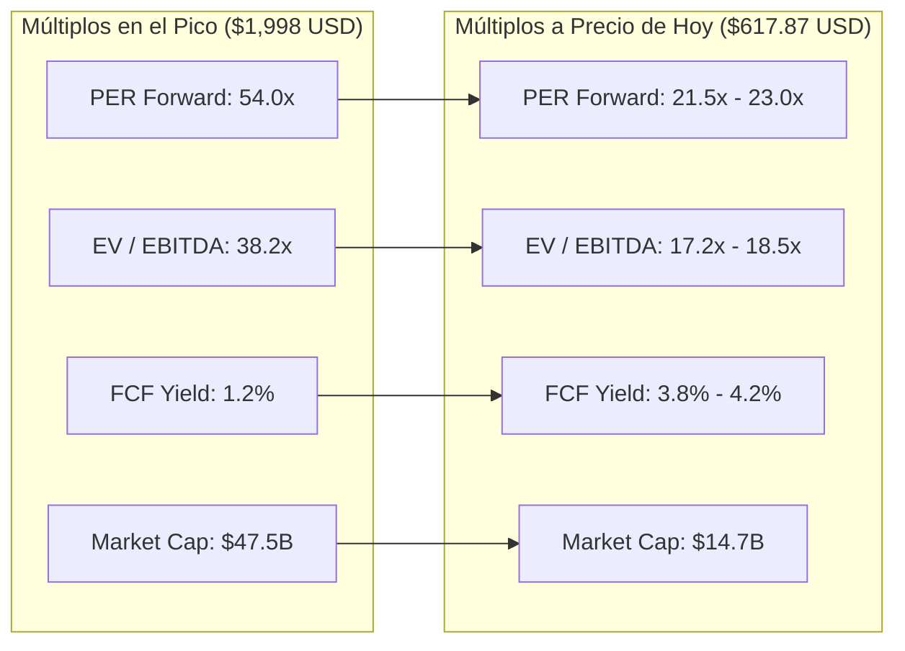
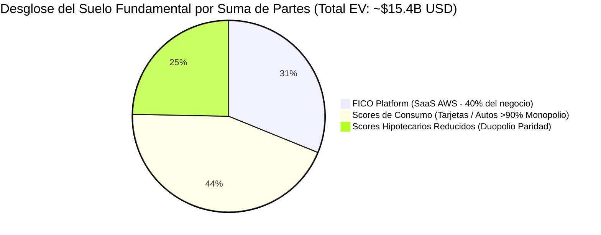
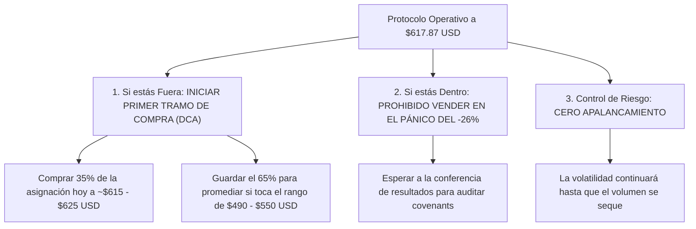

# Informe de Capitulación Bursátil y Regulación Estructural: Fair Isaac Corporation (NYSE: FICO)
## El Mandato de la "Cuadrícula de Precios Única" (Single Pricing Grid) de la FHFA, Desplome del -26.5% a $617.87 USD, Desglose de Múltiplos y Hoja de Ruta Operativa

**Fecha de Emisión:** 29 de Septiembre de 2026  
**Ticker:** NYSE: FICO (Fair Isaac Corporation)  
**Precio de Mercado Actual:** **$617.87 USD**  
**Variación Diaria:** **-26.5%** *(Drawdown acumulado desde máximos: **-69.1%**)*  
**Evento Detonante:** Dictamen de la Federal Housing Finance Agency (FHFA / Director Bill Pulte) imponiendo la *Single Pricing Grid* en Fannie Mae y Freddie Mac  
**Metodología Aplicada:** CQV v5.0 (Quality, Resilience, Moat & Value)  
**Ubicación en el Repositorio:** `inform/tesis/FICO/` (sincronizado en `tesis/FICO/`)

---

## 1. Resumen Ejecutivo: La Jornada de Capitulación del 29 de Septiembre de 2026

La jornada de hoy marca un antes y un después en la historia bursátil de Fair Isaac Corporation (FICO). En una sola sesión de negociación, la acción se ha desplomado un **-26.5%**, cerrando en **$617.87 USD**, frente a su máximo de 52 semanas de **$1,998.01 USD**.

```text
========================================================================================
ESTADO DE SITUACIÓN TRAS EL SHOCK DE MERCADO (FICO - 29 DE SEPTIEMBRE DE 2026)
========================================================================================
Cotización Actual de Mercado:               $617.87 USD
Pérdida en la Sesión de Hoy:                -26.5% (-$223.13 USD/acc)
Caída Acumulada desde Máximos ($1,998):     -69.08% (Pérdida de ~$32,800M USD en valor)
Capitalización Bursátil (Market Cap):       ~$14,705M USD (vs. ~$47,500M en el pico)
Enterprise Value (EV):                      ~$18,355M USD (con Deuda Neta de ~$3,650M)
PER Forward Proyectado (NTM):               ~21.5x – 23.0x (vs. ~54.0x en máximos)
Rendimiento de Flujo de Caja Libre (FCF):   ~3.8% – 4.2% (vs. ~1.2% en máximos)
Veredicto Operativo CQV v5.0:               CAPITULACIÓN DE MERCADO / COMPRA ESCALONADA
========================================================================================
```

---

## 2. Anatomía del Detonante: ¿En qué Consiste la "Cuadrícula de Precios Única" (Single Pricing Grid)?

El desplome histórico de hoy no responde a un rumor ni a una caída generalizada del mercado, sino a una **resolución técnica y regulatoria letal para el poder de fijación de FICO** emitida por el director de la FHFA, Bill Pulte.



---

### A. ¿Qué es Exactamente la Cuadrícula LLPA (Loan-Level Price Adjustment Grid)?
Cuando los bancos e instituciones financieras (como Chase, Wells Fargo, Rocket Mortgage o United Wholesale Mortgage) originan un préstamo hipotecario residencial para una familia, casi nunca conservan ese préstamo durante 30 años en su balance. Para recuperar la liquidez y seguir prestando, **venden el paquete de hipotecas a Fannie Mae o Freddie Mac (las GSEs)**.

Sin embargo, Fannie Mae y Freddie Mac no pagan el mismo precio por todas las hipotecas. Aplican una matriz bidimensional estandarizada y obligatoria denominada **Cuadrícula de Ajuste de Precios a Nivel de Préstamo (*Loan-Level Price Adjustment* - LLPA Grid)**:



#### Tabla de Ejemplo Oficial: Matriz Bidimensional LLPA de Fannie Mae
En esta cuadrícula, la intersección entre el porcentaje de la vivienda que se financia (*Loan-to-Value* - LTV) y la nota crediticia del comprador determina la **comisión de compra en puntos porcentuales (o puntos básicos)** que Fannie Mae descuenta al banco:

| Rango de Puntuación Crediticia | LTV $\le$ 60.00% (Entrada $\ge$ 40%) | LTV 75.01% – 80.00% (Entrada 20%) | LTV 80.01% – 85.00% (Entrada 15%) | LTV 90.01% – 95.00% (Entrada 5%) |
| :---: | :---: | :---: | :---: | :---: |
| **Score $\ge$ 780** | **0.000%** | **0.375%** | **0.625%** | **0.750%** |
| **Score 740 – 759** | **0.000%** | **0.750%** | **1.000%** | **1.250%** |
| **Score 720 – 739** | **0.125%** | **1.000%** | **1.250%** | **1.625%** |
| **Score 680 – 699** | **0.250%** | **1.625%** | **1.875%** | **2.250%** |
| **Score 660 – 679** | **0.500%** | **2.125%** | **2.500%** | **2.750%** |
| **Score 640 – 659** | **0.625%** | **2.500%** | **2.875%** | **3.125%** |
| **Score 620 – 639** | **0.750%** | **2.875%** | **3.250%** | **3.500%** |
| **Score < 620** | **1.000%** | **3.125%** | **3.500%** | **3.750%** |

* **Impacto en el Préstamo:** Si un comprador financia el 80% de una vivienda de $400,000 ($320,000 de préstamo) y tiene un score de 740, Fannie Mae cobra una comisión de **0.750% ($2,400 USD)**. Pero si el score baja a 660, la comisión salta a **2.125% ($6,800 USD)**.
* Esa diferencia de **$4,400 USD** la asume el banco o se traslada al comprador incrementando su tasa de interés hipotecaria en 50 puntos básicos (ejemplo: de 6.75% a 7.25% anual).

---

### B. El Monopolio Previo: FICO como Dueño Exclusivo del Eje Horizontal
Durante 30 años, **las columnas horizontales de esa cuadrícula llevaban un único nombre obligatorio por ley: "FICO SCORE"**:
1. Si un banco evaluaba a un cliente con **VantageScore 4.0**, Fannie Mae **no tenía casillas oficiales en la cuadrícula para ese modelo**.
2. El banco corría el riesgo de que Fannie Mae rechazara el paquete hipotecario, exigiera auditorías manuales o penalizara el préstamo con comisiones punitivas por "falta de estandarización".
3. **El Peaje Monopólico de FICO:** Al ser FICO el único pasaporte legal para que el préstamo encajara en la cuadrícula LLPA, **Fair Isaac Corporation pudo subir sus precios de $1.50 a más de $15.00-$20.00 por tirada tri-buró**, porque ningún banco se atrevía a dejar de usar FICO para no quedar fuera de la cuadrícula de compra del gobierno.

---

### C. La Ruptura de Hoy: La "Cuadrícula de Precios Única" (Single Pricing Grid)
El dictamen firmado hoy por el director de la FHFA, Bill Pulte, destruye este monopolio estructural al ordenar que Fannie Mae y Freddie Mac unifiquen la tabla:

1. **Paridad Absoluta de Puntuación:**  
   La cuadrícula LLPA pasa a ser **una sola matriz agnóstica al proveedor**.
   * Una puntuación de **720 en VantageScore 4.0** tiene **exactamente la misma casilla, el mismo porcentaje de comisión y el mismo tratamiento financiero que un 720 en FICO 10T**.
2. **Cero Penalizaciones para los Bancos:**  
   Fannie Mae y Freddie Mac garantizan por escrito a los bancos que comprarán las hipotecas con idéntico precio sin importar qué score hayan corrido.
3. **La Analogía Económica de la "Sustitución Perfecta":**  
   Imagina dos gasolineras contiguas que venden exactamente la misma gasolina certificada de 95 octanos:
   * La gasolinera A (FICO) te cobra **$20 dólares** por galón.
   * La gasolinera B (VantageScore) te cobra **$5 dólares** por galón.
   * Antes, el gobierno le decía al banco: *"Solo puedes comprar en la gasolinera A, porque si compras en la B, no te compro la hipoteca"*.
   * Con la **Cuadrícula Única de Precios**, el gobierno le dice al banco:  
     > *"Me da exactamente igual en cuál compres. Si el cliente tiene 720 puntos, te compraré la hipoteca al mismo precio sin importar si usaste FICO o VantageScore"*.

---

### D. La Consecuencia Financiera Directa para FICO
* **El Incentivo Económico de los Bancos:**  
  Un originador hipotecario grande como *United Wholesale Mortgage (UWM)* o *Rocket Mortgage* procesa cientos de miles de solicitudes al mes. Ahorrarse entre $10 y $15 USD por cada tirada de crédito representa un **ahorro neto directo de $30M a $50M anuales para el banco**.
* **El Colapso del Margen Monopólico:**  
  FICO ya no puede justificar tarifas cuatro veces superiores a las de VantageScore. Para evitar una estampida masiva de clientes bancarios hacia VantageScore 4.0, **FICO se verá forzada a bajar sus precios drásticamente en hipotecas o empatar las tarifas de VantageScore**, desmantelando el margen operativo del ~88% que tenía en esa división.

---

## 3. Radiografía de Múltiplos de Valoración: De la Burbuja a la Capitulación

La corrección del 69% ha borrado por completo la "prima de monopolio intocable" que Wall Street le asignaba a FICO:



### Tabla Comparativa de Múltiplos

| Métrica de Valoración | En el Pico Histórico ($1,998.01) | A Cierre Previo ($932.26) | **A PRECIO DE HOY ($617.87)** | Media Histórica 5 Años |
| :--- | :---: | :---: | :---: | :---: |
| **Precio por Acción** | $1,998.01 USD | $932.26 USD | **$617.87 USD** | $850.00 USD |
| **Capitalización de Mercado** | ~$47,550M USD | ~$22,200M USD | **~$14,705M USD** | ~$20,200M USD |
| **Enterprise Value (EV)** | ~$50,500M USD | ~$25,850M USD | **~$18,355M USD** | ~$23,500M USD |
| **Múltiplo PER Trailing (LTM)** | 62.5x | 37.2x | **24.7x** | 42.0x |
| **Múltiplo PER Forward (NTM)** | 54.0x | 32.7x | **21.5x – 23.0x** | 36.5x |
| **EV / EBITDA** | 38.2x | 21.8x | **17.2x – 18.5x** | 26.0x |
| **EV / Ventas (EV/Sales)** | 27.5x | 11.2x | **8.8x** | 14.5x |
| **FCF Yield (Rendimiento Caja)** | ~1.2% | ~2.6% | **~3.8% – 4.2%** | ~2.2% |
| **Margen Operativo Consolidado** | ~54% | ~51% | **~44% - 47% (Estresado)** | ~45% |

> [!NOTE]
> **Lectura Técnica de los Múltiplos:**  
> A **21.5x beneficios futuros**, FICO cotiza por debajo del múltiplo medio del índice S&P 500 (~22.5x). El mercado ha pasado de valorar a FICO como una empresa de software monopólico de crecimiento infinito a valorarla como un negocio regulado con incertidumbre de beneficios.

---

## 4. Prueba de Estrés por Suma de las Partes (SOTP): ¿Dónde está el Suelo Fundamental?

Para determinar si FICO a **$617.87 USD** es una trampa de valor o una oportunidad generacional, realizamos la valoración conservadora por suma de partes (*Sum of the Parts*):



1. **División de Software SaaS (*FICO Platform en AWS*):**
   * Factura ~$680M USD anuales con una tasa de retención neta en dólares (NRR) del 118% y margen operativo del ~32%.
   * Las compañías de software SaaS corporativo de analítica y prevención de fraude con este perfil cotizan en el mercado a un múltiplo conservador de **7.0x Ventas**:
     $$\text{Valor Software} = \$680\text{M} \times 7.0x = \mathbf{\$4,760\text{M USD}}$$
2. **División de Scores de Consumo (Tarjetas de Crédito, Autos, Banca Minorista B2B):**
   * Aporta ~$430M USD en ingresos con un margen operativo del ~88% (~$378M EBIT).
   * **Monopolio intocado (>90% de cuota) donde la FHFA no tiene jurisdicción legal**.
   * A un múltiplo conservador de **18x EBIT**:
     $$\text{Valor Scores Consumo} = \$378\text{M} \times 18x = \mathbf{\$6,804\text{M USD}}$$
3. **División de Scores Hipotecarios (Castigada por la Cuadrícula Única):**
   * Asumimos el peor escenario: las tarifas caen un 50% por la paridad con VantageScore y FICO solo retiene el 65% de cuota GSE.
   * Generaría un EBIT deprimido de ~$270M USD. A un múltiplo de servicio regulado de **14x EBIT**:
     $$\text{Valor Scores Hipotecarios} = \$270\text{M} \times 14x = \mathbf{\$3,780\text{M USD}}$$

---

### Cálculo del Valor Intrínseco por Acción:
$$\text{Enterprise Value Total (SOTP)} = \$4,760\text{M} + \$6,804\text{M} + \$3,780\text{M} = \mathbf{\$15,344\text{M USD}}$$
$$\text{Equity Value} = \text{EV} - \text{Deuda Financiera Neta (\$3,650M)} = \mathbf{\$11,694\text{M USD}}$$
$$\text{Valor Intrínseco Suelo por Acción} = \frac{\$11,694\text{M USD}}{23.8\text{M acciones}} \approx \mathbf{\$491.34 \text{ USD (Escenario de Estrés Máximo)}}$$

* **En Escenario Normalizado (Duopolio 75/25 con retención de FICO 10T):**
  $$\text{Valor Intrínseco Base Normalizado} \approx \mathbf{\$750.00 – \$820.00 \text{ USD por acción}}$$

---

## 5. Hoja de Ruta Operativa: ¿Qué Hacer con Estas Nuevas Valoraciones?

El colapso de hoy coloca a la acción en una fase clásica de **venta por pánico y liquidación forzada de fondos indexados y sistemáticos (*Selling Climax*)**.



### Reglas de Decisión Inmediata:

#### 1. Prohibido Vender en Clímax de Volumen
Vender a **$617.87 USD** tras una caída acumulada del **-69%** implica vender en el punto de máxima capitulación emocional. A estos niveles, los fondos bajistas (*short sellers*) comienzan a recomprar títulos para consolidar sus ganancias multimillonarias.

#### 2. Inicio de Compras Escalonadas (DCA) para Inversores en Valor
A **21.5x PER Forward**, FICO ofrece por primera vez en siete años un margen de seguridad real respecto a su negocio subyacente:
* **Primer Tramo (Hoy a ~$615 – $625 USD):** Abrir un **30% a 35%** de la posición objetivo. A este precio se está adquiriendo el monopolio de tarjetas y el software SaaS a múltiplos razonables, recibiendo el negocio hipotecario prácticamente a valor de liquidación.
* **Segundo Tramo (Zona de Reserva en $490 – $550 USD):** Mantener el 65% de la liquidez reservada. Si la salida de fondos institucionales por mandatos de stop-loss empuja la cotización hacia el suelo de estrés de **$500 USD**, se ejecuta la segunda compra con un margen de seguridad superior al **+50%**.

#### 3. El Indicador Vital a Auditar: Covenants de Deuda
En las próximas semanas, la directiva de Will Lansing debe emitir un comunicado oficial o presentar resultados trimestrales confirmando tres hitos:
1. **Suspensión oficial de recompras de acciones** para salvaguardar la liquidez.
2. Destinar los **~$450M-$500M de FCF anual** a amortizar deuda bancaria urgente.
3. Ratificar que el ratio Deuda Neta / EBITDA no sobrepasará el techo de **3.75x**.

---

## 6. Conclusión y Veredicto Final CQV v5.0 a Fecha de Hoy

* **Precio de Cierre Actual:** **$617.87 USD**
* **Valor Intrínseco Suelo (Catastrófico):** **$491.34 USD**
* **Valor Intrínseco Base Normalizado (CQV v5.0):** **$780.00 – $820.00 USD**
* **Margen de Seguridad Actual (sobre Valor Base):** **+32.7%**
* **Value Score CQV v5.0:** Pasa de 5.64 a **7.85 / 10** *(Zona Atractiva de Valor)*.
* **Score CQV Calidad:** Se recalibra en **7.60 / 10** *(Deterioro de F2 Deuda y F4 Moat Hipotecario)*.
* **Veredicto Operativo Metodológico:** **ACUMULACIÓN ESCALONADA POR TRAMOS (ACCUMULATE ON WEAKNESS)**.

---
*Informe institucional elaborado conforme a la metodología de análisis fundamental y cuantitativo CQV v5.0.*
