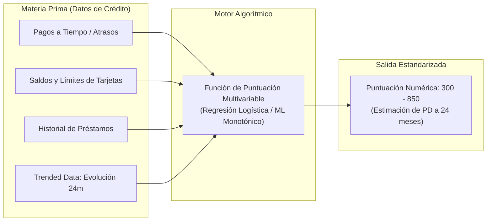
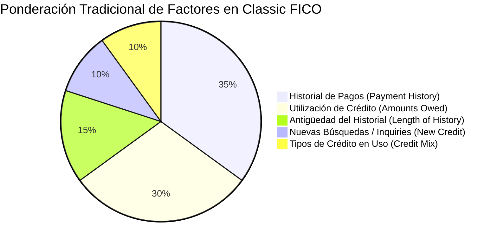
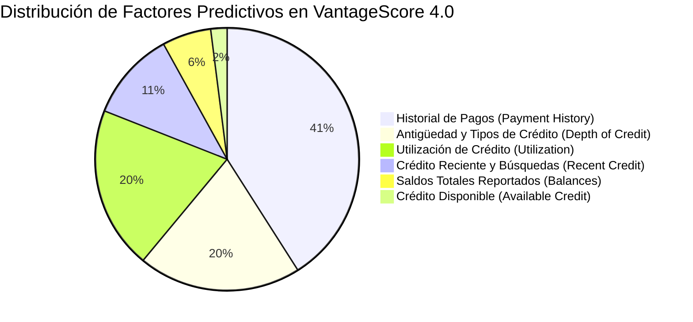
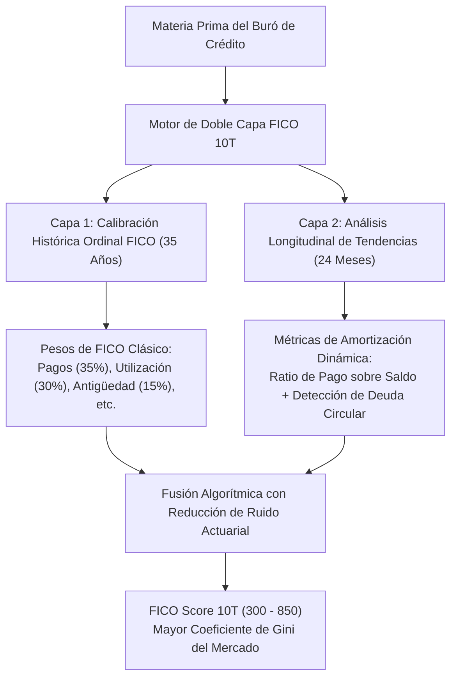
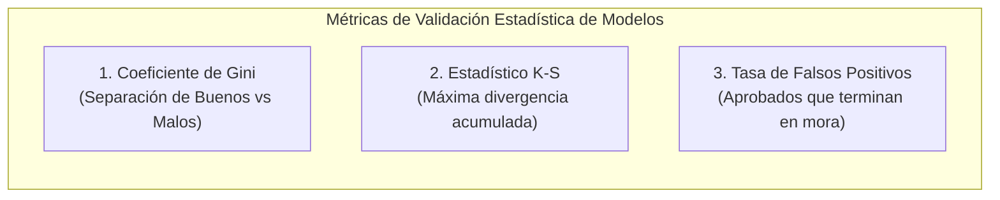
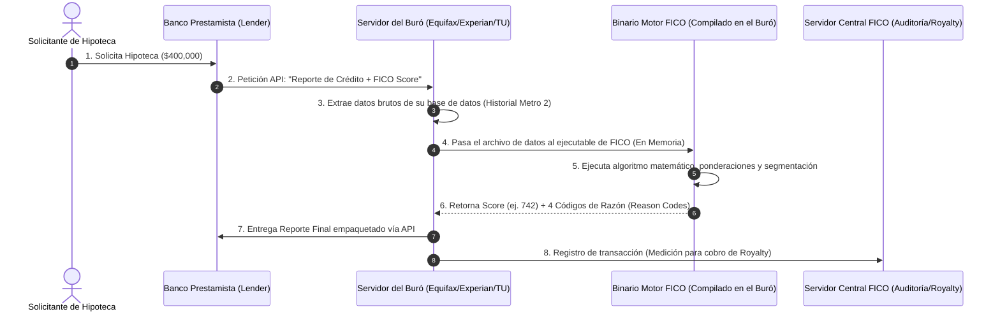
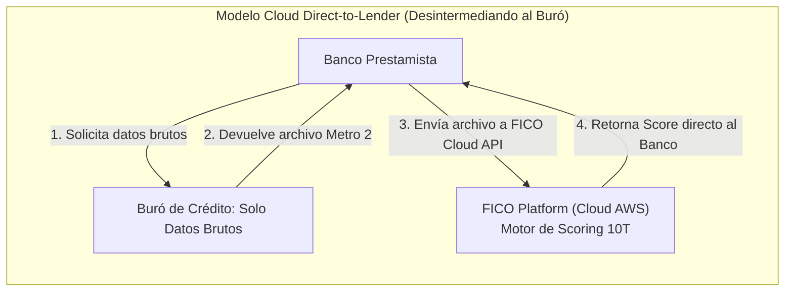
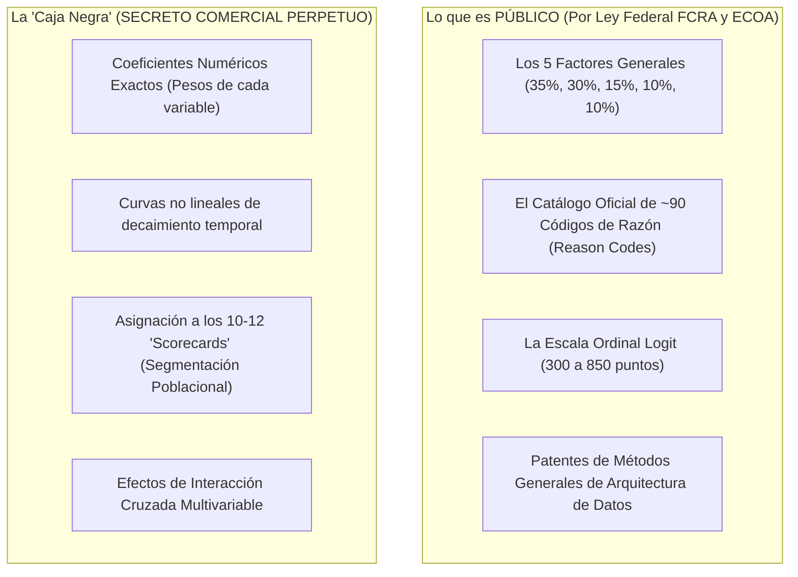

# Manual de Arquitectura Algorítmica y Modelado de Riesgo: Classic FICO vs. FICO Score 10T vs. VantageScore 4.0
## Mecánica Matemática, Inclusión de Trended Data, Tratamiento de Datos Alternativos y Validación Actuarial de Poder Predictivo

**Fecha de Emisión:** 28 de Septiembre de 2026  
**Área de Investigación:** Modelos Cuantitativos de Riesgo Crediticio e Infraestructura Financiera  
**Modelos Analizados:**
1. **Classic FICO (Legacy 1995):** Equifax Beacon 5.0, Experian/Fair Isaac V2SM, TransUnion FICO Risk Score 04.
2. **FICO® Score 10T (Nueva Generación FICO):** Modelo de datos con tendencia (*Trended Data*).
3. **VantageScore 4.0 (Consorcio de Burós):** Modelo tri-buró con Machine Learning e inclusión de datos alternativos.
**Ubicación:** `tesis/FICO/` (sincronizado en `inform/tesis/FICO/`)

---

## 1. Fundamento Matemático: ¿Qué Calcula un Modelo de Scoring Crediticio?

El objetivo primario de cualquier algoritmo de puntuación crediticia al consumidor no es medir la "riqueza" o el "patrimonio" de un individuo, sino estimar con la mayor precisión matemática posible la **Probabilidad de Impago Grave** (*Probability of Default* - $PD$) en una ventana temporal estándar:

$$PD = P(\text{Morosidad} \ge 90 \text{ días en un horizonte de 24 meses})$$

Esa probabilidad matemática continua (que oscila entre 0.00 y 1.00) se transforma mediante una función de escalamiento logístico (*Odds Logit Scaling*) en una puntuación numérica de tres dígitos, calibrada habitualmente entre **300 y 850 puntos**:

$$\text{Score} = \text{Offset} + \text{Factor} \times \ln\left(\frac{1 - PD}{PD}\right)$$

Donde cada incremento fijo de puntos (por ejemplo, cada +20 puntos en la escala) suele representar una duplicación de las probabilidades de buen comportamiento frente al impago (*Doubling the Odds*).



---

## 2. Classic FICO (Legacy 1995): La Fotografía Estática del Pasado

**Classic FICO** es la denominación colectiva de los tres modelos de scoring licenciados por FICO a los burós a finales de los años 90 y mediados de los 2000 que Fannie Mae y Freddie Mac institucionalizaron por ley en 1995:
* **Equifax:** *Beacon 5.0* (posteriormente adaptado a Pinnacle).
* **Experian:** *Experian/Fair Isaac Risk Model V2SM*.
* **TransUnion:** *FICO Risk Score, Classic 04*.



### A. Los 5 Componentes de Classic FICO
1. **Historial de Pagos (35%):** Evalúa la presencia de morosidades pasadas (30, 60, 90, 120+ días), quiebras, ejecuciones hipotecarias (*foreclosures*) y cuentas enviadas a cobro legal. Castiga severamente la gravedad, la frecuencia y la recencia del atraso.
2. **Importes Adeudados / Ratio de Utilización (30%):** Mide la relación entre el saldo dispuesto y el límite total de crédito concedido en tarjetas rotativas (*Revolving Credit Utilization*):
   $$\text{Utilización} = \frac{\sum \text{Saldos DisCurrent}}{\sum \text{Límites Totales}}$$
   Una utilización superior al 30% activa penalizaciones exponenciales en la nota.
3. **Antigüedad del Historial Crediticio (15%):** Considera la edad de la cuenta más antigua, la edad promedio de todas las cuentas del informe y el tiempo transcurrido desde la apertura de cuentas específicas.
4. **Nuevas Búsquedas de Crédito (10%):** Audita el número de consultas duras (*Hard Inquiries*) realizadas en los últimos 12 meses. Agrupa consultas de hipotecas o préstamos de auto realizadas en ventanas cortas (14 a 45 días) como una sola para permitir la búsqueda de mejores tasas (*rate shopping*).
5. **Tipos de Crédito / Mix de Crédito (10%):** Premia la tenencia combinada y equilibrada de créditos rotativos (tarjetas) y préstamos a plazos fijos (*installment loans* como hipotecas o préstamos de auto).

### B. Las Grandes Limitaciones Estructurales de Classic FICO
* **El Defecto de la "Fotografía Estática" (*Snapshot Data*):**  
  Classic FICO solo observa el saldo y la utilización del **último mes reportado**. No sabe qué ocurrió en los 23 meses previos.
  * *Ejemplo Crítico:* Si un prestatario A gasta $5,000 en su tarjeta cada mes pero **paga el 100% de la deuda religiosamente al final del ciclo** (*Transactor*), el buró registra un saldo de $5,000 en la fecha de corte.
  * Si un prestatario B gasta $5,000 pero **solo paga el pago mínimo de $150 y está atrapado en intereses** (*Revolver*), el buró también registra un saldo de $5,000.
  * **Classic FICO asigna exactamente el mismo riesgo a ambos**, a pesar de que el prestatario B tiene una probabilidad de quiebra 5 veces mayor.
* **Criterios Mínimos de Exclusión Rigurosos (*Minimum Scoring Criteria*):**  
  Para calcular un Classic FICO, el expediente debe tener:
  1. Al menos una cuenta abierta durante un mínimo de **6 meses**.
  2. Al menos una cuenta con actividad reportada en los **últimos 6 meses**.
  * **Consecuencia Social:** Deja fuera del sistema a más de **30 a 40 millones de estadounidenses** que no tienen tarjetas de crédito tradicionales o que pagan en efectivo ("Invisibles al Crédito").
* **Tratamiento Punitivo de Deudas Médicas:**  
  Classic FICO trata las colecciones por facturas médicas no pagadas con la misma dureza que si el consumidor hubiera dejado de pagar una tarjeta de crédito o un crédito bancario.

---

## 3. VantageScore 4.0: La Disrupción de los Burós con Trended Data e Inclusión

Lanzado en 2017 por la sociedad conjunta de Equifax, Experian y TransUnion, **VantageScore 4.0** fue el primer modelo a escala nacional en rediseñar la arquitectura matemática para corregir las fallas de Classic FICO:



### A. La Gran Innovación: Trended Data a 24 Meses
VantageScore 4.0 rompe la fotografía estática y analiza la **trayectoria histórica longitudinal de 24 meses**:
1. **Diferenciación Transactor vs. Revolver:** Identifica si el consumidor amortiza el saldo completo mes a mes o si solo abona el pago mínimo mensual (*Minimum Payment Behavior*). Premia activamente a los prestatarios que reducen sus saldos a lo largo del tiempo.
2. **Patrones de Quema de Crédito (*Balance Burn-Rate*):** Detecta si una persona está incrementando progresivamente su endeudamiento mes tras mes (señal inequívoca de estrés financiero previo al impago), reduciendo su puntuación mucho antes de que ocurra el primer atraso de 30 días.

### B. Inclusión Financiera Extrema y Datos Alternativos
* **Eliminación del Requisito de los 6 Meses:** VantageScore 4.0 puede calificar a un consumidor con **tan solo 1 mes de historial crediticio** y actividad reportada en los últimos 24 meses.
* **Puntuación para 33 Millones de "Invisibles":** Al relajar este umbral, otorga una puntuación formal a decenas de millones de adultos jóvenes, inmigrantes y sectores no bancarizados.
* **Incorporación de Pagos Alternativos:** Admite la inclusión en el algoritmo de pagos recurrentes de **alquiler de vivienda (*rent payments*)**, suministros básicos (**luz, agua, gas**) y telefonía móvil, siempre que los proveedores los reporten al buró.
* **Eliminación de Deudas Médicas:** Excluye automáticamente de la fórmula todas las deudas médicas cobradas que ya hayan sido pagadas y **todas las deudas médicas inferiores a $500 USD**, eliminando distorsiones por disputas con compañías de seguros de salud.

### C. Técnicas de Machine Learning y Segmentación No Lineal
A diferencia de las regresiones logísticas rígidas de los años 90, VantageScore 4.0 utiliza modelos de **Machine Learning segmentados con restricciones de monotonicidad**:
* Divide a la población en múltiples segmentos de riesgo independientes (*scorecards* no lineales).
* La restricción de monotonicidad garantiza que el modelo cumpla con las leyes federales de transparencia (*Fair Credit Reporting Act* - FCRA y *Equal Credit Opportunity Act* - ECOA), permitiendo emitir con exactitud los **códigos de razón (*Reason Codes*)** que explican al ciudadano por qué su nota subió o bajó.

---

## 4. FICO® Score 10T: La Respuesta de Ingeniería de FICO

Anunciado formalmente por Fair Isaac Corporation en enero de 2020 y aprobado por la FHFA junto con VantageScore 4.0, **FICO Score 10T** (donde la "T" significa *Trended Data*) representa el pináculo de la ingeniería estadística de FICO:



### A. La Arquitectura de Doble Capa de FICO 10T
FICO diseñó FICO 10T para resolver el dilema de la industria: ¿cómo incorporar datos de tendencia avanzados sin romper la compatibilidad con las series históricas de riesgo que los bancos usan en sus modelos regulatorios de Basilea y CECL?
* **Capa Base FICO:** Conserva la lógica ordinal tradicional del estándar FICO (300 a 850), manteniendo idéntico el significado de un "720 FICO" para los comités de riesgo.
* **Capa Longitudinal Superpuesta:** Analiza la dirección del endeudamiento en los últimos 24 meses mediante dos variables clave:
  1. **Ratio de Pago Real sobre Pago Mínimo Exigido:** Distingue con precisión milimétrica entre prestatarios que pagan el balance total (*Transactors*), los que pagan una cantidad fija sustancial por encima del mínimo (*Amortizers*) y los que solo abonan el mínimo legal (*Minimum Replayers*).
  2. **Detección del "Camuflaje de Deuda" (*Personal Loan Masking*):** Es el único algoritmo diseñado específicamente para detectar cuando un prestatario toma un **préstamo personal no garantizado de una fintech** (SoFi, Upstart, LendingClub) para pagar temporalmente sus tarjetas de crédito y fingir una caída de utilización. FICO 10T detecta que el saldo agregado no se redujo, neutralizando la manipulación artificial de la puntuación.

### B. Superioridad Estadística: Validación Independiente de Milliman
FICO financió un estudio exhaustivo a cargo de la firma actuarial y de consultoría de riesgos independiente más respetada de Wall Street: **Milliman Inc.**

Los resultados empíricos al analizar millones de préstamos hipotecarios revelaron:

```text
========================================================================================
RESULTADOS DEL ESTUDIO ACTUARIAL MILLIMAN (PODER PREDICTIVO EN HIPOTECAS)
========================================================================================
1. Reducción de Tasas de Impago (Default Rates):
   - FICO Score 10T reduce las tasas de morosidad hipotecaria en hasta un 17% en 
     comparación con Classic FICO para el mismo volumen de aprobación de préstamos.
   
2. Coeficiente de Discriminación de Riesgo (Gini Ratio):
   - FICO Score 10T supera a VantageScore 4.0 en el coeficiente de Gini en todos los
     segmentos de originación hipotecaria primaria (Conforming Loans GSE).

3. Precisión en Prestatarios Límite (Near-Prime: 620 - 680 FICO):
   - En la franja de mayor riesgo y volumen para Fannie Mae y Freddie Mac, FICO 10T
     identifica con mayor nitidez a los prestatarios que sufrirán estrés ante subidas 
     de tipos de interés o desempleo.
========================================================================================
```

---

## 5. Tabla Comparativa de Arquitectura Algorítmica y de Datos

La siguiente matriz confronta las especificaciones técnicas de los tres modelos de puntuación:

| Dimensión Técnica | Classic FICO (Legacy 1995) | VantageScore 4.0 | FICO® Score 10T |
| :--- | :--- | :--- | :--- |
| **Entidad Propietaria** | Fair Isaac Corporation | Consorcio Equifax, Experian, TransUnion | Fair Isaac Corporation |
| **Rango de Puntuación** | 300 – 850 (escalas variables por buró) | 300 – 850 (escala unificada) | **300 – 850 (escala estandarizada)** |
| **Estructura Temporal de Datos** | **Estática** (Fotografía del último mes) | **Dinámica** (Tendencia 24 meses) | **Dinámica** (Tendencia 24 meses) |
| **Diferenciación Transactor vs. Revolver** | **NO** (Trata igual al que paga todo y al que paga el mínimo) | **SÍ** (Premia a quien amortiza saldos) | **SÍ** (Análisis exhaustivo de pagos sobre el mínimo) |
| **Requisito de Historial Mínimo** | 6 meses de antigüedad + actividad reciente | **1 mes de actividad reciente** | 6 meses de antigüedad + actividad reciente |
| **Población Calificable en EE. UU.** | Base tradicional (~200M personas) | **+33 Millones adicionales** (*Thin files*) | Base tradicional refinada (~215M personas) |
| **Inclusión de Alquiler y Utilities** | No contemplado | **SÍ** (Alquiler, agua, luz, telecom) | Compatible mediante *UltraFICO / Open Banking* |
| **Tratamiento de Deudas Médicas** | Muy punitivo (igual que impagos bancarios) | **Excluye deudas pagadas y < $500 USD** | Excluye deudas pagadas y menor peso a < $500 |
| **Detección de Deuda Circular Fintech** | No detecta préstamos de consolidación | Limitada | **ALTA** (Detecta consolidaciones cosméticas) |
| **Técnica Matemática Central** | Regresión Logística Lineal Segmentada | Machine Learning Monotónico por Segmentos | Redes Neuronales Restringidas + Doble Capa FICO |
| **Coeficiente de Gini en Hipotecas** | Base de referencia histórica | Alto (+5% - 8% vs. Classic FICO) | **Máximo del Mercado (+10% - 15% vs. Classic)** |

---

## 6. Métricas Estadísticas de Validación: ¿Cómo Evalúa la Industria a un Modelo?

Los Chief Risk Officers (CRO) de los bancos y las agencias de calificación evalúan la solvencia de estos algoritmos mediante tres métricas estadísticas universales:



### 1. El Coeficiente de Gini (Discriminación de Riesgo)
* Mide la capacidad del algoritmo para separar a los futuros prestatarios cumplidores (*goods*) de los morosos (*bads*).
* Un Gini de **0.0** significa que el modelo es equivalente a lanzar una moneda al aire; un Gini de **1.0** representaría la predicción perfecta de quién pagará y quién no.
* **En hipotecas:** Classic FICO ofrece un Gini en torno a **0.45 – 0.48**. VantageScore 4.0 eleva esta métrica a **~0.51 – 0.53**. FICO Score 10T alcanza los registros más elevados de la industria: **~0.54 – 0.56**.

### 2. El Estadístico Kolmogorov-Smirnov (K-S Metric)
* Evalúa la distancia vertical máxima entre las funciones de distribución acumulada de los clientes buenos y los malos:
  $$K\text{-}S = \max |F_{\text{buenos}}(s) - F_{\text{malos}}(s)|$$
* Cuanto mayor es el estadístico K-S en el punto de corte (*cutoff score* de aprobación bancaria, típicamente 620 o 680 FICO), **menor es la tasa de provisiones de capital que el banco debe inmovilizar bajo las normativas CECL y Basilea III**.

---

---

## 8. Arquitectura Operativa y Flujo Físico de Datos: ¿Dónde Corre el Software y Cómo se Ejecuta el Cálculo?

Una de las dudas técnicas más comunes entre analistas e inversores es: **¿Cómo se calcula físicamente el FICO Score? ¿FICO extrae los datos de los bancos por API? ¿O solo les entrega la fórmula matemática?**

La respuesta distingue entre el **modelo tradicional en los servidores de los burós (*Bureau On-Premise Engine*)** y el **modelo moderno en la nube (*FICO Platform Cloud / Direct-to-Lender*)**.

---

### A. El Ciclo de la Materia Prima: ¿Quién Tiene los Datos Brutos?
FICO **NO** recopila directamente los datos de crédito de los ciudadanos ni se conecta a los bancos en el día a día para rastrear préstamos:
1. **El Reporte Bancario Mensual (Estándar Metro 2):**  
   Miles de instituciones financieras (Chase, Bank of America, emisores de tarjetas, cooperativas de crédito) envían mensualmente sus bases de datos actualizadas de pagos, saldos e impagos a los **tres burós de crédito (Equifax, Experian y TransUnion)** utilizando un formato de archivo estandarizado por la industria llamado **Metro 2® Format**.
2. **Los Burós como Almacenes de Datos:**  
   Son los tres burós quienes almacenan y actualizan físicamente los historiales crediticios de más de **250 millones de personas** en sus gigantescos centros de datos.

---

### B. El Modelo Tradicional: FICO como Binario Propietario (*On-Premise Engine*)
Durante más de 30 años, FICO operó bajo el modelo análogo a **"Intel Inside"**:



1. **¿Qué le da FICO a los burós?**  
   FICO no les entrega una fórmula matemática en un papel para que ellos la programen. FICO les entrega un **software binario compilado cerrado y fuertemente ofuscado (en C++ o Java de ultra-alto rendimiento)**.
2. **¿Dónde corre el cálculo?**  
   El motor de software de FICO está instalado **DENTRO de los centros de datos de cada uno de los tres burós**.
3. **Milisegundos de Ejecución:**  
   Cuando el banco solicita un score, el buró carga los datos brutos del expediente del cliente en memoria, invoca la biblioteca ejecutable de FICO, el software calcula la puntuación en milisegundos y devuelve dos cosas:
   * El número de tres cifras (ej. **742**).
   * Los 4 o 5 **Códigos de Razón (*Reason Codes*)** obligatorios por la ley federal FCRA (ej. *"Code 08: Proporción de saldos de tarjetas demasiado alta"*).
4. **El Contador de Peaje (*Metered Royalty*):**  
   Cada vez que el binario de FICO ejecuta un cálculo dentro de los servidores del buró, se genera un registro criptográfico de auditoría. A final de mes, FICO le pasa la factura de regalías al buró por cada consulta generada.

---

### C. El Modelo Moderno: FICO Platform en la Nube y Canal "Direct-to-Lender"
Con la migración a la nube y la guerra comercial contra los burós, FICO desarrolló su propia infraestructura API en **Amazon Web Services (AWS)**:



* **Cómo Funciona Direct-to-Lender:**  
  1. El banco compra al buró únicamente el **archivo de datos brutos** (*Raw Credit File*), pagando una tarifa mínima por el dato sin el sobreprecio del score.
  2. El banco envía ese archivo JSON/XML mediante una **API REST segura a los servidores de FICO Platform en AWS**.
  3. FICO procesa los datos en su propia nube con el algoritmo **FICO Score 10T** y le devuelve la puntuación directamente al banco.
* **La Gran Ventaja:** FICO le arrebata el control de la facturación a los tres burós y captura el 100% del valor económico de la transacción.

---

### D. El Caso de Open Banking: ¿Cómo Funciona UltraFICO™?
Cuando se trata de **datos alternativos bancarios**, FICO sí consume directamente datos financieros de las cuentas bancarias de los consumidores:
1. **Consentimiento del Consumidor:** El solicitante autoriza explícitamente vincular sus cuentas corrientes y de ahorro (banca móvil).
2. **Conexión API (Agregadores de Datos):** FICO se conecta mediante APIs seguras a través de agregadores financieros autorizados (*Plaid*, *Finicity* de Mastercard o *MX*).
3. **Extracción y Cálculo:** FICO extrae directamente los flujos de caja de los últimos 24 meses (saldo promedio diario, si mantiene un colchón de $400 USD sin descubiertos, ausencia de comisiones por sobregiro).
4. **Score Mejorado:** El algoritmo de FICO calcula un score potenciado (**UltraFICO**) que puede sumar de +15 a +30 puntos a prestatarios con historiales de crédito delgados (*thin files*), compitiendo directamente con la inclusión de VantageScore 4.0.

---

## 9. El Gran Secreto Comercial (*Trade Secret*) vs. Patentes: ¿Por Qué la Fórmula Exacta Sigue Siendo una "Caja Negra"?

Una de las preguntas más incisivas planteadas por analistas e ingenieros es: **¿Por qué nadie conoce la fórmula matemática exacta del FICO Score? ¿Acaso no está patentada? ¿No debería estar publicada en algún registro público?**

La respuesta radica en una de las mayores decisiones de estrategia jurídica y corporativa de Wall Street: **FICO no protege su fórmula matemática mediante patentes, sino como un SECRETO COMERCIAL (*Trade Secret*)**, exactamente bajo el mismo principio que **la fórmula química de la Coca-Cola o el algoritmo de búsqueda de Google**.



---

### A. La Trampa de las Patentes: ¿Por qué FICO NO Patenta su Fórmula?
FICO posee decenas de patentes en la Oficina de Patentes y Marcas de EE. UU. (USPTO), pero **esas patentes solo cubren métodos informáticos abstractos y arquitecturas de flujo de datos, jamás los pesos ni los coeficientes numéricos de la fórmula**.

* **La Exigencia Legal de la Patente:** Para que el gobierno otorgue una patente, la ley exige revelar el invento con total detalle (*Full Disclosure*) para que cualquiera en la industria pueda replicarlo, y la protección legal **expira obligatoriamente a los 20 años**.
* **El Riesgo Estratégico:** Si FICO hubiera patentado su algoritmo original en 1989, **en el año 2009 la patente habría expirado** y cualquier banco, fintech o competidor (incluyendo a los tres burós) habría podido usar la fórmula idéntica de forma 100% legal y gratuita.
* **El Poder del Secreto Comercial:** Al proteger la fórmula bajo la ley de secretos comerciales (*Defend Trade Secrets Act*), **la protección no caduca jamás**, siempre que la empresa mantenga la fórmula bajo estricta custodia interna.

---

### B. Lo que SÍ se Conoce Públicamente (Por Mandato Legal)
FICO no puede operar en la opacidad absoluta porque las leyes federales de protección al consumidor en EE. UU. (*Fair Credit Reporting Act* - FCRA y *Equal Credit Opportunity Act* - ECOA) exigen transparencia en decisiones de crédito adverso:

1. **Los Cinco Pilares Ponderados Aproximados:**  
   FICO divulga los rangos promedio (35% pagos, 30% utilización, 15% antigüedad, 10% mix, 10% búsquedas). Sin embargo, la propia compañía aclara que estos porcentajes son promedios poblacionales y no aplican de forma idéntica a cada individuo.
2. **Los Códigos de Razón Oficiales (*Reason Codes*):**  
   Si a un ciudadano se le deniega un crédito o se le encarece la tasa debido a su FICO Score, **la ley federal obliga al banco a entregarle los 4 o 5 motivos principales que más dañaron su puntuación**. FICO mantiene un catálogo público de unos 90 códigos estandarizados (ejemplo: *"Reason Code 08: Proporción de saldos de tarjetas respecto a sus límites es demasiado alta"*, *"Reason Code 14: Falta de historial en préstamos a plazos recientes"*).
3. **La Función de Escalamiento Logit:**  
   Se conoce la estructura de regresión logística subyacente, calibrada de modo que un incremento fijo de **+20 puntos duplica las probabilidades de pago a tiempo (*Doubling the Odds*)**.

---

### C. Lo que es Estrictamente SECRETO: Los 4 Pilares de la "Caja Negra"
Lo que ningún banco, buró de crédito ni competidor conoce son las siguientes cuatro matrices matemáticas:

#### 1. Los Coeficientes Numéricos Exactos de Penalización
* Si una persona con 790 puntos se atrasa 30 días en el pago de una tarjeta de crédito, ¿cuántos puntos exactos pierde?
* La respuesta no es una cifra fija: puede perder **60 puntos** o puede perder **110 puntos**. 
* El impacto numérico exacto depende de la matriz multivariable de su expediente. Esa ponderación específica es un secreto confidencial celosamente guardado en los servidores centrales de FICO.

#### 2. La Segmentación Dinámica en "Scorecards" (Múltiples Submodelos)
El FICO Score no es una ecuación solitaria para toda la población; es un **conjunto de aproximadamente 10 a 12 submodelos matemáticos independientes (*Scorecards*)**:
* *Scorecard 1:* Expedientes limpios con más de 10 años de antigüedad (*Thick / Clean Files*).
* *Scorecard 2:* Expedientes jóvenes sin manchas pero con pocas cuentas (*Thin / Clean Files*).
* *Scorecard 3:* Expedientes con atrasos menores recientes.
* *Scorecard 4:* Expedientes con eventos de insolvencia severa o quiebras (*Bankruptcy Files*).

Una misma acción (por ejemplo, solicitar una nueva tarjeta de crédito) puede restar **3 puntos** a un prestatario asignado al *Scorecard 1*, pero restar **25 puntos** a un prestatario en el *Scorecard 2*. **Las condiciones matemáticas y los umbrales de decisión que determinan en qué Scorecard cae un consumidor son un secreto absoluto.**

#### 3. Las Curvas No Lineales de Decaimiento Temporal
Los registros de impago permanecen legalmente en el informe crediticio durante 7 años (10 años en bancarrotas). Sin embargo, el algoritmo de FICO no castiga con la misma intensidad un atraso ocurrido hace 3 meses que uno ocurrido hace 48 meses:
* La función matemática que reduce el castigo con el paso del tiempo es **completamente no lineal y logarítmica**. La ecuación exacta de esa curva jamás ha sido divulgada.

#### 4. Matrices de Interacción Cruzada Multivariable
El modelo no suma variables de forma aislada; evalúa el impacto cruzado: tener 5 tarjetas con 10% de uso cada una no puntúa igual que tener 1 sola tarjeta al 50% de uso con el mismo saldo total. Esas interacciones n-dimensionales constituyen el núcleo de la propiedad intelectual de la firma.

---

### D. ¿Por Qué Nadie Puede Piratearlo ni Hacerle Ingeniería Inversa?
1. **El Software se Entrega como Binario Ofuscado:**  
   Como se detalló en la arquitectura operativa, FICO entrega a los tres burós un **archivo binario ejecutable cerrado (en C++/Java)**. Los ingenieros de Equifax, Experian o TransUnion no tienen acceso al código fuente; solo pueden alimentar el archivo Metro 2 en memoria y recibir la respuesta calculada.
2. **Dimensionalidad Matemática Imposible:**  
   Con más de 300 variables latentes interactuando en series de tiempo longitudinales de 24 meses a través de una docena de scorecards, **el número de grados de libertad matemática es astronómico**. Intentar deducir la fórmula mediante fuerza bruta o simulaciones externas (como intentan apps tipo Credit Karma) solo produce aproximaciones lineales con márgenes de error de ±20 a ±40 puntos.
3. **El Muro Regulatorio de la Reserva Federal:**  
   Aunque un competidor lograra aproximar la fórmula en un 99%, **ningún banco regulado de EE. UU. podría utilizarla legalmente**. Las normativas bancarias federales exigen el uso de puntuaciones auditadas y certificadas para cumplir con los requisitos de provisión de capital de Basilea y CECL. Usar un score no licenciado expondría a la entidad a demandas multimillonarias bajo la ley federal *Defend Trade Secrets Act*.

---

## 10. Implicaciones Estratégicas para la Tesis de Inversión FICO

Comprender la arquitectura interna de estos modelos desmitifica por completo la narrativa simplista de que *"VantageScore 4.0 destruirá a FICO"*:

1. **VantageScore 4.0 es el Rey de la Inclusión Social:**  
   Su mayor fortaleza radica en calificar a **33 millones de prestatarios no bancarizados** gracias a que solo exige 1 mes de historial y acepta pagos de luz o alquiler. Esto lo hace el producto predilecto de la agenda política de la FHFA y el CFPB.
2. **FICO 10T es el Rey de la Minimización de Pérdidas para Wall Street:**  
   Para los inversores que compran bonos titulizados de $500 millones (RMBS), la prioridad número uno no es la inclusión de deudores sin historial, sino la **certeza de que la cartera no sufrirá impagos masivos ante una recesión**. FICO 10T ofrece una precisión predictiva superior demostrada por Milliman.
3. **La Inercia Tecnológica de los Bancos:**  
   Migrar de Classic FICO a VantageScore 4.0 exige cambiar la lógica de decisión, recalibrar los sistemas de provisión CECL y asumir un modelo no probado durante la crisis de 2008. Migrar a **FICO 10T** ofrece la modernidad del *trended data* manteniendo la tranquilidad institucional del estándar FICO.
4. **La Independencia Tecnológica de FICO:**  
   El despliegue de **FICO Platform en AWS** demuestra que FICO ya no depende de que los burós instalen su binario en sus servidores; ahora puede calcular puntuaciones y prestar analítica directamente a los bancos a través de la nube.
5. **El Foso del Secreto Comercial:**  
   La condición de "Caja Negra" celosamente custodiada garantiza que, a diferencia de los modelos patentados que caducan a los 20 años, **la propiedad intelectual de FICO sigue blindada indefinidamente**, protegiendo sus márgenes operativos del 88% en el negocio de licencias.

> [!TIP]
> **Veredicto Técnico Final:**  
> VantageScore 4.0 obligó a FICO a abandonar la complacencia de su modelo estático de 1995. Al responder con **FICO Score 10T**, modernizar su arquitectura mediante **APIs directas en la nube** y conservar su fórmula bajo el régimen de **Secreto Comercial perpetuo**, FICO no solo igualó la tecnología de datos con tendencia de los burós, sino que **diseñó un algoritmo matemáticamente superior y una plataforma SaaS independiente**, blindando su foso cualitativo más allá de cualquier mandato regulatorio.

---
*Manual técnico elaborado para la investigación fundamental y cuantitativa del repositorio finance-cqv-find.*
