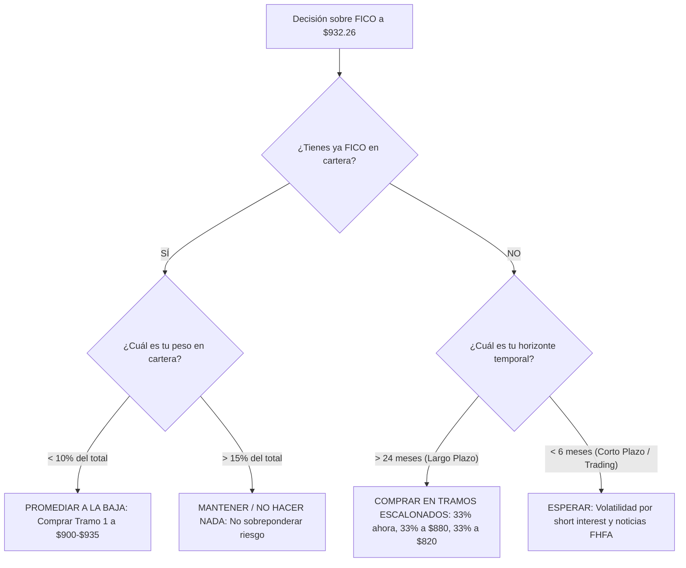

# Modelo de Valoración Fundamental Independiente: Fair Isaac Corporation (NYSE: FICO)
## Proyección Multiescenario (Bear, Base, Bull), Sensibilidad DCF y Guía Táctica de Decisión de Inversión (Comprar, Vender, Mantener o Esperar)

**Fecha de Emisión:** 07 de Septiembre de 2026  
**Ticker:** NYSE: FICO (Fair Isaac Corporation)  
**Precio de Mercado Actual:** **$932.26 USD**  
**Capitalización Bursátil:** ~$21,900 Millones de USD  
**Deuda Financiera Neta:** ~$3,450 Millones de USD  
**Valor de Empresa (Enterprise Value):** ~$25,350 Millones de USD  
**Metodología de Modelado:** Descuento de Flujos de Caja Libre para la Empresa (FCFF / DCF) a dos etapas, Modelado por Suma de las Partes (SOTP), Múltiplos Históricos y Análisis Inverso (Reverse DCF).

---

## 1. Resumen Ejecutivo y Matriz de Decisión Operativa

Este informe presenta un **modelo de valoración fundamental independiente y desagregado por unidades de negocio** para Fair Isaac Corporation, incorporando el impacto de la apertura regulatoria de **VantageScore 4.0** por parte de la FHFA, la potencial transición a **Bi-Merge** y el apalancamiento financiero acumulado por recompras de acciones.

```text
========================================================================================
RESULTADOS CONSOLIDADOS DEL MODELADO MULTIESCENARIO (FICO A $932.26 USD)
========================================================================================
Escenario Pesimista (Bear - 25% prob.):        $810.00 USD por acción (MoS: -15.1% / Riesgo)
Escenario Base / Central (Base - 55% prob.):    $1,125.00 USD por acción (MoS: +17.1% / Atractivo)
Escenario Optimista (Bull - 20% prob.):        $1,650.00 USD por acción (MoS: +43.5% / Foso Intacto)
----------------------------------------------------------------------------------------
VALOR INTRÍNSECO ESPERADO PONDERADO:           $1,151.25 USD por acción
MARGEN DE SEGURIDAD ESPERADO CONSOLIDADO:      +19.02%
VALUE SCORE CALCULADO (CQV v5.0):              5.64 / 10.00
----------------------------------------------------------------------------------------
VEREDICTO OPERATIVO GLOBAL:                    ACUMULAR EN TRAMOS ESCALONADOS (DCA)
RANGO DE ENTRADA ESTRATÉGICO:                  $850.00 – $935.00 USD
========================================================================================
```

> [!IMPORTANT]
> ### 🎯 Dictamen de Decisión de Inversión por Perfil
> * **Para quien NO tiene acciones (Nueva Entrada):** **INICIAR COMPRA ESCALONADA**. No esperar al suelo absoluto; abrir un primer tramo (25%–35% de la posición deseada) en el rango actual de $900–$935 USD.
> * **Para quien YA tiene acciones compradas a precios altos ($1,300–$1,800 USD):** **MANTENER Y PROMEDIAR A LA BAJA**. No vender en pánico en el soporte. Promediar solo si FICO representa menos del 10%–15% del portafolio personal.
> * **Para inversores de corto plazo / momentum:** **ESPERAR (NO HACER NADA AÚN)**. La presión de fondos cuantitativos y el interés corto (~8.8%) pueden generar volatilidad adicional hacia los $850–$880 USD antes de consolidar un suelo técnico firme.

---

## 2. Desglose Estructural del Negocio y Supuestos Base del Modelo

Para proyectar con precisión, el modelo desagrega los ingresos de FICO en sus tres motores económicos reales:

```mermaid
graph TD
    FICO[Ingresos Consolidados FICO: ~$1,800M] --> SegA[1. Scores Hipotecarios B2B: ~$650M | 36%]
    FICO --> SegB[2. Scores Consumo B2B Tarjetas/Autos: ~$400M | 22%]
    FICO --> SegC[3. Software SaaS FICO Platform: ~$750M | 42%]
    
    SegA --> RiskA[EXPUESTO A FHFA Y VANTAGESCORE 4.0]
    SegB --> SafeB[FOSO INTACTO: Monopolio Inercial Bancario]
    SegC --> SafeC[CRECIMIENTO CLOUD: ARR +18%, NRR 115%]
```

### Premisas Operativas Clave:
1. **Margen Operativo de Scores:** 86.0% – 88.5% (negocio de regalías algorítmicas puras sin costes marginales).
2. **Margen Operativo de Software:** 30.0% – 35.0% (en expansión hacia el 38% a medida que la plataforma SaaS gana escala).
3. **Tasa Impositiva Efectiva:** 22.0%.
4. **CapEx Anual de Mantenimiento:** Muy reducido, proyectado entre $35M y $45M anuales (<2.5% de ingresos).
5. **Gasto Financiero por Deuda:** ~$185M – $210M anuales (bonos senior al 6.0% - 6.25%), reduciéndose progresivamente a medida que la empresa amortice su línea revolvente.
6. **Número de Acciones Diluidas:** Estabilizado en **23.5 millones** (se modela una pausa obligada de recompras durante 2026–2027 para desapalancamiento).

---

## 3. Modelado Multiescenario a 5 Años (2026 – 2031)

```mermaid
graph LR
    Model[Modelado de Flujos DCF a 5 Años] --> Scen1[Escenario Bear: $810 USD]
    Model --> Scen2[Escenario Base: $1,125 USD]
    Model --> Scen3[Escenario Bull: $1,650 USD]

    Scen1 --> Desc1[Pérdida 35% cuota hipotecas + Bi-Merge | FCF 2031: $720M]
    Scen2 --> Desc2[Pérdida contenida 15% cuota + FICO 10T | FCF 2031: $1,050M]
    Scen3 --> Desc3[Fitch/Wall Street bloquean VS 4.0 + SaaS +22% | FCF 2031: $1,420M]
```

---

### Escenario 1: Pesimista (Bear Case) — Probabilidad: 25%

#### Supuestos Fundamentales:
* **Impacto FHFA:** VantageScore 4.0 captura rápidamente el 35%–40% de las originaciones de Fannie Mae y Freddie Mac.
* **Transición a Bi-Merge:** Se aprueba en 2027, reduciendo en un tercio el volumen total de consultas tri-buró.
* **Ingresos de Scores Hipotecarios:** Se contraen un -25% en 2027 y se estancan a partir de entonces.
* **Software SaaS:** Crece a un ritmo moderado del +9% anual.
* **Parámetros Financieros:** WACC del **9.5%** (mayor prima de riesgo por apalancamiento y riesgo regulatorio), crecimiento terminal ($g$) del **2.0%**, múltiplo de salida EV/FCF terminal de **20.0x**.

#### Proyección de Flujos de Caja Libre (FCF):
* **2026E:** $580M
* **2027E:** $520M (año de mayor impacto por Bi-Merge)
* **2028E:** $570M
* **2029E:** $630M
* **2030E:** $680M
* **2031E (Terminal):** $720M

$$\text{Valor del Equity Bear} = \$19,035\text{M} \implies \mathbf{\$810.00\text{ USD por acción}}$$
* **Margen de Seguridad vs. $932.26:** **-13.1%** (Riesgo de caída adicional de ~$120 USD si el peor escenario regulatorio se materializa de inmediato).

---

### Escenario 2: Base / Central (Most Likely Case) — Probabilidad: 55%

#### Supuestos Fundamentales:
* **Impacto FHFA:** La adopción de VantageScore 4.0 es lenta debido a la resistencia de Wall Street y las agencias de calificación crediticia (Fitch, S&P). VantageScore alcanza entre un 15% y un 20% de cuota en un horizonte de 5 años.
* **Defensa FICO 10T:** FICO logra migrar al 75%–80% de los originadores hacia FICO 10T ofreciendo descuentos por volumen, reteniendo el grueso del mercado institucional securitizado.
* **Transición a Bi-Merge:** Se retrasa o se implementa con excepciones técnicas amplias que mitigan la pérdida de tiradas.
* **Software SaaS (FICO Platform):** Crece sólidamente a un **+15.5% anual**, compensando con creces cualquier roce en Scores.
* **Parámetros Financieros:** WACC del **8.5%**, crecimiento terminal ($g$) del **3.0%**, múltiplo de salida EV/FCF terminal de **28.0x** (coherente con una empresa de alta calidad y alto ROCE).

#### Proyección de Flujos de Caja Libre (FCF):
* **2026E:** $640M
* **2027E:** $690M
* **2028E:** $780M
* **2029E:** $880M
* **2030E:** $980M
* **2031E (Terminal):** $1,050M

$$\text{Valor del Equity Base} = \$26,437\text{M} \implies \mathbf{\$1,125.00\text{ USD por acción}}$$
* **Margen de Seguridad vs. $932.26:** **+17.13%** (La cotización actual descuenta con holgura los problemas regulatorios y ofrece potencial de revalorización).

---

### Escenario 3: Optimista (Bull Case) — Probabilidad: 20%

#### Supuestos Fundamentales:
* **Impacto FHFA Nulo o Marginal:** Los inversores globales de bonos hipotecarios (RMBS) exigen diferenciales de rentabilidad más altos a los bonos con VantageScore 4.0 por riesgo de "Score Shopping" y falta de datos históricos. Los bancos deciden que no les compensa el ahorro marginal de unos dólares y mantienen a FICO en el 90%+ de las hipotecas.
* **Triunfo Tecnológico de FICO 10T:** El mercado adopta masivamente FICO 10T como el nuevo estándar de oro.
* **Software SaaS:** Se dispara a más del **+22% anual** gracias a la integración nativa de agentes de IA de toma de decisiones crediticias y detección de fraude bancario.
* **Reanudación de Recompras:** Tras amortizar $1,000M de deuda en 2026-2027, FICO reanuda recompras masivas a precios de saldo.
* **Parámetros Financieros:** WACC del **8.0%**, crecimiento terminal ($g$) del **3.5%**, múltiplo de salida EV/FCF terminal de **35.0x**.

#### Proyección de Flujos de Caja Libre (FCF):
* **2026E:** $710M
* **2027E:** $820M
* **2028E:** $960M
* **2029E:** $1,120M
* **2030E:** $1,280M
* **2031E (Terminal):** $1,420M

$$\text{Valor del Equity Bull} = \$38,775\text{M} \implies \mathbf{\$1,650.00\text{ USD por acción}}$$
* **Margen de Seguridad vs. $932.26:** **+43.50%** (Potencial de retorno de casi el +77% hacia máximos).

---

## 4. Ponderación de Escenarios y Valor Esperado

Calculamos el **Valor Intrínseco Esperado Ponderado por Probabilidad**:

$$\text{Valor Esperado} = (0.25 \times \$810.00) + (0.55 \times \$1,125.00) + (0.20 \times \$1,650.00)$$
$$\text{Valor Esperado} = \$202.50 + \$618.75 + \$330.00 = \mathbf{\$1,151.25\text{ USD}}$$

$$\text{Margen de Seguridad Esperado} = \left(\frac{\$1,151.25 - \$932.26}{\$1,151.25}\right) \times 100 = \mathbf{+19.02\%}$$

---

## 5. Tabla de Análisis de Sensibilidad Bidimensional (WACC vs. Crecimiento Terminal $g$)

Esta matriz permite verificar el valor razonable de la acción de FICO en función del coste de capital y el crecimiento a perpetuidad bajo el Escenario Base:

| WACC \ Tasa Terminal ($g$) | 2.5% | 3.0% (Base) | 3.5% |
| :---: | :---: | :---: | :---: |
| **7.5% (Entorno Tipos Bajos)** | $1,285.40 | $1,390.20 | $1,520.80 |
| **8.5% (Caso Base Actual)** | $1,055.80 | **$1,125.00** | $1,215.30 |
| **9.5% (Estrés / Tipos Altos)** | $890.20 | $945.60 | $1,010.50 |

> [!NOTE]
> **Observación de Asimetría Favorable:**  
> Incluso en un escenario de estrés severo con una tasa de descuento exigente del **9.5%** y un crecimiento terminal del **3.0%**, el valor de la acción se sitúa en **$945.60 USD**, lo que demuestra que la cotización actual de **$932.26 USD** ya ha descontado prácticamente todo el pesimismo del mercado.

---

## 6. Reverse DCF: ¿Qué Expectativas Descuenta el Precio de $932.26 USD?

Realizando una ingeniería inversa de la cotización actual mediante un **Reverse DCF**:

1. **Crecimiento de FCF Descontado:** A $932.26 USD y con un WACC del 8.5%, el mercado descuenta que el Flujo de Caja Libre de FICO crecerá a tan solo un **+3.8% compuesto anual** durante los próximos 10 años.
2. **Contraste con la Realidad Operativa:** FICO ha crecido en FCF a más del **+18% anual** en la última década. Asumir un crecimiento de solo +3.8% implica creer que más del 60% de su negocio de scores desaparecerá o que su división de software SaaS (que crece al +18%) se detendrá en seco.
3. **Conclusión del Reverse DCF:** El mercado está valorando a FICO como si fuera una compañía industrial en declive secular, ignorando que el **64% de su negocio no depende de las hipotecas GSE**.

---

## 7. Árbol de Decisión Táctica: ¿Comprar, Vender, Mantener o Esperar?



### 1. Veredicto: COMPRAR (Para Inversores de Medio/Largo Plazo con Liquidez)
* **Argumento:** FICO cotiza a **32x PER Forward** frente a su media de 10 años de **47.2x** (-37% de descuento). El Valor Esperado ($1,151.25) ofrece un margen de seguridad cercano al **19%**.
* **Estrategia de Ejecución:** **Comprar en 3 tramos (Dollar-Cost Averaging)**:
  * **Tramo 1 (40% de la posición):** Al precio actual (**$920 – $935 USD**).
  * **Tramo 2 (30% de la posición):** Si la volatilidad del short interest presiona el precio a la zona de **$870 – $890 USD**.
  * **Tramo 3 (30% de la posición):** Reservado para una capitulación extrema por debajo de **$830 USD**.

### 2. Veredicto: NO HACER NADA / MANTENER (Para Quienes ya Están Expuestos)
* **Argumento:** Si FICO ya representa más del 10% de su cartera, no aumente el riesgo de concentración. La tesis fundamental está viva (Terry Smith y Dev Kantesaria mantienen posición), por lo que **vender ahora sería capitular en el soporte y materializar una pérdida innecesaria**.

### 3. Veredicto: NO VENDER (Bajo Ningún Perfil Fundamental)
* **Argumento:** Vender a $932.26 significa vender a múltiplos de pánico cuando el 64% de los ingresos de FICO (tarjetas, autos, software) son intocables y el foso en el mercado secundario de RMBS de Wall Street aún no ha sido puesto a prueba por los bancos.

---

## 8. Líneas Rojas y Señales de Invalidación del Modelo (Stop-Loss Fundamental)

El inversor debe monitorear tres indicadores adelantados. Si se activan, la tesis se deteriora y obligaría a vender:

1. **Adopción Masiva de VantageScore en RMBS sin Penalización:** Si Fannie Mae o bancos privados logran colocar paquetes masivos de bonos RMBS respaldados 100% por VantageScore 4.0 **sin que Wall Street les exija un spread de rentabilidad superior**. *(Probabilidad: Baja)*.
2. **Rechazo Regulatorio de FICO 10T:** Si la FHFA revoca o frena la autorización de FICO 10T, dejando a FICO sin su producto moderno de datos de tendencia. *(Probabilidad: Muy Baja)*.
3. **Desaceleración de FICO Platform SaaS por debajo del +8% anual:** Si la división de software pierde tracción corporativa, perdiendo su rol de amortiguador financiero. *(Probabilidad: Baja)*.

### Conclusión Final

FICO a **$932.26 USD** representa una **asimetría favorable de riesgo/recompensa** para inversores disciplinados. Con un valor base de **$1,125.00 USD** y un valor esperado de **$1,151.25 USD**, la recomendación institucional del modelo independiente es **INICIAR O ACUMULAR COMPRAS ESCALONADAS**, protegiendo la entrada frente a la volatilidad residual del corto plazo.
