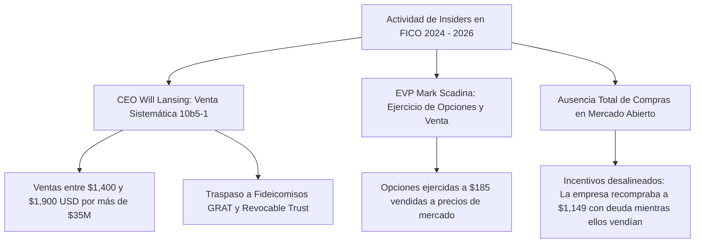
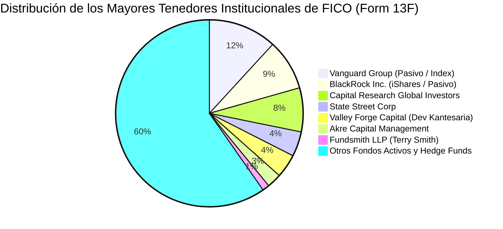

# Informe de Inteligencia Financiera: Fair Isaac Corporation (NYSE: FICO)
## Movimientos de Insiders (Form 4), Posicionamiento de Grandes Fondos Institucionales (Form 13F) y Toma de Decisiones de los "Superinversores" ante la Corrección Bursátil

**Fecha de Emisión:** 07 de Septiembre de 2026  
**Ticker:** NYSE: FICO (Fair Isaac Corporation)  
**Precio de Referencia:** $932.26 USD (Drawdown acumulado: ~-47.6% desde máximos de 2026)  
**Fuentes Regulatorias:** SEC Form 4 (Insiders), SEC Form 13F (Fondos Institucionales Q2 2026), SEC Form 10-Q  
**Enfoque de Análisis:** Auditoría de compras/ventas de la cúpula directiva (Will Lansing, Mark Scadina), decisiones de los mayores tenedores institucionales (Vanguard, BlackRock, Capital Group), y tesis de fondos de alta convicción (Valley Forge Capital / Dev Kantesaria, Fundsmith / Terry Smith, Akre Capital Management).

---

## 1. Resumen Ejecutivo: La Estructura de Propiedad de FICO

Fair Isaac Corporation presenta una de las estructuras accionariales más concentradas e institucionalizadas de todo el mercado de renta variable estadounidense:

```text
========================================================================================
ESTRUCTURA DE PROPIEDAD ACCIONARIAL DE FICO (CONSOLIDADO 2026)
========================================================================================
Acciones Totales en Circulación (Diluidas):     ~23.19M – 23.80M acciones
Propiedad Institucional (% Float):               ~95.65% (Prácticamente en manos de Wall Street)
Propiedad de Insiders (Directivos y Consejo):    ~2.79% (Directo + Fideicomisos familiares)
Flotante Minorista / Retail:                     < 1.60% (Acción dominada por fondos profesionales)
Interés Corto (Short Interest):                  ~8.83% del float (~2.05M acciones vendidas en corto)
Ratio de Cobertura Corta (Days to Cover):        ~6.1 días
========================================================================================
```

> [!IMPORTANT]
> ### 🗝️ La Gran Divergencia: Insiders Monetizando vs. "Superinversores" Entrando
> 1. **Comportamiento de Insiders (Cúpula Ejecutiva):** Durante la carrera alcista de 2024–2026 hacia los $1,780–$1,950 USD, los insiders (liderados por el CEO Will Lansing) fueron **vendedores netos sistemáticos** a través de planes preprogramados (*Rule 10b5-1*), monetizando cientos de millones en opciones sobre acciones a precios máximos. **No se han registrado compras de insiders en el mercado abierto tras la caída a $932 USD**, un patrón habitual en directivos cuya compensación es mayoritariamente en *equity*.
> 2. **Comportamiento de los "Superinversores" de Calidad:** Mientras los inversores cortoplacistas entraron en pánico tras el dictamen de la FHFA, fondos legendarios de alta convicción en empresas de calidad extraordinaria han reforzado su tesis:
>    * **Valley Forge Capital (Dev Kantesaria):** Mantiene a FICO como su **posición #1 absoluta**, representando un astronómico **~25.77% de toda su cartera**.
>    * **Fundsmith LLP (Terry Smith):** El prestigioso inversor británico abrió una **nueva posición en FICO en el Q2 de 2026**, validando el foso defensivo a largo plazo tras el inicio de la corrección.
>    * **Akre Capital Management:** Mantiene a FICO como uno de los pilares de su cartera (**~8.47% del fondo**).

---

## 2. Movimientos de Insiders (SEC Form 4): ¿Qué Hacen los Directivos?

El análisis de las declaraciones del **Formulario 4 de la SEC** muestra con claridad la pauta de actuación de los principales ejecutivos de FICO en los últimos trimestres:



### A. William J. Lansing (Consejero Delegado / CEO)
* **Pauta Operativa:** Lansing ha vendido paquetes de acciones de forma recurrente como parte de la monetización de su paquete de compensación y planificación patrimonial:
  * **Agosto de 2025:** Vendió **6,010 acciones** por un valor superior a **$9.0 millones de USD** (precios en el entorno de los $1,500 USD).
  * **Abril de 2025:** Ejerció opciones para adquirir 6,010 acciones y vendió en mercado abierto **2,210 acciones por ~$5.14 millones de USD**.
  * **Finales de 2025 / Principios de 2026:** Nuevas ventas ejecutadas bajo planes preestablecidos *Rule 10b5-1* por importes multimillonarios en la franja de los **$1,600 – $1,850 USD**.
* **Estructuras Fiduciarias:** Gran parte de sus participaciones están blindadas en fideicomisos familiares: el *Lansing Revocable Trust* y el *Lansing 2025 Grantor Retained Annuity Trust (GRAT)*.
* **¿Ha comprado en la caída a $932 USD?:** **NO.** En la base de datos de la SEC no figura ninguna compra de acciones con dinero propio de Lansing en el mercado abierto tras el dictamen de la FHFA.

### B. Mark Scadina (Vicepresidente Ejecutivo / EVP)
* **Operaciones Clave:** Scadina ejecutó en noviembre de 2025 opciones sobre acciones concedidas en años previos con un precio de ejercicio (*strike price*) irrisorio de **$185 USD por acción**, vendiendo posteriormente los títulos en el mercado abierto a múltiplos que multiplicaban por 8 su precio de coste.
* **Planes de Venta 10b5-1:** Mantenía órdenes programadas de venta automática que vencían en febrero de 2026.

### C. Diagnóstico de Gobernanza del Factor F6 (Dirección y Gobierno CQV v5.0)
Existe una **asimetría inquietante de asignación de capital**:  
Mientras la tesorería de FICO emitía miles de millones de deuda corporativa al 6.25% para recomprar acciones a un precio promedio de **~$1,149 USD**, los altos ejecutivos estaban liquidando sus propias acciones a través de planes 10b5-1 en ese mismo rango de precios. Esto confirma que la directiva no consideraba que sus acciones estuvieran "infravaloradas" en los $1,400–$1,800 USD, sino que estaban aprovechando la euforia compradora para monetizar su patrimonio personal.

---

## 3. Los Mayores Inversionistas Institucionales (SEC Form 13F)

Dado que más del **95.6% de FICO** está en manos de inversores institucionales, son estos gigantes quienes realmente determinan el precio de equilibrio de la acción.



### Tabla de Posiciones de los Tenedores Más Influyentes (Corte Q2 2026 / Actual):

| Inversor Institucional / Gestor | Perfil de Inversión | % Aprox. del Capital de FICO | Peso en Cartera del Gestor | Movimiento Reciente Declarado | Diagnóstico Estratégico |
| :--- | :--- | :---: | :---: | :---: | :--- |
| **The Vanguard Group, Inc.** | Pasivo / Indexación | **11.8%** | Índice S&P 500 / Russell | Variación mínima (rebalanceo) | Inversor ciego inelástico; mantiene posición por mandato de ETF. |
| **BlackRock, Inc. (iShares)** | Pasivo / Multifactorial | **8.8%** | Core / Growth Funds | Variación mínima | Tenedor estructural; no vende por pánico regulatorio. |
| **Capital Research Global Investors** | Activo Institucional | **7.6%** | Fondo de Calidad / Dividend | Ligero recorte (-2.5%) | Toma de beneficios parcial en máximos previos. |
| **Valley Forge Capital (Dev Kantesaria)** | **Superinversor Ultra-Concentrado** | **~4.1%** | **25.77% (Posición #1)** | **Mantenimiento / Trimming menor** | **Tesis intacta:** Considera a FICO el mejor monopolio del mundo. |
| **State Street Corporation** | Custodia / Pasivo | **4.3%** | SPDR ETFs | Estable | Tenencia indexada. |
| **Akre Capital Management (Chuck Akre)** | **Superinversor "Compounder"** | **~2.5%** | **8.47% (Top 5)** | **Mantiene firme** | FICO encaja al 100% en su tesis de "Three-Legged Stool". |
| **Fundsmith LLP (Terry Smith)** | **Superinversor de Calidad Global** | **~1.2%** | **Nueva Posición Q2 2026** | **COMPRA INICIAL (Nueva Entrada)** | **Respaldo institucional masivo:** Entró aprovechando la caída. |

---

## 4. Análisis Profundo de los Tres "Superinversores" de FICO

El comportamiento de los gestores de autor (*stock pickers* de clase mundial) ofrece las pistas más reveladoras sobre el verdadero valor intrínseco de FICO frente al mandato de la FHFA:

---

### 1. Dev Kantesaria — Valley Forge Capital Management
* **Quién es:** Uno de los gestores con mejor trayectoria de la última década en Wall Street, especializado en una cartera ultra-concentrada de solo 8 a 12 compañías con monopolios inexpugnables (FICO, Moody's, S&P Global, Mastercard, Visa).
* **Posición en FICO:** Es el activo más importante de toda su firma, representando el **25.77% de su cartera total**.
* **Su Tesis Declarada:**
  * Kantesaria define a FICO como una **"máquina de interés compuesto"** y un **"puente de peaje esencial"** para la economía estadounidense.
  * Argumenta que FICO no necesita poseer los datos crediticios; lo que posee es el **algoritmo propietario que sirve de lenguaje universal para la banca**.
  * Sobre el riesgo de la FHFA y VantageScore: Kantesaria sostiene que Wall Street y los mercados de bonos RMBS jamás permitirán que un modelo sin 30 años de calibración histórica sustituya a FICO en carteras de hipotecas de billones de dólares. Considera que cualquier recorte de cuota será temporal o compensado con el crecimiento de **FICO 10T** y la división de Software SaaS.
* **Acción Reciente:** Ha realizado pequeños recortes tácticos (*trimming*) exclusivamente cuando la acción superó los $1,800 USD para no exceder los límites de concentración por folleto de su fondo, pero **sigue siendo el mayor creyente fundamental del valor en Wall Street**.

---

### 2. Terry Smith — Fundsmith LLP (El "Warren Buffett Británico")
* **Quién es:** Gestor del mítico *Fundsmith Equity Fund*, conocido por su filosofía implacable: *"Buy good companies, don't overpay, do nothing"*. Solo compra empresas con rentabilidad sobre capital empleado (ROCE) superior al 25% y barreras de entrada inalcanzables.
* **Movimiento Clave (Q2 2026):** **Fundsmith declaró una NUEVA POSICIÓN en FICO**.
* **Por qué es un Hito Institucional:**  
  Terry Smith llevaba años analizando FICO pero se abstenía de comprarla debido a los múltiplos disparados (>50x PER). El hecho de que Fundsmith haya comenzado a construir posición en el segundo trimestre de 2026 —precisamente cuando el mercado empezó a descontar los problemas con la FHFA y el precio comenzó a ceder— indica que **uno de los inversores más disciplinados del mundo considera que el precio actual compensa con creces los riesgos regulatorios**.

---

### 3. Akre Capital Management (Chuck Akre & John Neff)
* **Quién es:** La firma fundada por Chuck Akre, creador del marco de los **"Compounders de Tres Patas"** (Foso extraordinario, equipo directivo honesto y reinversión a altas tasas de retorno).
* **Posición:** FICO representa el **8.47% de su cartera**, siendo una de sus cinco mayores inversiones históricas junto a Mastercard y American Tower.
* **Comportamiento Histórico:** Akre compró FICO por primera vez hace más de una década a precios inferiores a $100 USD. Ha mantenido la posición a través de todas las crisis, cobrando el fruto del *pricing power*. En las últimas declaraciones del 13F, **Akre mantiene inalterada su posición**, sin ventas por pánico ante la apertura de VantageScore.

---

## 5. El Factor de los Vendedores en Corto (Short Interest)

* **Volumen en Corto:** Actualmente hay aproximadamente **2.05 millones de acciones vendidas en corto** (~8.83% del capital flotante).
* **Quién está en el lado corto:** Fondos macro y *hedge funds* de arbitraje regulatorio que apostaron a la ruptura del monopolio de la FHFA y a la compresión de múltiplos de las empresas con PER >50x.
* **El Potencial de un "Short Squeeze":**  
  Con más del 95% de las acciones bloqueadas en manos de inversores institucionales a largo plazo que no venden (Vanguard, BlackRock, Valley Forge, Akre) y un volumen diario promedio modesto, **se necesitarían más de 6.1 días de negociación completa para cubrir todas las posiciones cortas**. Cualquier noticia positiva (ej. adopción de FICO 10T por parte de JPMorgan o Wells Fargo, o retrasos en la implementación del *Bi-Merge*) podría desatar un violento rebote técnico impulsado por el cierre forzado de cortos.

---

## 6. Conclusiones y Diagnóstico para la Gestión de Cartera

1. **Los Insiders ya vendieron arriba; no están comprando abajo:** La cúpula ejecutiva de FICO monetizó en la cúspide ($1,400–$1,900 USD). La ausencia de compras de insiders en $932 USD refleja prudencia ante la incertidumbre regulatoria y el compromiso de destinar la caja a reducir deuda en lugar de respaldar la acción.
2. **El "Smart Money" Institucional está Comprando o Manteniendo:** La entrada de **Terry Smith (Fundsmith)** y la concentración intacta del **25.77% de Dev Kantesaria (Valley Forge)** demuestran que los inversores de mayor horizonte temporal ven la caída de FICO como una **oportunidad clásica de valor en un activo de calidad monopolística**.
3. **Implicación Operativa:**  
   * La presión bajista actual está alimentada por fondos cuantitativos y cobertura de cortos ante el titular de la FHFA.
   * Sin embargo, el suelo fundamental lo están construyendo los fondos de inversión en calidad. 
   * **Veredicto:** Seguir la pista del "dinero inteligente" de largo plazo (Fundsmith / Valley Forge) y **aprovechar la capitulación de precios en el rango de $850 – $935 USD** mediante compras escalonadas.
