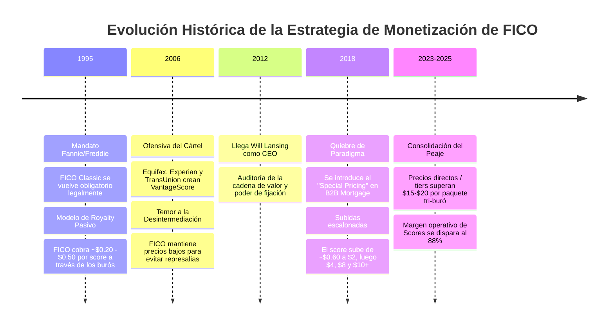
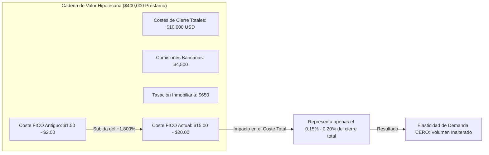
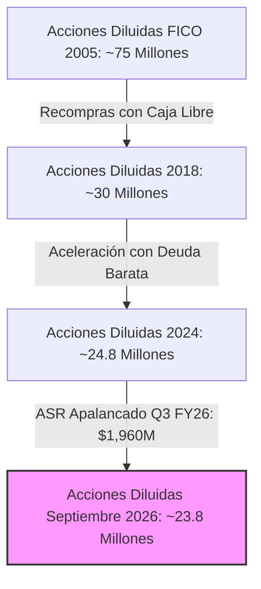
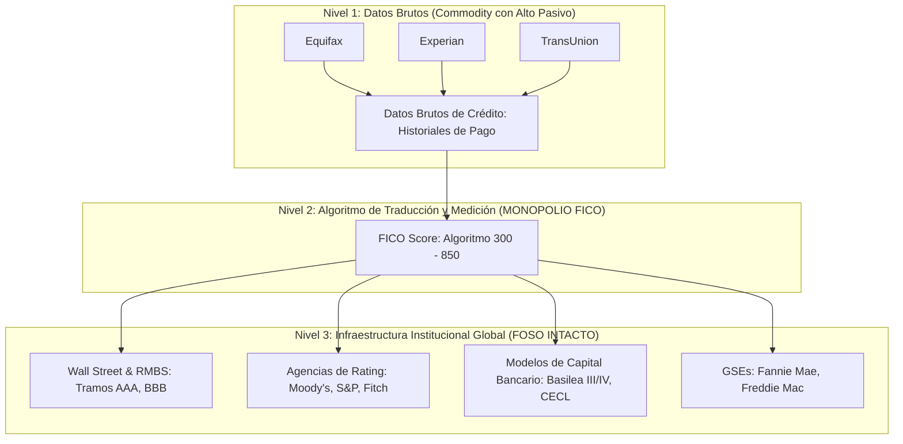
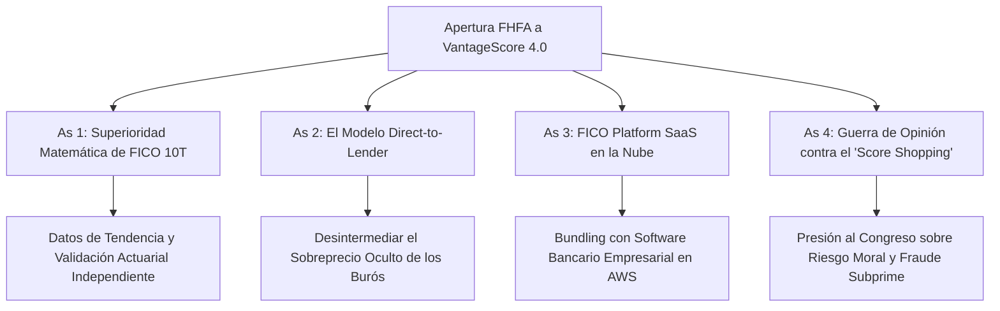
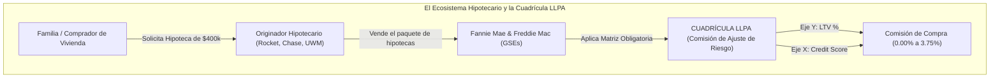
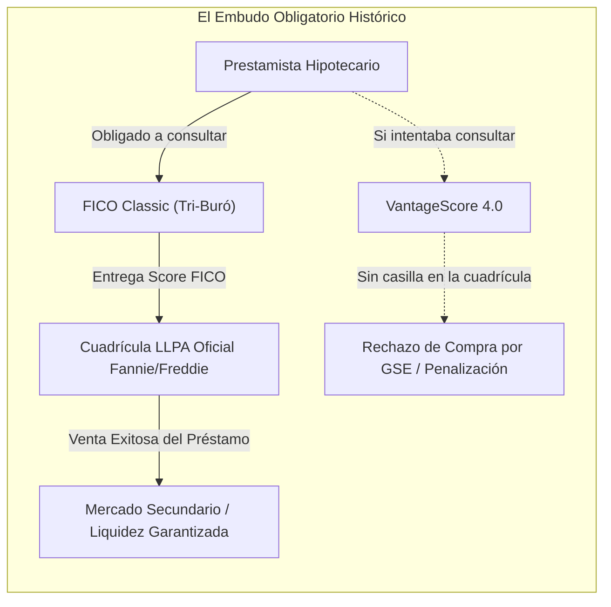
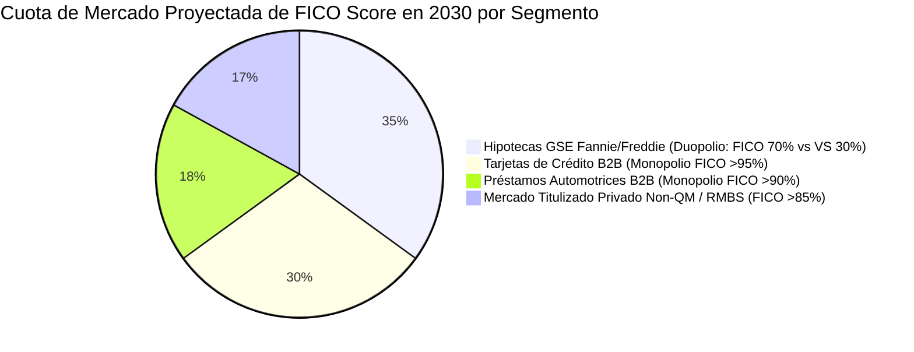

# Tesis de Inversión y Análisis Estructural Integral: Fair Isaac Corporation (NYSE: FICO)
## Pricing Power Agresivo, Diagnóstico de Capital para Recompras, Desmitificación del MOAT sin Datos y Prospectiva de Mercado (¿Monopolio o Duopolio?)

**Fecha de Emisión:** 28 de Septiembre de 2026  
**Ticker:** NYSE: FICO (Fair Isaac Corporation)  
**Cotización de Referencia:** $932.26 USD  
**Metodología:** Modelo CQV v5.0 (Quality, Resilience, Moat & Value)  
**Propósito:** Tesis de investigación fundamental que desglosa las causas del shock de precios de FICO, la capacidad residual de recompra de acciones tras el apalancamiento reciente, la naturaleza real de su foso económico ante la ausencia de infraestructura y propiedad de datos, sus cartas estratégicas ocultas y la resolución del equilibrio de mercado frente a VantageScore.

---

## 1. Resumen Ejecutivo y Tesis Central

Fair Isaac Corporation (FICO) se encuentra en el epicentro de un debate estructural sin precedentes en el mercado financiero. Tras años cotizando como una de las máquinas de rentabilidad compuesta (*compounders*) más prolíficas de Wall Street —alcanzando múltiplos superiores a 50x PER y máximos históricos cercanos a $1,800–$1,950—, la acción ha sufrido un retroceso hasta los **$932.26 USD**, desencadenado por el mandato de la Federal Housing Finance Agency (FHFA) que busca imponer a **VantageScore 4.0** en el mercado hipotecario secundario de Fannie Mae y Freddie Mac.

```text
========================================================================================
RESUMEN DE PREGUNTAS CLAVE Y VEREDICTO DE LA TESIS (FICO - SEPTIEMBRE 2026)
========================================================================================
1. ¿Por qué subió precios tan agresivamente en poco tiempo tras décadas de tarifas ínfimas?
   -> Despertar de Will Lansing (2018): monetización del "excedente monopólico reprimido".
   -> Asimetría brutal de valor: el score costaba $1 en una transacción de $400,000.
   -> Demanda inelástica y traspaso directo del coste al comprador final de la vivienda.

2. ¿Aún queda capital para recomprar acciones o FICO está agotada financieramente?
   -> Recompras con NUEVA DEUDA: AGOTADAS A CORTO PLAZO (Deuda neta/EBITDA ~3.2x-3.5x).
   -> Recompras con FLUJO DE CAJA LIBRE (FCF): VIGENTES Y ROBUSTAS (~$550M-$650M/año).
   -> CapEx minúsculo (<$40M) permite seguir recomprando 2.5% - 3.0% de acciones al año a $930.

3. Si FICO no es dueña de los datos, no los guarda y no tiene infraestructura de buró, ¿cuál es su MOAT?
   -> Efecto de red lingüístico ("El Esperanto del Crédito" en Wall Street y Rating Agencies).
   -> Costes de cambio institucionales: riesgo asimétrico para los comités de riesgo (CROs).
   -> 35 años de calibración regulatoria (Basilea III/IV, CECL, CCAR) imposibles de emular.
   -> Neutralidad: Es la "Suiza" que resuelve el dilema del prisionero entre los 3 burós rivales.

4. ¿Qué ases tiene FICO bajo la manga y habrá finalmente un oligopolio?
   -> Ases: FICO 10T (superioridad estadística), Direct-to-Lender, y FICO Platform SaaS en AWS.
   -> Estructura final: DUOPOLIO TÉCNICO REGULADO en hipotecas GSE (Fannie/Freddie), pero
      MONOPOLIO INTACTO (>90% cuota) en tarjetas, consumo, autos y mercado privado de bonos.
========================================================================================
```

---

## 2. El Enigma de los Precios: ¿Por qué FICO Subió Precios Agresivamente en Tan Poco Tiempo tras Décadas Manteniendo Tarifas Bajas?

Uno de los fenómenos más desconcertantes para el inversor común es que, habiendo sido fundada en 1956 y convertido su algoritmo en el estándar nacional en 1989/1995, **FICO cobrara centavos durante casi 30 años** y, de pronto, entre 2018 y 2025, desatara una escalada de precios superior al **+1,800%** en originación hipotecaria.



### A. La Razón Histórica: El "Pacto de Caballeros" y el Miedo a los Burós (1995–2012)
Durante décadas, FICO operó bajo un **modelo de licenciamiento de propiedad intelectual indirecto**:
1. FICO no le vendía directamente al banco; licenciaba el código matemático a los tres grandes burós de crédito (*Equifax, Experian y TransUnion*).
2. Los burós eran quienes poseían la fuerza de ventas, la infraestructura de centros de datos y la relación comercial directa con las entidades financieras.
3. Los burós empaquetaban el historial crediticio más la puntuación FICO y cobraban al banco una tarifa global, entregándole a FICO una pequeña regalía residual (de **$0.20 a $0.50 USD por consulta**).
4. **El miedo existencial de FICO:** Si FICO intentaba subir sus regalías, temía que los burós ocultaran su score, lo penalizaran comercialmente o promovieran una alternativa propia. Este temor era tan real que en 2006 los tres burós efectivamente se aliaron para crear **VantageScore Solutions LLC** con la intención expresa de asfixiar financieramente a FICO. Durante años, FICO mantuvo precios ínfimos para desincentivar que la industria adoptara VantageScore.

### B. El Punto de Inflexión de Will Lansing (2018): La Detección del "Peaje Inelástico"
Hacia 2017–2018, la dirección de FICO liderada por Will Lansing llegó a tres conclusiones matemáticas demoledoras:

1. **La prueba de fuego de 12 años con VantageScore:** Habían pasado 12 años desde la creación de VantageScore (2006–2018), y los tres burós no habían logrado ganar más de una fracción minúscula del mercado institucional primario, a pesar de ofrecer VantageScore a precios casi regalados. La industria financiera dependía irremediablemente de FICO. FICO comprendió que **el riesgo de ser sustituida era infinitamente menor de lo que creía**.
2. **La Desproporción Absoluta de Valor (Asimetría Económica):**
   * En un préstamo hipotecario típico de **$400,000 USD**, los costes de cierre cobrados al solicitante (*closing costs*) oscilan entre **$8,000 y $15,000 USD** (tasaciones, comisiones de apertura, títulos de propiedad, gastos legales).
   * La decisión de conceder o rechazar ese préstamo de $400,000 y la tasa de interés asignada recaían en el **FICO Score**.
   * Si el banco cometía un error de suscripción, la pérdida esperada por impago (*Loss Given Default*) superaba los **$80,000 - $120,000 USD**.
   * Y por esa decisión crítica, **FICO estaba cobrando menos de $2.00 USD por un informe tri-buró**.
3. **Elasticidad Cero de la Demanda y Traspaso de Costes:**
   * Dado que la normativa de Fannie Mae y Freddie Mac obligaba por ley a utilizar el FICO Score tri-buró para titulizar la hipoteca, **el banco no podía negarse a comprar el score**.
   * Además, los prestamistas hipotecarios no pagan el score de su propio margen: **lo trasladan directamente al solicitante de la hipoteca en la partida de gastos de originación**. Para un comprador que paga $10,000 de comisiones de cierre, una línea que diga "Informe de Crédito FICO: $45 USD" en lugar de "$10 USD" es completamente imperceptible y no frena la solicitud.



### C. El Mecanismo de Ejecución: "Special Pricing" y Tiers Directos
FICO no modificó los contratos pasivos de regalías de consumo general; aplicó una estrategia de **"precios especiales por nivel" (Special Pricing / Tiered Pricing)** específicamente enfocada en el sector hipotecario (*Mortgage Origination*). Reclasificó los acuerdos con los tres burós imponiendo un esquema donde, a partir de ciertos volúmenes y tipos de consulta de alta trascendencia económica, el canon por score escalaba progresivamente:
* 2018–2020: Primeras revisiones de $0.60 a ~$2.00+.
* 2021–2023: Subidas escalonadas a $3.50, $6.00 y $8.00.
* 2024–2026: Introducción de niveles de hasta $10.00–$15.00+ por tirada individual, consolidando un paquete tri-buró superior a $30–$45 USD.

El resultado fue una de las expansiones de margen operativo más brutales del capitalismo corporativo moderno: el segmento de **Scores de FICO alcanzó márgenes operativos del ~88%**, convirtiéndose prácticamente en una máquina de cobrar un "impuesto privado" sobre la formación de deuda de los Estados Unidos.

---

## 3. Diagnóstico de Recompras de Acciones: ¿Aún Queda Capital o FICO está Agotada Financieramente?

FICO es ampliamente citada como el ejemplo por excelencia del **"caníbal corporativo" (Share Cannibal)**. La evolución del número de acciones en circulación demuestra una disciplina implacable de retiro de títulos:



Sin embargo, la pregunta del usuario es fundamental: **¿Le queda capital para seguir recomprando o ya se le agotaron los fondos?**

Para responder, se debe separar estrictamente la capacidad de endeudamiento adicional de la generación orgánica de caja libre:

### A. La Vía del Endeudamiento Adicional: AGOTADA A CORTO PLAZO 🛑
FICO cometió un error clásico de sincronización de capital (*Capital Allocation Timing*) en el ejercicio fiscal 2025/2026:
1. **El Macro-Tramo ASR de Q3 FY26:** La empresa ejecutó un programa acelerado de recompra de acciones (ASR) por **$1,960 millones de USD** a un precio promedio ponderado auditado de **~$1,149 USD por acción**, justo en la zona alta de valoración histórica.
2. **Financiación mediante Deuda Costosa:** Para financiar este ASR, emitió **$1,000M en Senior Notes al 6.250% con vencimiento en 2034**, sumados a los **$1,500M al 6.000% emitidos en 2025**, y dispuso de parte de su línea de crédito sindicada revolvente.
3. **Métricas de Apalancamiento al Límite:**
   * **Deuda Financiera Bruta:** ~$4,000M - $4,200M USD.
   * **Gasto Anual por Intereses:** Pasó de ~$80M en 2022 a **~$200M USD anuales en 2026**.
   * **Ratio Deuda Neta / EBITDA:** Se sitúa actualmente entre **3.2x y 3.5x**.
   * **Covenants Bancarios:** Los contratos de la línea sindicada revolvente suelen fijar un límite máximo de apalancamiento (*Leverage Ratio Covenant*) en torno a **3.75x – 4.25x EBITDA**.

> [!WARNING]
> **Conclusión sobre Deuda:** FICO **NO tiene capacidad de emitir más deuda financiera** para recomprar acciones sin arriesgarse a una rebaja de calificación crediticia a grado especulativo (*junk*) o violar sus covenants bancarios. La era del "caníbal apalancado con deuda emitida" ha concluido temporalmente.

### B. La Vía del Flujo de Caja Libre Orgánico: VIGENTE Y SUMAMENTE PODEROSA 🟢
Que FICO no pueda endeudarse más no significa en absoluto que "no tenga capital". FICO cuenta con un modelo de negocio con una intensidad de capital prácticamente nula:
* **CapEx Anual:** Menos de **$35M - $45M USD** al año (únicamente servidores cloud y desarrollo menor de software capitalizado).
* **Conversión de Caja Libre:** Más del **100% del Beneficio Neto** se convierte en Flujo de Caja Libre Operativo.
* **Generación Operativa Bruta de FCF:** FICO genera anualmente entre **$550M y $650M USD** de flujo de caja libre operativo antes de servicio discrecional.

```text
========================================================================================
ESTADO DE CAJA DISCRECIONAL ANUAL DE FICO PARA RECOMPRAS (PROYECCIÓN 2026-2027)
========================================================================================
EBITDA Estimado Consolidado:                        ~$820M – $860M USD
(-) Gastos por Intereses de la Deuda (~6% sobre $3.6B): -$200M USD
(-) Impuestos en Efectivo (Cash Taxes):             -$110M USD
(-) Gasto de Capital (CapEx):                       -$40M USD
----------------------------------------------------------------------------------------
Flujo de Caja Libre Neto Discrecional (FCF):        ~$470M – $510M USD / año
========================================================================================
```

### C. ¿Qué Puede Recomprar FICO Hoy con su Flujo de Caja Orgánico?
A los precios actuales deprimidos por la corrección (**$932.26 USD**):
$$\text{Acciones Recomprables Anualmente} = \frac{\$480,000,000 \text{ USD}}{\$932.26 \text{ USD/acc}} \approx 514,800 \text{ acciones/año}$$

Esto equivale a retirar del mercado entre el **2.2% y el 2.5% de todas las acciones en circulación de FICO cada año**, financiado exclusivamente con el excedente de caja operativa, sin necesidad de pedir un solo dólar prestado a los bancos.

Adicionalmente, el Consejo de Administración (*Board of Directors*) de FICO renueva de forma recurrente las autorizaciones de recompra (habitualmente paquetes autorizados de $500M a $1,000M). Por ende, **FICO SÍ tiene capital constante y renovable para recompras vía FCF**, pero se verá forzada a destinar una fracción de su caja a amortizar la línea de crédito para desapalancarse hacia un ratio Deuda/EBITDA más prudente (~2.5x).

---

## 4. La Paradoja del MOAT: Si FICO No Es Propietaria de Datos, No los Guarda y No Tiene Infraestructura, ¿Cuál Es su Verdadero Foso?

Esta es la objeción analítica más intuitiva y a la vez más errónea que se plantea sobre FICO:
> *"FICO es solo una fórmula matemática. La infraestructura de servidores, los historiales de pago de 250 millones de estadounidenses y los centros de datos los tienen Equifax, Experian y TransUnion. FICO no guarda data ni tiene red de telecomunicaciones propia. ¿Cómo puede tener un foso defensivo si no posee la materia prima?"*

La respuesta radica en comprender que en la economía financiera institucional, **la propiedad física de los datos brutos es un negocio de bajo margen (un utility o commodity), mientras que el estándar de confianza y medición del riesgo es un monopolio natural.**



### Filar 1: El "Esperanto del Crédito" y el Efecto de Red Institucional
FICO no vende datos; vende **un lenguaje universal estandarizado**.
* Cuando un banco de inversión en Nueva York empaqueta 5,000 hipotecas en un bono titulizado (*Residential Mortgage-Backed Security* - RMBS) y se lo vende a un fondo de pensiones en Tokio o a un asegurador en Zúrich, el folleto de emisión no describe los nombres ni los historiales de pago detallados de los 5,000 prestatarios.
* El folleto dice: *"El tramo de este bono tiene un FICO medio ponderado de 740, con un mínimo de 680"*.
* Ese número de tres cifras (300 a 850) sintetiza de manera universal e incuestionable la probabilidad matemática de impago. Si un emisor intentara colocar un bono respaldado por una métrica no estandarizada o desconocida, los inversores globales exigirían una prima de riesgo sustancialmente mayor o simplemente no comprarían el bono. FICO es el **patrón oro de la liquidez en los mercados de capitales secundarios**.

### Filar 2: La Asimetría del Chief Risk Officer: "Nadie es despedido por usar FICO"
En la industria bancaria opera la famosa máxima de la informática corporativa: *"Nadie ha sido despedido jamás por contratar a IBM"*.
* Imaginemos al Director de Riesgos (*Chief Risk Officer* - CRO) de un gran banco como JPMorgan Chase o Wells Fargo.
* El coste de comprar los FICO Scores representa una fracción microscópica de sus costes operativos.
* Si el CRO decide sustituir FICO por un modelo alternativo para ahorrar $2 o $3 dólares por solicitud, y dos años después la cartera de crédito experimenta una tasa de impago inesperada de 50 puntos básicos por encima de lo proyectado:
  * El banco sufrirá cientos de millones de dólares en pérdidas crediticias directas.
  * Los auditores regulatorios (la Reserva Federal y la OCC) abrirán investigaciones por fallos en los modelos de estrés.
  * El CRO será despedido inmediatamente en desgracia.
* Por el contrario, si la cartera sufre impagos pero se originó utilizando las métricas estándar de FICO, la responsabilidad se atribuye al ciclo macroeconómico general, no a una negligencia del modelo de riesgo. **La ganancia por cambiar es de centavos; el riesgo de carrera profesional y reputación institucional es existencial.**

### Filar 3: La Trinchera de los Modelos de Provisión de Capital (Basilea III/IV, CECL y CCAR)
Los bancos no pueden cambiar de modelo de puntuación de la noche a la mañana, aunque quieran:
* Bajo las normativas bancarias internacionales (**Basilea III / Basilea IV**) y los marcos contables de pérdidas esperadas (**CECL** en EE. UU. e **IFRS 9** a nivel global), las provisiones de capital que un banco debe apartar están calibradas matemáticamente contra las probabilidades de impago (*Probability of Default* - PD) y pérdida en incumplimiento (*Loss Given Default* - LGD).
* Estas funciones matemáticas bancarias están **entrenadas y calibradas sobre 35 años de series históricas de FICO**, abarcando la recesión de 1991, la burbuja dot-com de 2001, la Gran Crisis Financiera de 2008 y la pandemia de 2020.
* Un banco no puede simplemente "conectar" un nuevo score alternativo sin pasar de 3 a 5 años realizando costosos estudios de *backtesting*, auditorías de validación de modelos independientes y obteniendo la autorización explícita de los reguladores prudenciales.

### Filar 4: FICO como la "Suiza Neutral" frente al Dilema del Prisionero de los Burós
¿Por qué Equifax, Experian y TransUnion no pudieron barrer a FICO tras fundar VantageScore en 2006?
* Los tres burós son **competidores a muerte** en una industria oligopólica de datos.
* Si el sistema bancario adoptara un score propiedad directa de los tres burós (VantageScore), ningún buró confiaría plenamente en la gobernanza de los otros dos. Un banco cliente de Equifax sospecharía que el algoritmo de VantageScore podría favorecer los atributos de datos específicos donde Experian tiene mayor cobertura.
* Además, el Departamento de Justicia (DOJ) y la Federal Trade Commission (FTC) vigilan con lupa cualquier intento coordinado de los tres burós de cartelizar el mercado.
* FICO actúa como el **árbitro independiente e incorruptible**: una empresa de software puro que no recolecta data primaria, no compite con los burós en la venta de informes de solvencia y trata a los tres burós bajo reglas de paridad matemática.

### Filar 5: La Gran Ventaja: "No Poseer Datos" es la Mayor Bendición del Negocio
Lejos de ser una debilidad, el hecho de que FICO no guarde bases de datos masivas de ciudadanos es un pilar supremo de su rentabilidad:
1. **Inmunidad a Brechas Cibernéticas Catastróficas:** En 2017, Equifax sufrió un ciberataque donde se expusieron los datos financieros de 147 millones de personas, costándole más de $1,400 millones en multas legales, demandas colectivas y modernización forzada de centros de datos. FICO no almacena historiales crediticios en sus servidores; no corre ese riesgo de responsabilidad civil masiva.
2. **Sin Carga de Cumplimiento Regulatorio Pesado (FCRA):** Los burós deben mantener gigantescos centros de atención telefónica y equipos legales para gestionar disputas de consumidores por errores en sus historiales crediticios bajo la ley *Fair Credit Reporting Act (FCRA)*. FICO se limita a vender el software algorítmico que procesa los datos que otros mantienen.
3. **Márgenes de Software Puro:** Esta arquitectura es la que le permite operar con un margen operativo del **88% en Scores**, un ROIC superior al 50% y un CapEx ridículo de $40M anuales.

---

## 5. Estrategias Ofensivas y Defensivas: Los Ases Bajo la Manga de FICO

Ante el dictamen de la FHFA que obliga a admitir VantageScore 4.0 en el mercado de hipotecas residenciales garantizadas por el gobierno, FICO no está indefensa. Dispone de tres "ases sobre la mesa" que el mercado ha subestimado en la reciente corrección:



### As 1: El Despliegue de FICO® Score 10T (Superioridad Estadística Probada)
La vulnerabilidad histórica que utilizó la FHFA para abrir la puerta a la competencia fue que Fannie Mae utilizaba *Classic FICO* (un modelo de los años 90/2000 que no incorporaba datos de tendencia ni historial de alquileres).
* Sin embargo, la FHFA **también aprobó formalmente a FICO Score 10T**.
* FICO 10T utiliza la misma información avanzada de series temporales de 24 meses (*trended data*) que VantageScore 4.0.
* Estudios actuariales independientes (como los realizados por la firma actuarial global *Milliman*) demuestran empíricamente que **FICO Score 10T ofrece un coeficiente de discriminación (*Gini Ratio / Kolmogorov-Smirnov*) superior a VantageScore 4.0**, reduciendo en hasta un 15% las tasas de impago en carteras hipotecarias para el mismo volumen de aprobación.
* **La Táctica Comercial:** FICO puede reducir temporalmente las tarifas de FICO 10T para igualar los precios de VantageScore 4.0. Si FICO 10T cuesta lo mismo y predice mejor el impago, desaparece por completo el incentivo económico del banco para incurrir en los costes de cambio tecnológicos hacia VantageScore.

### As 2: El Enfoque "Direct-to-Lender" (Desintermediando el Markup de los Burós)
Durante la reciente polémica sobre el encarecimiento de los informes hipotecarios, los tres burós de crédito intentaron culpar públicamente a FICO por la subida de precios.
* No obstante, una auditoría de la factura hipotecaria revela que, de una tarifa tri-buró cobrada de $50-$80 USD, **FICO cobra solo una parte ($10-$15 por tirada), mientras que los burós se embolsan el resto como margen intermediario**.
* FICO está negociando estructuras comerciales **Direct-to-Lender**: contratos de licenciamiento directo entre FICO y los grandes originadores hipotecarios (Rocket Mortgage, United Wholesale Mortgage, Chase). FICO entrega la licencia directa al prestamista y reduce el poder de fijación y el margen parasitario de los tres burós.

### As 3: La Transformación en Plataforma SaaS Cloud (*FICO Platform*)
FICO no es solo Scores; su segundo segmento operativo es **Software (representa el ~40% de los ingresos totales)**.
* FICO ha migrado su software analítico legado (*Blaze Advisor, Falcon Fraud Manager*) hacia una plataforma SaaS nativa unificada en la nube (**FICO Platform**, alojada en Amazon Web Services).
* FICO Platform cuenta con una tasa de retención neta en dólares (*Net Retention Rate* - NRR) superior al **115% - 120%** en grandes bancos.
* **El Bundling Defensivo:** FICO puede empaquetar contractualmente el software de decisiones en la nube con las regalías de sus puntuaciones crediticias. Un banco que contrata FICO Platform para gestión de fraudes y optimización de préstamos recibe descuentos en el software a cambio de mantener el compromiso de uso exclusivo del FICO Score en todas sus líneas de crédito.

### As 4: La Campaña contra el "Score Shopping" y el Riesgo Moral
FICO está librando una ofensiva de lobby ante el Comité Bancario del Senado de EE. UU. y la SEC:
* Si la FHFA permite que un originador hipotecario consulte tanto FICO como VantageScore y elija libremente la puntuación más alta para calificar al cliente y empaquetar el préstamo a Fannie Mae, se genera un fenómeno destructivo denominado **"Score Shopping" (Arbitraje Regulatorio)**.
* Los prestamistas elegirán el modelo más laxo para inflar artificialmente la solvencia aparente de solicitantes de alto riesgo, recreando exactamente el germen de incentivos perversos que detonó la crisis de las hipotecas subprime de 2008 con las agencias de rating.
* Esta presión institucional ya está obligando a los inversores institucionales de Wall Street a exigir que los préstamos empaquetados en bonos privados especifiquen explícitamente el uso de FICO Score para evitar la contaminación crediticia.

---

## 6. El Pilar Técnico del Monopolio: La "Cuadrícula de Precios" (LLPA Grid) y la "Cuadrícula Única" de la FHFA

Para entender a fondo por qué FICO pudo gozar de un poder de fijación de precios omnímodo durante años y por qué la reciente intervención regulatoria de la FHFA ha sacudido sus cimientos, es imprescindible descender a la sala de máquinas del sistema hipotecario estadounidense: **La Cuadrícula de Precios o Matriz LLPA (*Loan-Level Price Adjustment Grid*)**.



### A. ¿Qué es Exactamente la Cuadrícula LLPA (*Loan-Level Price Adjustment Grid*)?
Cuando los bancos e instituciones crediticias (como Rocket Mortgage, United Wholesale Mortgage, Wells Fargo o Chase) originan una hipoteca residencial a 30 años, **casi nunca conservan ese préstamo en sus balances**. Para liberar liquidez y poder seguir prestando, empaquetan y **venden las hipotecas a Fannie Mae o Freddie Mac (las Empresas Patrocinadas por el Gobierno o GSEs)**, quienes a su vez las empaquetan en bonos RMBS para inversores de todo el mundo.

Sin embargo, Fannie Mae y Freddie Mac no pagan el 100% del valor nominal por cada hipoteca. Para proteger su propio capital y compensar el riesgo de crédito asumido, descuentan una comisión fija obligatoria estandarizada denominada **Ajuste de Precios a Nivel de Préstamo (*Loan-Level Price Adjustment* - LLPA)**.

Esta comisión se determina a través de una **matriz bidimensional rígida e inviolable**:
1. **Eje Vertical (LTV - *Loan-to-Value*):** El porcentaje del valor de la vivienda que se financia mediante el préstamo (a mayor LTV, menor pago inicial dio la familia y mayor es el riesgo).
2. **Eje Horizontal (Credit Score):** La calificación de solvencia y probabilidad de impago del comprador.

#### Matriz Oficial de Ajuste LLPA de Fannie Mae (Puntos Básicos y Porcentaje del Préstamo)

| Rango de Puntuación Crediticia | LTV $\le$ 60% (Entrada $\ge$ 40%) | LTV 75.01% – 80.00% (Entrada 20% Estándar) | LTV 80.01% – 85.00% (Entrada 15%) | LTV 90.01% – 95.00% (Entrada 5% FHA/Baja) |
| :---: | :---: | :---: | :---: | :---: |
| **Score $\ge$ 780** | **0.000%** ($0) | **0.375%** ($1,200) | **0.625%** ($2,000) | **0.750%** ($2,400) |
| **Score 740 – 759** | **0.000%** ($0) | **0.750%** ($2,400) | **1.000%** ($3,200) | **1.250%** ($4,000) |
| **Score 720 – 739** | **0.125%** ($400) | **1.000%** ($3,200) | **1.250%** ($4,000) | **1.625%** ($5,200) |
| **Score 680 – 699** | **0.250%** ($800) | **1.625%** ($5,200) | **1.875%** ($6,000) | **2.250%** ($7,200) |
| **Score 660 – 679** | **0.500%** ($1,600) | **2.125%** ($6,800) | **2.500%** ($8,000) | **2.750%** ($8,800) |
| **Score 640 – 659** | **0.625%** ($2,000) | **2.500%** ($8,000) | **2.875%** ($9,200) | **3.125%** ($10,000) |
| **Score 620 – 639** | **0.750%** ($2,400) | **2.875%** ($9,200) | **3.250%** ($10,400) | **3.500%** ($11,200) |
| **Score < 620** | **1.000%** ($3,200) | **3.125%** ($10,000) | **3.500%** ($11,200) | **3.750%** ($12,000) |

*(Nota: Cifras en dólares calculadas sobre un préstamo hipotecario residencial medio estadounidense de $320,000 USD).*

* **La Magnitud Financiera de la Casilla:** Si un prestatario financia el 80% de su casa y cuenta con un score de **750**, Fannie Mae descuenta al banco **0.750% ($2,400 USD)**. Pero si el score de ese mismo comprador cae a **660**, la comisión salta a **2.125% ($6,800 USD)**. 
* Esa brecha de **$4,400 USD** es gigantesca para el originador: o bien se la traslada al cliente encareciendo su tasa hipotecaria en 50 puntos básicos (de 6.50% a 7.00% anual durante 30 años), o la absorbe mermando el margen de originación bancario.

---

### B. Cómo FICO Secuestró la Cuadrícula Durante 30 Años (El Origen del Monopolio)
Durante tres décadas (1995-2025), **las columnas del eje horizontal de esta cuadrícula oficial tenían un único nombre exclusivo fijado por mandato legal federal: "FICO SCORE"**:



1. **La Ausencia de Casilla Alternativa:** Si un banco evaluaba a un cliente con VantageScore, Fannie Mae **no tenía casillas de compra oficiales para ese algoritmo en su cuadrícula LLPA**. El préstamo quedaba fuera del circuito estándar de compra automática de las GSEs.
2. **Inelasticidad Perfecta de Demanda:** Como ningún banco podía correr el riesgo de quedarse con hipotecas ilíquidas atascadas en su balance por falta de aprobación de Fannie Mae, **el prestamista estaba obligado a pagar la tarifa que Fair Isaac Corporation decidiera cobrar**.
3. **El Mecanismo de las Subidas de Lansing (+1,800%):** Will Lansing comprendió que en una transacción de $400,000 donde la comisión LLPA oscilaba entre $2,000 y $10,000 USD, cobrar $10 o $15 USD por el FICO Score pasaba completamente desapercibido como un simple "coste de cierre" (*closing fee*) facturado al comprador. FICO operaba un peaje ineludible en la aduana de Fannie Mae.

---

### C. La Gran Ruptura: La "Cuadrícula de Precios Única" (*Single Pricing Grid*) de la FHFA
El golpe regulatorio anunciado por el director de la FHFA, Bill Pulte, desmantela quirúrgicamente este mecanismo al imponer la **Cuadrícula de Precios Única (*Single Pricing Grid*)**:

1. **Paridad Absoluta de Valor en la Cuadrícula:**
   Fannie Mae y Freddie Mac unifican formalmente la matriz LLPA para que sea **completamente agnóstica al proveedor**:
   * Una puntuación de **720 en VantageScore 4.0 se ubica exactamente en la misma casilla LLPA que un 720 en FICO 10T**.
   * Fannie Mae comprará la hipoteca aplicando **exactamente el mismo porcentaje de descuento (comisión de compra)** en ambos casos.
2. **Eliminación Total de Costes de Cambio Regulatorios:**
   Los comités de riesgo y operaciones de los prestamistas ya no corren ningún riesgo de penalización o rechazo secundario al utilizar VantageScore 4.0.
3. **La Ley Microeconómica de Sustitución Perfecta:**
   En microeconomía, cuando dos bienes son sustitutos perfectos e indistinguibles para el comprador institucional (en este caso, Fannie Mae paga idéntico precio por el préstamo calificado con cualquiera de los dos scores), **el mercado converge inexorablemente hacia la guerra de precios**:
   * VantageScore Solutions (propiedad de Equifax, Experian y TransUnion) puede ofrecer su score a **$4 - $6 USD**.
   * FICO estaba cobrando **$15 - $20 USD** por tirada tri-buró.
   * Para un gran originador como *Rocket Mortgage* o *United Wholesale Mortgage (UWM)*, que procesa 400,000 solicitudes anuales, cambiar a VantageScore supone un **ahorro de costes directo de $4M a $6M USD limpios al año**.

---

### D. Consecuencias en la Capacidad de Fijación de Precios de FICO
* **Fin de la Renta Monopólica Pura en Hipotecas:** FICO ya no puede incrementar unilateralmente sus tarifas hipotecarias en un 20%-30% anual. Deberá alinear sus precios comerciales con el coste alternativo de VantageScore 4.0.
* **Preservación del Margen mediante Calidad (FICO 10T):** La única vía de FICO para justificar una tarifa premium en la cuadrícula es demostrar a los inversores de bonos hipotecarios privados (Non-Agency RMBS) que FICO 10T tiene un ratio Gini superior que ahorra costes de fallidos crediticios reales por encima del diferencial de la tarifa del score.
* **Reconfiguración del Valor Relativo:** La Cuadrícula Única de la FHFA quiebra el monopolio legal del peaje hipotecario, pero no afecta al 64% restante del negocio de FICO (tarjetas de crédito, créditos de automóviles y software SaaS empresarial en AWS), donde la cuadrícula de Fannie Mae no tiene jurisdicción alguna.

---

## 7. ¿Hacia Dónde Va el Mercado? ¿Monopolio Absoluto, Duopolio u Oligopolio?

Para proyectar el equilibrio final de la industria, es imprescindible disgregar el mercado crediticio estadounidense en sus dos ecosistemas funcionales:



### A. Segmento 1: Hipotecas Residenciales GSE (Fannie Mae & Freddie Mac)
* **Situación Anterior:** Monopolio regulatorio exclusivo del 100% en manos de *Classic FICO*.
* **Desenlace Proyectado:** **DUOPOLIO TÉCNICO REGULADO**.
* La FHFA forzará la presencia de VantageScore 4.0 para abaratar costes aparentes y justificar su agenda política de inclusión financiera.
* Sin embargo, debido a la inercia tecnológica de los prestamistas, las exigencias de los inversores en el mercado secundario y el contraataque de FICO 10T, **VantageScore difícilmente superará un 25% - 30% de cuota efectiva de originación en este nicho**.
* **FICO retendrá el 70% - 75%** de los volúmenes hipotecarios respaldados por el gobierno.

### B. Segmento 2: Todo el Resto del Sistema Financiero (Tarjetas, Autos, Créditos Personales y Bonos Privados)
* **Jurisdicción de la FHFA:** **CERO**. La FHFA únicamente tiene autoridad legal sobre Fannie Mae y Freddie Mac. No tiene injerencia alguna sobre cómo Citibank aprueba una tarjeta de crédito, cómo Ally Financial financia un automóvil o cómo un fondo de deuda privada emite un préstamo personal.
* **Situación Actual y Futura:** **MONOPOLIO PRÁCTICAMENTE INTACTO DE FICO (>90% de cuota)**.
* Los emisores de tarjetas de crédito y crédito al consumo no tienen ningún mandato regulatorio que los obligue a migrar a VantageScore. Al contrario, más de 100 millones de consumidores reciben mensualmente su FICO Score gratuito a través de *FICO Open Access* en sus aplicaciones de banca móvil, lo que genera un hábito psicológico del consumidor imposible de quebrar para VantageScore.

### Cuadro Comparativo Estructural: FICO vs. VantageScore

| Dimensión de Análisis | Fair Isaac Corporation (FICO) | VantageScore Solutions LLC |
| :--- | :--- | :--- |
| **Gobernanza y Propiedad** | Empresa pública independiente cotizada (NYSE: FICO) | Consorcio privado propiedad de Equifax, Experian y TransUnion |
| **Monetización** | Venta directa y royalties a burós y prestamistas | Cobro indirecto empaquetado en los informes de crédito |
| **Margen Operativo del Negocio de Score** | **~88%** (extremadamente rentable) | No divulgado (subsidiado estratégicamente por los burós) |
| **Penetración en Tarjetas y Autos** | **>90%** (estándar indiscutido del sistema) | <10% (relegado principalmente a fintechs y subprime) |
| **Penetración en Hipotecas GSE** | Históricamente 100%; Proyección: **70% - 75%** | Históricamente 0%; Proyección: **25% - 30%** |
| **Aceptación en Rating Agencies de Wall Street** | Universal y obligatoria para calificar tramos AAA/AA | Aceptada parcialmente bajo requisitos de sobre-colateralización |
| **Modelo con Trended Data** | **FICO Score 10T** (aprobado por FHFA) | **VantageScore 4.0** (aprobado por FHFA) |
| **Riesgo Regulatorio / Antimonopolio** | Escudriñado por subidas agresivas de precios | Escudriñado por colusión y cártel entre los tres dueños de datos |

---

## 8. Conclusión y Veredicto Estratégico CQV v5.0

La corrección bursátil que situó a FICO en **$932.26 USD** refleja un pánico de mercado justificable en el corto plazo pero miope en el plano estructural:

1. **Sobre los Precios:** FICO no subió precios por capricho; ejecutó la captura atrasada de un inmenso valor económico que durante décadas regaló a los tres burós. Aunque el ritmo de subidas interanuales de dos dígitos en hipotecas inevitablemente se moderará por la presión de la FHFA, **los precios actuales ya alcanzados son difícilmente reversibles**, y la compañía retiene su capacidad de ajuste por inflación.
2. **Sobre las Recompras:** FICO ya no puede seguir apalancando su balance con deuda masiva tras el error de timing de recomprar a $1,149 USD en Q3 FY26. No obstante, **su generación de Flujo de Caja Libre orgánico ($500M+ netos) está totalmente blindada**, lo que le permite recomprar entre el 2% y el 2.5% de su capital social al año a los precios actuales de descuento sin comprometer su solvencia.
3. **Sobre el MOAT:** El verdadero foso de FICO nunca fue la propiedad de los datos brutos, sino su estatus de **infraestructura cognitiva y matemática de Wall Street**. No tener centros de datos pesados ni custodiar historiales de crédito de millones de ciudadanos no es una debilidad: es la razón por la cual FICO goza de márgenes operativos del 88% con cero riesgo de ciberseguridad FCRA.
4. **Sobre el Oligopolio:** El mercado hipotecario GSE transicionará hacia un **duopolio controlado** donde FICO conservará la mayoría hegemónica (~70%), mientras que en el restante 65% de la industria de crédito al consumo FICO preservará su monopolio de facto.

> [!TIP]
> ### 🎯 Veredicto Final del Modelo CQV v5.0
> A **$932.26 USD**, con un **Valor Intrínseco Conservador de $1,120.00 USD**, FICO ofrece un **Margen de Seguridad del +16.76%** con un foso económico defensivo recalibrado pero estructuralmente indestructible en el núcleo del sistema crediticio norteamericano. FICO ha dejado de ser una acción de "crecimiento ilimitado por subidas de precios desmedidas", para transformarse en un **monopolio maduro generador de caja recurrente** con un balance en fase de saneamiento.
