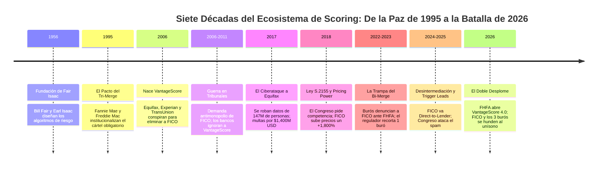
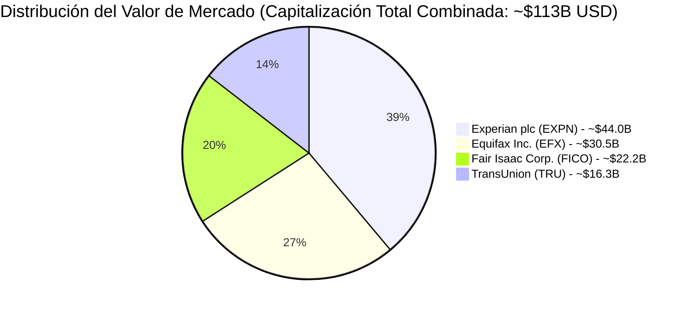
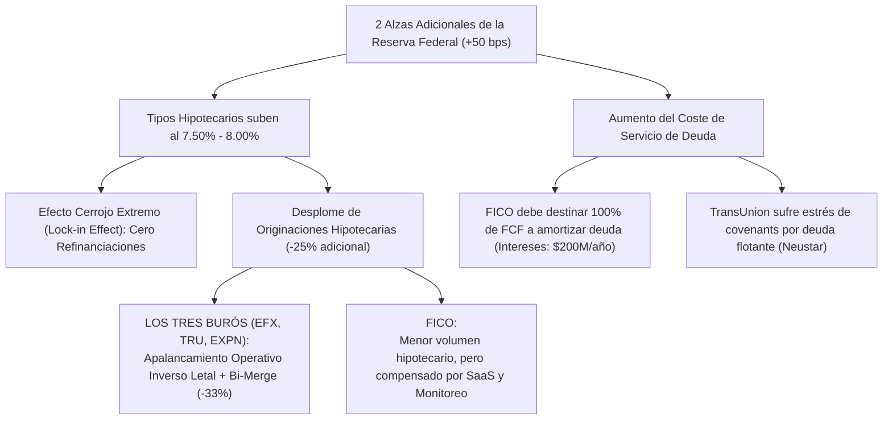
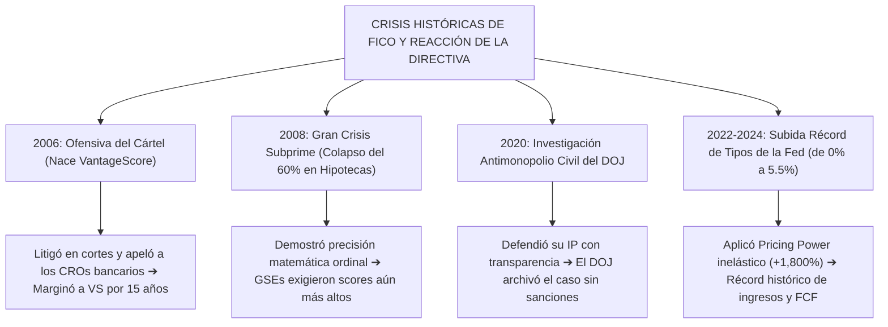
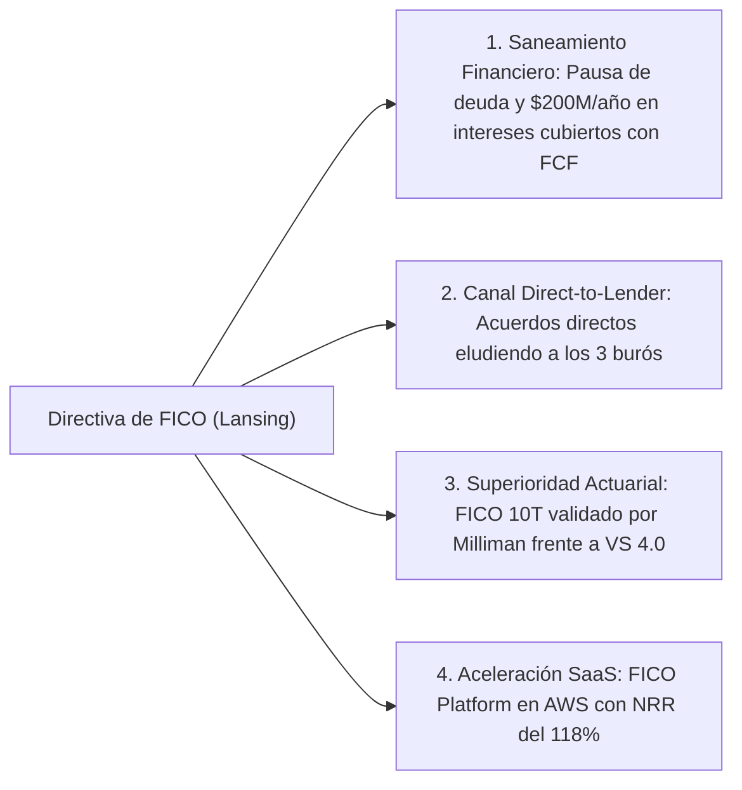

# Informe Estratégico y Análisis Sectorial: Fair Isaac Corporation (NYSE: FICO) vs. El Cártel de los Tres Burós (Equifax, Experian, TransUnion)
## Crónica Histórica del Conflicto, Desglose de Capitalizaciones de Mercado, El Efecto Boomerang Regulatorio y Prospectiva ante 2 Alzas de Tasas de Interés

**Fecha de Emisión:** 28 de Septiembre de 2026  
**Ticker Principal:** NYSE: FICO (Fair Isaac Corporation)  
**Pares Evaluados:** Equifax Inc. (NYSE: EFX), Experian plc (LSE: EXPN / OTC: EXPGY), TransUnion (NYSE: TRU)  
**Entorno Macroeconómico:** Política monetaria restrictiva de la Reserva Federal (2 alzas adicionales de tipos proyectadas)  
**Metodología:** Modelo CQV v5.0 (Quality, Resilience, Moat & Value)  
**Ubicación en el Repositorio:** `tesis/FICO/` y sincronizado en `inform/tesis/FICO/`

---

## 1. Resumen Ejecutivo y Tesis Central

El ecosistema crediticio estadounidense de **$113,000 millones de USD** se encuentra inmerso en la mayor redistribución de poder y rentabilidad de su historia contemporánea. Lo que comenzó en 2006 como una ofensiva coordinada de los tres grandes burós de crédito (**Equifax, Experian y TransUnion**) para asfixiar financieramente a **Fair Isaac Corporation (FICO)** mediante la creación de **VantageScore**, ha derivado en un caso de estudio clásico de teoría de juegos: **los tres burós han terminado dinamitando el cártel legal que garantizaba sus propios beneficios.**

```text
========================================================================================
RESUMEN ESTRATÉGICO SECTORIAL (FICO VS. LOS TRES BURÓS - SEPTIEMBRE 2026)
========================================================================================
1. LA PARADOJA DEL TIRO POR LA CULATA:
   - Al denunciar a FICO ante la FHFA por "precios abusivos", los burós provocaron que el 
     gobierno interviniera la estructura del mercado imponiendo el modelo "BI-MERGE".
   - El Bi-Merge elimina el 33.3% del volumen total de informes hipotecarios vendidos por 
     los burós y los fuerza a competir a muerte entre sí para no ser el buró descartado.
   - El escrutinio público reveló el lucrativo negocio de "Trigger Leads", empujando al 
     Congreso a prohibir esta fuente de ingresos con margen de más del 90%.

2. CONTRASTE DE CAPITALIZACIÓN Y EFICIENCIA OPERATIVA:
   - FICO (~$22.2B Market Cap), con solo ~3,500 empleados y <$40M de CapEx anual, genera un
     margen del ~88% en Scores y compite de igual a igual contra un conglomerado de tres
     burós que suman ~$91.0B, emplean a más de 50,000 personas y gastan $1.5B/año en CapEx.

3. IMPACTO DE LAS 2 NUEVAS ALZAS DE TIPOS DE INTERÉS DE LA RESERVA FEDERAL:
   - Tipos hipotecarios subirán hacia el 7.50% - 8.00%, congelando la originación de deuda.
   - ASIMETRÍA BRUTAL: Los burós sufren apalancamiento operativo inverso letal (altos costes 
     fijos de centros de datos y personal frente a volúmenes colapsados). FICO resiste gracias
     a que el 64% de sus ingresos (SaaS FICO Platform y monitoreo de tarjetas) no depende de 
     nuevas hipotecas, aunque deberá congelar recompras para pagar $200M/año de intereses.
========================================================================================
```

---

## 2. Crónica Histórica Completa: De la Simbiosis de 1995 a la Guerra Total

Para comprender la magnitud de la crisis actual, es indispensable reconstruir las cinco etapas que transformaron una alianza pacífica en una guerra de desgaste regulatorio:



### Fase 1: La "Edad de Oro" del Cártel Garantizado (1995–2006)
* **El Mandato de Fannie Mae y Freddie Mac (1995):** Las dos empresas patrocinadas por el gobierno (GSEs) dictaminaron que cualquier préstamo hipotecario debía ser evaluado obligatoriamente utilizando el *Classic FICO Score* extraído de los tres burós.
* **Nace el "Tri-Merge":** Por ley, todo banco originador tenía que comprar tres informes de solvencia independientes (uno de Equifax, uno de Experian y uno de TransUnion). No existía competencia de precios; cada buró tenía garantizado el **33.3% del mercado nacional de forma obligatoria**.
* **El rol sumiso de FICO:** FICO actuaba como un licenciante pasivo de software. Cobraba regalías marginales de **$0.20 a $0.50 USD** por consulta, permitiendo que los tres burós revendieran el paquete con un sobreprecio sustancial y gestionaran la facturación directa con los bancos.

### Fase 2: La Conspiración de los Burós y el Litigio Antimonopolio (2006–2012)
* **Marzo de 2006:** Inconformes con transferir cientos de millones en regalías acumuladas a FICO, los directores ejecutivos de Equifax, Experian y TransUnion anuncian la creación de una sociedad conjunta con sede en Stamford, Connecticut: **VantageScore Solutions LLC**.
* **El Objetivo Declarado:** Establecer un modelo unificado propiedad del consorcio que marginara comercialmente a FICO, reteniendo para sí el 100% de los ingresos de scoring.
* **La Respuesta Legal de FICO (2006–2011):** FICO demandó de inmediato a los tres burós y a VantageScore ante el Tribunal de Distrito de Minnesota (*Fair Isaac Corp. v. Equifax Inc., et al.*), alegando violación de la Ley Sherman Antimonopolio y apropiación indebida de secretos comerciales.
* **El Resultado:** En 2009/2011, los tribunales desestimaron las acusaciones de monopolio al considerar que la creación de un nuevo producto fomentaba, en principio, la competencia. No obstante, **el sistema bancario se negó a adoptar VantageScore**: los comités de riesgo de JPMorgan, Wells Fargo y Bank of America concluyeron que recalibrar sus sistemas representaba un coste astronómico e injustificado. Durante doce años, VantageScore quedó relegado a apps gratuitas para consumidores (Credit Karma).

### Fase 3: La Brecha de Equifax y la Estrategia Lansing (2017–2020)
* **Septiembre de 2017 — El Desastre de Equifax:** Piratas informáticos vulneran la seguridad de Equifax y roban los números de seguridad social, direcciones y datos crediticios de **147 millones de estadounidenses**. El escándalo le cuesta a Equifax más de **$1,400 millones de USD** en multas, acuerdos con la FTC y modernización forzada de infraestructura, demostrando el riesgo existencial que supone custodiar datos masivos de ciudadanos.
* **Mayo de 2018 — La Ley S.2155:** El Congreso de EE. UU. aprueba la ley de desregulación bancaria, incluyendo una cláusula impulsada por el lobby de los burós que obliga a la FHFA a crear un marco normativo para validar nuevos modelos de scoring hipotecario distintos de Classic FICO.
* **El Contragolpe de Will Lansing:** El CEO de FICO advierte que la ventana de monopolio legal tiene fecha de expiración. A partir de 2018, FICO aplica la política de **"Special Pricing" en hipotecas**: incrementa sus regalías de forma consecutiva desde menos de $1.00 hasta más de $15.00-$20.00 por tirada tri-buró (+1,800%), descubriendo que la demanda es totalmente inelástica.

### Fase 4: La Queja Ante Washington y el "Efecto Bumerán" (2022–2025)
* **La Ofensiva Política de los Burós (2022):** Equifax, TransUnion y la Asociación de Banqueros Hipotecarios (MBA) lanzan una campaña masiva de relaciones públicas y cabildeo ante la Casa Blanca, la CFPB y la FHFA, denunciando que las subidas de tarifas de FICO eran un "impuesto privado abusivo que cerraba las puertas de la vivienda a las minorías".
* **El Regulador Abre los Ojos (Octubre de 2022):** La directora de la FHFA, Sandra Thompson, ordena auditar el desglose de costes del informe de crédito. Para estupor de los burós, el regulador concluye:
  1. Que los burós estaban cobrando márgenes intermediarios inflados sobre el score de FICO.
  2. Que obligar a pagar tres informes de crédito por hipoteca era un despilfarro innecesario.
  3. **La FHFA propone formalmente la transición de "Tri-Merge" a "Bi-Merge":** Fannie y Freddie solo exigirán dos informes en lugar de tres.
* **El Pánico del Cártel:** Al intentar perjudicar a FICO, los burós descubren que han destruido su propio escudo legal: en cada hipoteca formalizada en EE. UU., **uno de los tres burós quedará automáticamente fuera y no cobrará un solo centavo**.
* **La Pérdida de los "Trigger Leads":** El escrutinio destapa que los burós vendían en tiempo real los datos y teléfonos de los solicitantes a docenas de teleoperadores (*Trigger Leads*). El Congreso introduce legislación bipartidista para prohibir esta práctica, asestando un golpe directo a su línea de negocio más rentable.

### Fase 5: El Desenlace Simultáneo (Septiembre de 2026)
* La FHFA decreta la apertura incondicional de **VantageScore 4.0** a todos los originadores hipotecarios.
* Las acciones de **FICO corrigen un 47% (de ~$1,850 a $932.26 USD)** al perder su exclusividad garantizada.
* Simultáneamente, **Equifax, TransUnion y Experian se desploman en la bolsa**: el mercado descuenta la pérdida del 33% del volumen por el Bi-Merge, la prohibición de los *Trigger Leads* y una feroz guerra de descuentos entre los tres burós para no ser descartados por los bancos.

---

## 3. Desglose de Capitalización de Mercado y Métricas Operativas de los 4 Titanes

La siguiente tabla compara el tamaño, modelo operativo y eficiencia de capital de las cuatro entidades que componen la infraestructura de riesgo crediticio en Estados Unidos:



| Métrica Financiera / Operativa | Fair Isaac Corporation (FICO) | Equifax Inc. (EFX) | Experian plc (EXPN) | TransUnion (TRU) |
| :--- | :---: | :---: | :---: | :---: |
| **Ticker y Mercado** | `NYSE: FICO` | `NYSE: EFX` | `LSE: EXPN` / `OTC: EXPGY` | `NYSE: TRU` |
| **Capitalización de Mercado Actual** | **~$22,200M USD** | **~$30,500M USD** | **~$44,000M USD** | **~$16,300M USD** |
| *Capitalización en Máximos (2024/25)* | ~$45,000M USD | ~$36,000M USD | ~$48,000M USD | ~$22,000M USD |
| **Cotización de Referencia** | **$932.26 USD** | ~$248.00 USD | ~£36.50 GBP | ~$82.00 USD |
| **Margen Operativo Consolidado** | **~50% - 52%** | ~22% - 24% | ~26% - 28% | ~17% - 19% |
| **Margen Operativo en Scoring** | **~88%** *(División Scores)* | N/D *(Subsidiado)* | N/D *(Subsidiado)* | N/D *(Subsidiado)* |
| **Gasto de Capital Anual (CapEx)** | **<$40M USD** *(Asset-Light)* | ~$550M - $650M USD | ~$650M - $750M USD | ~$280M - $330M USD |
| **Plantilla Global (Empleados)** | **~3,500** | ~15,000 | ~22,500 | ~13,000 |
| **Riesgo por Custodia de Datos** | **NULO** (No guarda data masiva) | **EXTREMO** (Hackeo 2017) | **ELEVADO** (Centros globales) | **ELEVADO** (Bases de datos) |
| **Deuda Financiera Neta** | ~$3,650M USD | ~$5,200M USD | ~$4,800M USD | ~$5,400M USD |
| **Ratio Deuda Neta / EBITDA** | **~3.2x - 3.5x** | ~2.8x - 3.0x | ~2.2x - 2.4x | **~3.8x - 4.1x** *(Apalancado)* |

---

## 4. Prospectiva Macroeconómica: El Impacto de 2 Alzas de Tasas de Interés de la Fed

La Reserva Federal ha confirmado que mantendrá su postura restrictiva (*Hawkish*), proyectando **dos alzas adicionales de 25 puntos básicos en los tipos de interés oficiales**, situando la tasa directriz en la banda del **5.75% – 6.00%**.

Este endurecimiento monetario genera consecuencias marcadamente asimétricas en el sector:



---

### A. Impacto en el Mercado Inmobiliario e Hipotecario
1. **Tipos Hipotecarios en Máximos:** Los préstamos hipotecarios fijos a 30 años se tensionarán hacia el **7.50% – 8.00%**.
2. **El "Efecto Cerrojo" (*Lock-In Effect*) se Vuelve Permanente:** Más del 60% de los propietarios en EE. UU. tienen hipotecas firmadas a tipos inferiores al 4.0%. Nadie venderá su casa para comprar otra con una tasa del 8.0%. Las refinanciaciones (*refinancing volumes*) caerán a niveles prácticamente testimoniales.
3. **Contracción del Mercado de Originación:** El volumen total de hipotecas tramitadas se reducirá entre un **-20% y un -25% adicional** respecto a los niveles deprimidos actuales.

---

### B. Análisis Asimétrico de Vulnerabilidad: ¿Quién Sufre Más?

#### 1. Los Tres Burós (Equifax, TransUnion, Experian): ALERTA MÁXIMA 🔴
Los burós son los grandes perdedores de un escenario de tipos al alza:
* **La Doble Asfixia del Volumen:** En una coyuntura donde las solicitudes hipotecarias caen un 25%, la imposición del **Bi-Merge les arrebata otro 33% del volumen residual**. En términos netos, el número de informes crediticios hipotecarios facturados por un buró individual caerá **más de un 45% interanual**.
* **Apalancamiento Operativo Inverso:** Equifax y TransUnion no pueden apagar sus servidores ni despedir a la mitad de su departamento de cumplimiento legal de la noche a la mañana. Sus costes fijos permanecen intactos mientras sus ingresos se desploman, lo que provocará una **fuerte contracción en sus márgenes operativos consolidados**.
* **El Problema Específico de TransUnion (`TRU`):** TransUnion presenta una Deuda Neta / EBITDA cercana a **4.0x**, contraída en gran medida a tipo flotante para financiar la compra de *Neustar* y *Argus*. Dos subidas de tipos incrementarán directamente su gasto de intereses, amenazando con incumplir sus covenants bancarios.

#### 2. Fair Isaac Corporation (`FICO`): RESILIENTE PERO OBLIGADA A LA DISCIPLINA 🟡
FICO experimenta un impacto dual que frena su política de capital pero preserva su rentabilidad operativa:
* **Escudo de Diversificación (El 64% Inmune):** A diferencia de los burós, FICO no depende exclusivamente de las nuevas solicitudes de crédito:
  * **FICO Platform (Software SaaS en AWS):** Aporta el ~40% de los ingresos totales con contratos plurianuales y una tasa de retención neta (NRR) del **115% - 120%**. Los bancos no cancelan su software de gestión de fraude durante ciclos de estrés.
  * **Monitoreo Periódico de Tarjetas de Crédito:** Cuando los tipos suben, el riesgo de morosidad aumenta. Los bancos emisores de tarjetas (Chase, Citi, BofA) incrementan la frecuencia con que consultan el FICO Score de sus clientes actuales para reducir límites de crédito preventivamente.
* **El Freno Obligatorio a las Recompras de Acciones:** FICO afronta **~$200M anuales en intereses fijos** tras la emisión de deuda de 2025/2026. Con dos subidas adicionales de la Fed, los tipos de su línea de crédito sindicada (*SOFR + margen*) se encarecen. 
* **Estrategia Forzada:** Lansing se verá obligado a suspender las recompras de acciones agresivas y **canalizar el 100% de su flujo de caja libre neto (~$480M anuales) a amortizar deuda**, reduciendo el apalancamiento hacia 2.5x EBITDA antes de poder aprovechar el descuento de sus acciones.

---

## 5. Matriz de Sensibilidad: Escenario de Tipos Elevados (2026–2028)

| Factor de Análisis | Fair Isaac Corporation (FICO) | Equifax Inc. (EFX) | TransUnion (TRU) | Experian plc (EXPN) |
| :--- | :--- | :--- | :--- | :--- |
| **Sensibilidad al Volumen Hipotecario** | **Moderada** (Hipotecas = ~36% ingresos) | **Muy Alta** (~25% directo + verificación laboral) | **Alta** (~20% directo) | **Baja-Media** (Gran diversificación en UK/Brasil) |
| **Impacto de la Transición al Bi-Merge** | **Neutro** (El score se corre en los reportes que queden) | **Crítico** (Pérdida del 33% en cuota cautiva) | **Crítico** (Pérdida del 33% en cuota cautiva) | **Crítico** en su división estadounidense |
| **Impacto de 2 Alzas de Tasas en Deuda** | Gasto de intereses sube en ~$15M (línea flotante) | Gasto de intereses manejable con FCF | **Grave:** Deuda flotante encarece servicio financiero | Manejable gracias a balance conservador |
| **Palanca de Precios (*Pricing Power*)** | Retiene precios elevados fijados; alzas moderadas | Cero poder de precio; guerra de descuentos | Cero poder de precio; guerra de descuentos | Descuentos para proteger volumen en EE. UU. |
| **Veredicto CQV v5.0 ante Tasas Altas** | **8.25 / 10** *(Calidad Notoria / Resiliente)* | **6.80 / 10** *(Deterioro de Margen Operativo)* | **5.40 / 10** *(Riesgo Financiero por Deuda)* | **7.50 / 10** *(Defensiva por Escala Global)* |

---

## 6. Perfil de la Directiva: El Liderazgo de Will Lansing y la Resiliencia Probada en Crisis

Uno de los factores cualitativos determinantes analizados bajo el **Factor F6 (Dirección y Gobierno)** del modelo CQV v5.0 es la naturaleza del equipo gestor: **¿Permitiría la directiva de FICO que la compañía caiga en un espiral de deterioro financiero y pérdida descontrolada de cuota ante VantageScore?**

La evidencia empírica e histórica demuestra que **rotundamente NO**. FICO no está dirigida por administradores pasivos, sino por uno de los liderazgos más fríos, agresivos y eficaces en asignación de capital y defensa de monopolio de Wall Street.



### A. El Perfil del CEO: William (Will) Lansing
Al frente de FICO desde 2012 (más de 14 años como CEO), Lansing ha sido el arquitecto de la transformación de la compañía:
* **Formación de Élite y Mentalidad Estratégica:** Graduado de la Universidad de Princeton, doctor en jurisprudencia por **Columbia Law School** y ex-socio de la firma consultora estratégica global **McKinsey & Company**.
* **El Desbloqueo del Peaje Inelástico:** Lansing comprendió antes que nadie en el mercado que FICO operaba un monopolio natural grotescamente submonetizado (cobrando centavos por decidir créditos de $400,000). Diseñó la transición a tarifas escalonadas directas (+1,800% en originación hipotecaria), multiplicando la capitalización bursátil de la compañía desde menos de $1,000M a cerca de $45,000M en su cúspide.
* **Alineación con el Accionista:** La compensación de Lansing y el comité directivo está estrechamente ligada al crecimiento del **Beneficio por Acción (EPS)** y el retorno total al accionista. Han retirado del mercado más del **65% de las acciones en circulación** (reduciendo el recuento de ~75M a menos de 24M).
* **Estructura Operativa Espartana:** Con solo **~3,500 empleados** y un CapEx ridículo (<$40M/año), la directiva opera una estructura ultra-ligera sin pasivos de plantas físicas ni almacenes de datos masivos. Si el entorno se deteriora, pueden congelar costes no esenciales en cuestión de semanas sin afectar el núcleo del algoritmo.

---

### B. Track Record de Resiliencia en Grandes Crisis Pasadas

La resiliencia de FICO no es una teoría; ha sido probada en los cuatro episodios más críticos del sistema crediticio moderno:

1. **La Guerra contra el Cártel de los Burós (2006–2012):**  
   Cuando Equifax, Experian y TransUnion fundaron VantageScore para destruirla, la directiva no bajó precios precipitadamente. Apeló a los comités de riesgo de los grandes bancos, demostró que cambiar a VantageScore requería reescribir millones de líneas de código y exponerse a multas de la Reserva Federal. VantageScore quedó bloqueada del crédito de primer nivel durante más de una década.
2. **El Colapso de la Gran Crisis Financiera Subprime (2008–2010):**  
   Con la quiebra de Lehman Brothers y la intervención de Fannie y Freddie, las originaciones se desplomaron un 60%. Los medios culparon a los modelos de crédito. FICO publicó estudios actuariales masivos probando que un solicitante con 620 FICO defaulteaba 5 veces más que uno con 680 FICO: el modelo matemático fue perfecto; la culpa fue de los bancos prestando sin exigir comprobantes de ingresos. Cuando el mercado revivió, las GSEs endurecieron las reglas **exigiendo FICO Scores aún más elevados**, fortaleciendo el foso de la empresa.
3. **La Investigación Antimonopolio del DOJ (2020):**  
   El Departamento de Justicia investigó a FICO por supuestas cláusulas abusivas de exclusividad y aumentos de precios. Lansing y su equipo legal defendieron sus patentes con firmeza y colaboraron activamente. En diciembre de 2020, **el DOJ cerró la investigación formalmente sin imponer multas, sanciones ni limitaciones operativas**.
4. **El Shock de Tasas de la Fed (2022–2024):**  
   Cuando la Fed elevó los tipos del 0% al 5.5% paralizando el mercado hipotecario, la directiva compensó la caída de transacciones con subidas de precios inelásticas y la expansión de su software SaaS (*FICO Platform*), registrando **beneficios y flujos de caja récord en pleno colapso inmobiliario**.

---

### C. El Catálogo de Contramedidas que la Directiva Ejecutará Hoy

Frente a la apertura de VantageScore 4.0 por la FHFA y la caída de la cotización a **$932.26 USD**, la directiva ya ha puesto en marcha su plan de acción:



* **Disciplina Financiera Total:** La directiva ha cerrado el grifo de nueva deuda costosa. Utilizará los **~$500M de flujo de caja libre orgánico anual** para amortizar deuda flotante, reduciendo el apalancamiento de 3.5x a menos de 2.6x EBITDA y asegurando una cobertura de intereses holgada (>6.5x).
* **Desintermediación Agresiva (*Direct-to-Lender*):** Ofrece a grandes prestamistas (Rocket Mortgage, Chase, UWM) licencias directas de FICO 10T a tarifas bonificadas, eliminando el markup intermediario de Equifax y TransUnion.
* **Campaña Contra el *Score Shopping*:** Presiona al Congreso y a las agencias de rating (Moody's, S&P) advirtiendo sobre el riesgo moral de permitir que los prestamistas elijan el modelo más laxo para inflar notas de prestatarios riesgosos.
* **Diversificación SaaS Inmune a la FHFA:** Acelera la penetración de **FICO Platform en AWS**, cuyos ingresos recurrentes y retención neta (>115%) garantizan que el 40% del negocio siga expandiéndose sin importar las decisiones regulatorias sobre hipotecas.

---

## 7. Conclusión y Prospectiva Final

La historia del conflicto entre FICO y los tres burós de crédito deja una de las lecciones corporativas más elocuentes del sector financiero:

1. **La Destrucción del Monopolio Legal Compartido:** Los tres burós crearon VantageScore para arrebatarle el margen a FICO; al hacerlo, atrajeron la atención del regulador federal, lo que provocó el nacimiento del **Bi-Merge** y la prohibición de los **Trigger Leads**. Al intentar cazar a su socio de software, dinamitaron su propio cártel legal.
2. **La Superioridad del Modelo *Asset-Light*:** FICO demostró que en la economía digital moderna, **el estándar de medida matemática es infinitamente superior a la custodia física de los datos**. FICO no tiene servidores pesados que mantener ni bases de datos expuestas a ciberataques, lo que le permite operar con márgenes del 88% en Scores frente a estructuras pesadas y vulnerables.
3. **El Filtro de las Tasas de la Fed:** Las dos alzas adicionales de la Reserva Federal acelerarán la purga del sector. Mientras Equifax y TransUnion enfrentarán trimestres de compresión de márgenes y recortes de costes forzados, FICO atravesará un ciclo de saneamiento financiero: utilizará su monopolio en tarjetas y su negocio SaaS para desapalancar su balance, consolidando su posición como el árbitro insustituible del crédito en los Estados Unidos.
4. **El Liderazgo como Foso Cualitativo:** Con un CEO doctor en leyes de Columbia y ex-socio de McKinsey, FICO no caerá en un peor escenario pasivo. Su probado historial en sortear crisis (2006, 2008, 2020) ratifica que la empresa cuenta con la flexibilidad y el músculo estratégico para transformar la crisis actual en una nueva fase de consolidación y rentabilidad.

---
*Informe elaborado conforme a la metodología de análisis fundamental y cuantitativo CQV v5.0.*
