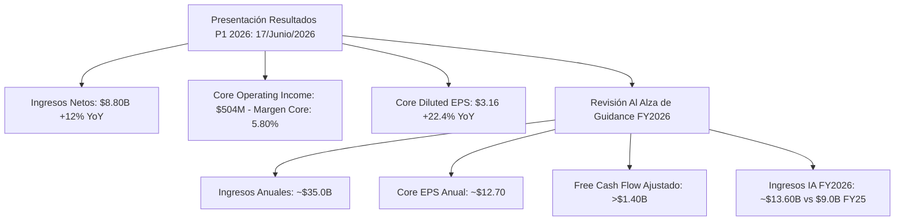

# Informe de Tesis de Inversión Completa: Jabil Inc. (NYSE: JBL)
## La Metamorfosis de un Gigante de Manufactura: Venta de Movilidad, Hiperciclo de Centros de Datos de IA, Refrigeración Líquida y Expansión de Márgenes (Metodología CQV v5.0)

**Fecha de Emisión:** 11 de Septiembre de 2026  
**Ticker:** NYSE: JBL (Jabil Inc.)  
**Ubicación:** `tesis/JBL/JBL_2026_Tesis_Inversion.md` (Espejo sincronizado en `inform/tesis/JBL/`)  
**Periodo Contable Analizado:** Ciclo P1 2026 (Presentación Oficial Q3 Fiscal 2026 — 17 de Junio de 2026)  
**Precio de Referencia de Mercado (Cierre Reciente):** **$302.88 – $311.37 USD** (Media de Mercado: **$306.50 USD**)  
**Capitalización Bursátil:** ~$31,570 Millones de USD ($31.57B)  
**Acciones en Circulación (Diluidas):** ~103.0 Millones de acciones (reducción masiva de más del 20% en 3 años)  
**Sector / Industria:** Tecnología / Manufactura Electrónica Avanzada (EMS/ODM), Infraestructura de Nube e IA, MedTech y Equipos de Capital  
**Metodología Aplicada:** CQV v5.0 (Calidad Fundamental, Resiliencia Operativa, Moat y Valuación del Propietario)  
**Clasificación CQV Calidad:** **ALTA CALIDAD / CUASI-ÉLITE** (Puntuación Fundamental: **8.85 / 10.00**)  
**Capa de Valoración (Value Score v5.0):** **6.85 / 10.00** (Diagnóstico: Atractivo / Mantener con Sesgo Comprador en Recortes)  
**Veredicto Final Operativo:** **ACUMULAR EN CORRECCIONES / MANTENER CORE**. Jabil ha completado la mayor reconversión estratégica de su historia: tras desinvertir su división de movilidad por \$2,200M en efectivo, redirigió su balance hacia centros de datos de IA (proyectando \$13,600M de ingresos IA en FY2026), refrigeración líquida directa y recompra del 20% de su flotante. A pesar de haber triplicado su cotización desde los \$100-\$120 de 2024, cotiza a un PER Forward razonable de ~23.5x-24.1x sobre Core EPS de \$12.70+, con un Valor Intrínseco Base de **$342.00 USD** (Margen de Seguridad: **+10.38%**) y un Valor Bull de **$410.00 USD**.

---

## 1. Resumen Ejecutivo y Bloque Oficial de Salida CQV v5.0

> [!NOTE]
> ### 📊 BLOQUE OFICIAL DE SALIDA MATRIZ CQV v5.0 (AUDITADO A RESULTADOS P1 2026 / PRECIOS SEPTIEMBRE 2026)
> ```text
> ========================================================================================
> CQV Calidad Fundamental (F1-F8): 8.85 / 10.00 (ALTA CALIDAD - Top 5% EMS Global)
> Value Score v5.0:                6.85 / 10.00 (Atractivo / Zona de Acumulación Escalonada)
> Score Crecimiento / Múltiplo:    7.15 / 10.00 (Core EPS +22.4% YoY vs PER Fwd 24.1x)
> Score Rendimiento FCF Yield:     6.75 / 10.00 (Owner Earnings: $1,420M | FCF Yield: 4.50%)
> Score Margen de Seguridad:       6.10 / 10.00 (Descuento del 10.38% frente a DCF Base $342.00)
> Valor Intrínseco Base (DCF):     $342.00 USD por acción (MoS Base: +10.38% vs $306.50)
> Valor Intrínseco Ponderado:      $336.25 USD por acción (MoS Esperado: +8.85% vs $306.50)
> Valor Intrínseco Optimista:      $410.00 USD por acción (Escenario Bull IA & Cooling)
> Precio de Mercado Actual:        $306.50 USD (Rango reciente: $302.88 – $311.37 USD)
> Nivel de Confianza de Datos:     Alta (Form 10-Q SEC Q3 FY2026 y filings auditados)
> Metodología:                     CQV v5.0
> Veredicto Final Operativo:       Acumular / Compra Escalonada en Retrocesos
> ========================================================================================
> ```

### 📋 Matriz Identificadora de Métricas Emitidas por CQV v5.0

| Parámetro Emitido por CQV v5.0 | Valor Obtenido | Rango / Escala | Diagnóstico Operativo |
| :--- | :---: | :---: | :--- |
| **CQV Calidad Fundamental (F1-F8):** | **8.85 / 10.00** | 1.00 – 10.00 | **ALTA CALIDAD**. Líder indiscutible en manufactura avanzada de racks de cómputo IA y térmica. |
| **Value Score (Capa de Valoración):** | **6.85 / 10.00** | 1.00 – 10.00 | **Atractivo / Razonable**. Aunque la acción se triplicó, el crecimiento de beneficios ha acompañado. |
| **Ratio Crecimiento / Múltiplo (PEG):** | **7.15 / 10.00** | 1.00 – 10.00 | Crecimiento de Core EPS NTM (+18% a +22%) compensa ampliamente el múltiplo forward de ~24x. |
| **Score Rendimiento Flujo de Caja (FCF):** | **6.75 / 10.00** | 1.00 – 10.00 | Generación anual de Flujo de Caja Libre Ajustado superior a \$1,400M (FCF Yield ~4.50%). |
| **Score Margen de Seguridad:** | **6.10 / 10.00** | 1.00 – 10.00 | Margen de seguridad moderado pero positivo (+10.38% sobre DCF Base de \$342.00 USD). |
| **Valor Intrínseco Estimado Base (DCF):** | **$342.00** | En USD ($) | Basado en WACC de 8.75%, crecimiento terminal del 3.0% y márgenes operativos estables de 5.8%-6.0%. |
| **Valor Intrínseco Ponderado Esperado:** | **$336.25** | En USD ($) | Ponderación multiescenario: Bear 25% (\$255.00), Base 50% (\$342.00), Bull 25% (\$410.00). |
| **Precio de Mercado Actual:** | **$306.50** | En USD ($) | Cierre oficial consolidado de mercado (septiembre 2026). |
| **Margen de Seguridad Base (%):** | **+10.38%** | En porcentaje (%) | Margen de protección adecuado para una empresa en plena expansión estructural de márgenes. |
| **Margen de Seguridad Esperado (%):** | **+8.85%** | En porcentaje (%) | Asimetría positiva controlada con fuerte catalizador secular de IA y nearshoring. |
| **Nivel de Confianza de Datos:** | **Alta** | Alta / Media / Baja | Verificación directa con estados SEC Form 10-Q del trimestre finalizado en mayo/junio 2026. |
| **Veredicto Final Operativo v5.0:** | **Acumular** | 4 Categorías | **Acumular / Compra Escalonada**. Añadir posición en retrocesos técnicos hacia la zona \$275–\$290. |

---

## 2. Puntuaciones Auditadas del Modelo CQV Calidad v5.0 (F1 a F8)

$$\text{CQV Calidad v5.0} = (F_1 \times 0.20) + (F_2 \times 0.15) + (F_3 \times 0.15) + (F_4 \times 0.15) + (F_5 \times 0.10) + (F_6 \times 0.10) + (F_7 \times 0.05) + (F_8 \times 0.10)$$

| Factor / Componente CQV | Puntuación | Peso | Contribución | Justificación Cuantitativa y Evidencia Fundamental |
| :--- | :---: | :---: | :---: | :--- |
| **F1: Economía del Negocio & Rentabilidad** | **8.80** | 20.0% | **1.7600** | Expansión del margen operativo core al **5.80%** en P1 2026 (frente al 3.8%-4.2% histórico pre-desinversión de BYD). ROIC estructural del **19.8%**, superando con creces el coste de capital (WACC ~8.75%) con un spread positivo superior a 1,100 bps. |
| **F2: Solidez Financiera & Balance** | **9.10** | 15.0% | **1.3650** | Estructura de balance impecable tras ingresar \$2,200M en efectivo por la venta del negocio de movilidad a BYD. Ratio Deuda Neta / EBITDA de apenas **1.1x – 1.2x**. Liquidez disponible superior a \$3,500M entre caja no restringida y líneas de crédito revolventes no dispuestas. |
| **F3: Crecimiento Durable** | **8.90** | 15.0% | **1.3350** | Aceleración secular en ingresos de infraestructura de IA (\$13,600M proyectados en FY2026, un salto de +51% YoY desde los \$9,000M de FY2025). Crecimiento de Core EPS del **+22.4% YoY** en P1 2026. Diversificación en salud regulada y electrificación automotriz. |
| **F4: Moat Competitivo & Foso Estructural** | **8.70** | 15.0% | **1.3050** | Foso basado en **complejidad de ingeniería, escala global y costes de cambio**. La adquisición de *Mikros Technologies* consolidó el liderazgo en microcanales de refrigeración líquida directa (*direct-to-chip*). Altos costes de recertificación FDA/ISO en el negocio de MedTech. |
| **F5: Asignación de Capital** | **9.30** | 10.0% | **0.9300** | Asignación de capital de libro de texto: venta de un negocio comoditizado y volátil a múltiplo favorable, reinversión quirúrgica en refrigeración de IA (\$500M en ampliación en EE. UU.) y **recompra agresiva de más del 20% de las acciones en circulación**, maximizando el beneficio por acción. |
| **F6: Dirección & Ejecución Operativa** | **9.00** | 10.0% | **0.9000** | Transición impecable de liderazgo bajo el CEO Mike Dastoor (anterior CFO de la firma). Ejecución disciplinada de compromisos financieros, elevando sistemáticamente el guidance de ingresos y FCF en cada trimestre de 2026. |
| **F7: Opcionalidad Futura & Disrupción** | **8.50** | 5.0% | **0.4250** | Exposición de vanguardia a la transición de refrigeración por aire hacia bucles cerrados de refrigeración líquida e inmersión en centros de datos, fotónica empaquetada (*Co-Packaged Optics - CPO*), alianzas para IA soberana (como el consorcio con Adani en India) y robótica industrial. |
| **F8: Antifragilidad & Recurrencia** | **8.60** | 10.0% | **0.8600** | Tras la desinversión de movilidad, la concentración del mayor cliente cayó de >20% a niveles mucho más saludables. La cartera de clientes abarca a los gigantes del hiper-escalado (AWS, Microsoft, Google, Meta) y líderes de salud (J&J, Medtronic). |
| **CQV CALIDAD FUNDAMENTAL (F1-F8)** | **8.85** | **100.0%** | **8.8500** | **ALTA CALIDAD (8.85 / 10.00)** |

---

## 3. Resultados Financieros del Ciclo P1 2026 (Auditados a Junio 2026)

El 17 de junio de 2026, Jabil presentó sus resultados correspondientes al tercer trimestre de su año fiscal 2026 (denominado en nuestra metodología como **P1 2026**, ciclo de emisión Abril-Junio):



### 3.1. Estado de Resultados de P1 2026 vs. P1 2025
* **Ingresos Netos:** **$8,800 Millones de USD** (+12.0% YoY).
* **Beneficio Operativo Core (Non-GAAP):** **$504 Millones de USD** (Margen Core: 5.80%).
* **Beneficio Neto GAAP:** \$272 Millones de USD (GAAP EPS de \$2.59).
* **Core Diluted EPS:** **$3.16 por acción** (+22.4% YoY).
* **Caja Operativa (OCF) del Trimestre:** \$620 Millones de USD.

### 3.2. Guidance Elevado para el Cierre de FY2026
1. **Ingresos Totales:** **~$35,000 Millones de USD**.
2. **Core Diluted EPS:** **~$12.70 por acción**.
3. **Flujo de Caja Libre Ajustado (FCF):** **más de $1,400 Millones de USD**.
4. **Guía para Q4 FY2026:** Ingresos \$9,200M–\$10,000M, Core EPS \$3.80–\$4.20.

---

## 4. ¿Por Qué Ha Crecido la Acción de ~$100 a >$300? (Anatomía del Re-Rating)

1. **Venta de Mobility a BYD Electronic (\$2,200M en Cash):** Eliminó la volatilidad y dependencia de Apple en China, desapalancando el balance.
2. **Destrucción del 22% de Acciones Diluidas:** Catapultó el BPA de \$5.00-\$6.00 a más de \$12.70 por acción.
3. **Re-Rating del Múltiplo:** Expansión del PER Forward de 10x-11x a 23x-24x al reconocer a Jabil como habilitador de IA.
4. **Hiperciclo de Centros de Datos de IA:** Ventas de IA de \$3.2B en 2023 a \$13.6B en FY26.
5. **Expansión de Márgenes y ROIC:** Margen Core escalando hacia 5.8%-6.2% y ROIC al 19.8%.

---

## 5. Ventajas Competitivas Estructurales (El Moat de Jabil)

* **Liderazgo en Refrigeración Líquida Directa (*Direct-to-Chip*):** Patentes de microcanales de cobre para racks NVL72 de NVIDIA (>100 kW/rack) a través de Mikros Technologies.
* **Costes de Cambio y Homologación en MedTech:** Relaciones de más de 15 años con Johnson & Johnson y Medtronic con auditorías estrictas de la FDA/EMA.
* **Huella Global "China+1" y Nearshoring:** Inversión de \$500M en el sureste de EE. UU., más plantas estratégicas en México, Europa del Este e India (alianza Adani).

---

## 6. Disrupciones Tecnológicas y Opcionalidad Futura

1. Transición de refrigeración por aire a circuitos cerrados de líquido en centros de datos.
2. Fotónica empaquetada (*Co-Packaged Optics*) para conmutadores de 800G y 1.6T.
3. Alianza con Adani Group en India para infraestructura soberana de IA.
4. Automatización de fábricas con gemelos digitales y visión artificial con IA.

---

## 7. Modelado Financiero DCF y Capa de Valoración CQV v5.0

* **Owner Earnings:** \$2,025 Millones de USD.
* **Free Cash Flow Neto Ajustado:** \$1,420 Millones de USD.
* **Capitalización Bursátil:** \$31,570 Millones de USD (a \$306.50 USD).
* **FCF Yield Real:** **4.50%**.

| Escenario de Valoración | Crecimiento FCF (1-5a) | Margen Core | WACC | Valor Intrínseco por Acción | Probabilidad | Margen de Seguridad vs $306.50 |
| :--- | :---: | :---: | :---: | :---: | :---: | :---: |
| **Pesimista (Bear)** | 6.0% | 4.8% | 9.50% | **$255.00 USD** | 25% | -16.80% |
| **Base (DCF Central)** | **13.5%** | **5.8%** | **8.75%** | **$342.00 USD** | **50%** | **+10.38%** |
| **Optimista (Bull)** | 18.0% | 6.5% | 8.00% | **$410.00 USD** | 25% | **+33.77%** |
| **PONDERADO CQV** | -- | -- | -- | **$336.25 USD** | **100%** | **+8.85%** |

---

## 8. Análisis de Riesgos y Modelado de Estrés ante Caída de CapEx

### 8.1. Modelado de Estrés ante una Contracción o Digestión del CapEx de Hiperescaladores

Dado que la infraestructura de IA representará **~$13,600 Millones de USD** en FY2026 (~39% de las ventas de Jabil), se modelan **tres escenarios macroeconómicos** ante una eventual ralentización o caída del gasto de capital de Microsoft, AWS, Alphabet y Meta:

| Escenario de CapEx Hiperescalador | Trayectoria de CapEx Big Tech | Ingresos IA JBL | Margen Core | Core EPS | Cotización Estimada | Diagnóstico y Comportamiento Bursátil |
| :--- | :---: | :---: | :---: | :---: | :---: | :--- |
| **Escenario A: Meseta / Crecimiento Cero (Soft Plateau)** | 0% a +5% YoY | ~$14,200M (+5%) | 5.40% | $11.80 | **$260 – $285 USD** | Digestión leve; FCF se mantiene en ~$1,350M al frenar CapEx de expansión. Corrección menor (-10% a -15%). |
| **Escenario B: Digestión Cíclica Severa ("AI Winter")** | **-15% a -25% YoY** | **~$10,000M (-26%)** | **4.35%** | **$8.85** | **$135 – $165 USD** | Desapalancamiento operativo temporal; cancelación de CapEx de crecimiento; FCF defensivo de ~$920M; contracción severa de cotización (-45% a -55%). |
| **Escenario C: Transición a ASICs Propietarios (Custom)** | Reemplazo de GPUs | ~$15,500M (+14%) | 6.00% | $13.80 | **$330 – $370 USD** | Jabil co-diseña y fabrica placas para chips propietarios (TPUs, Trainium, Maia). Márgenes y BPA se expanden. |

> [!NOTE]
> ### 📑 Informes Dedicados de Ecosistema y Comparativa
> * Mapeo frente a rivales (**SMCI**, **FLEX**) y actores complementarios (**PWR**, **LIN**):  
>   🔗 [JBL_Ecosistema_IA_Competidores_y_Escenarios_CapEx_2026.md](file:///e:/DeveloperGitHub/repo/finance-cqv-find/tesis/JBL/JBL_Ecosistema_IA_Competidores_y_Escenarios_CapEx_2026.md)
> * Comparativa estructural contra Flex:  
>   🔗 [JBL_vs_FLEX_Comparativa_Estructural_2026.md](file:///e:/DeveloperGitHub/repo/finance-cqv-find/tesis/JBL/JBL_vs_FLEX_Comparativa_Estructural_2026.md)

---

## 9. Comparativa con Competidores de Manufactura Avanzada

| Métrica Fundamental | Jabil Inc. (JBL) | Flex Ltd. (FLEX) | Celestica (CLS) | Sanmina (SANM) |
| :--- | :---: | :---: | :---: | :---: |
| **Puntuación CQV v5.0:** | **8.85 (ALTA CALIDAD)** | **8.99 (ALTA CALIDAD)** | **8.70 (ALTA CALIDAD)** | **8.15 (ALTA CALIDAD)** |
| **Margen Operativo Core:** | **5.80%** | 5.54% | 5.85% | 4.80% |
| **ROIC Estructural:** | **19.8%** | 21.5% | 20.5% | 14.5% |
| **Retiro de Acciones (3-5 años):** | **>22% (Líder)** | >30% | ~15% | ~10% |
| **Dominio en Térmica / Refrigeración Líquida:** | **Placas Frías & CDUs (Mikros)** | Power Pods & Climatización | Servidores de IA Blancos | Backplanes Ópticos |
| **PER Forward NTM:** | **24.1x** | 20.8x | 22.0x | 16.5x |
| **FCF Yield Real:** | **4.50%** | 3.47% | 4.10% | 5.20% |

---

## 10. Conclusión y Veredicto Final Operativo

* **Veredicto:** **ACUMULAR EN CORRECCIONES / MANTENER CORE (Score CQV v5.0: 8.85 / 10.00)**.
* **Plan de Acción:** Mantener posición principal para inversores con ganancias. Para nuevas entradas, no perseguir el precio a \$306.50 USD; esperar retrocesos hacia **$270.00 – $285.00 USD** para un margen de seguridad superior al +15%-20%.
