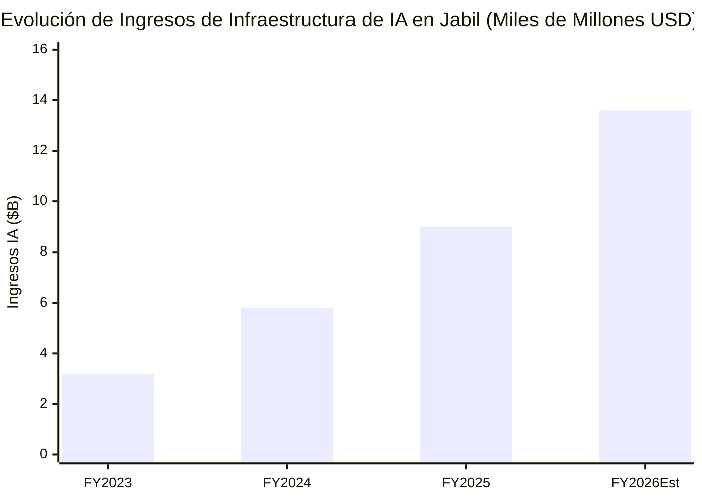
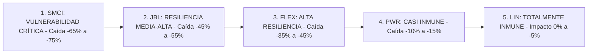

# Informe Estratégico y de Estrés de Cartera: Jabil Inc. (NYSE: JBL)
## Mapeo del Ecosistema de Infraestructura de IA (JBL vs. FLEX vs. SMCI vs. PWR vs. LIN) y Modelado Multiescenario ante una Contracción del CapEx de Hiperescaladores

**Fecha de Emisión:** 11 de Septiembre de 2026  
**Ubicación:** `tesis/JBL/JBL_Ecosistema_IA_Competidores_y_Escenarios_CapEx_2026.md` (Espejo sincronizado en `inform/tesis/JBL/`)  
**Metodología Aplicada:** CQV v5.0 (Calidad Fundamental, Moat, Resiliencia y Valuación del Propietario)  
**Activo Núcleo Analizado:** Jabil Inc. (NYSE: JBL) — Precio Ref.: **$306.50 USD** | Market Cap: **$31.57B** | Score CQV: **8.85 / 10**  
**Pares Comparativos y de Ecosistema:** Flex Ltd. (FLEX), Super Micro Computer (SMCI), Quanta Services (PWR), Linde plc (LIN)

---

## 1. Mapeo Integral de la Cadena de Valor de Centros de Datos de IA

En el despliegue global de centros de datos para Inteligencia Artificial generativa y computación acelerada, los inversores frecuentemente confunden los roles de los distintos proveedores. A continuación se define con rigor técnico la posición de cada compañía:

```mermaid
graph TD
    subgraph 1. Química y Gases Ultrapuros para Fabricación de Silicio
        LIN[Linde plc - LIN: Gases Criogénicos Argón/Helio/Nitrógeno] --> FAB[Foundries: TSMC / Intel / Samsung]
    end
    
    subgraph 2. Infraestructura Eléctrica Pesada de Red Exterior
        GRID[Generación Eléctrica: Nuclear / Gas / Renovable] --> PWR[Quanta Services - PWR: Líneas 500 kV y Subestaciones Masivas]
        PWR --> SITE[Perímetro del Campus de Centro de Datos]
    end
    
    subgraph 3. Entrada al Edificio y Distribución de Potencia Modular
        SITE --> FLEX_P[Flex Ltd. - FLEX: Módulos Power Pods y Transformación 800V]
        FLEX_P --> ROOM[Sala de Servidores Blanca]
    end
    
    subgraph 4. Computación en Rack, Refrigeración Líquida y Conmutación Óptica
        FAB --> CHIPS[GPUs NVIDIA Blackwell / ASICs Custom Nube]
        ROOM --> RACK{Integración de Racks de IA de Misión Crítica}
        CHIPS --> RACK
        
        RACK --> JBL_T[JABIL - JBL: Microcanales Liquid Cooling Mikros Tech y Ensamble JDM]
        RACK --> FLEX_T[FLEX - FLEX: Power & Thermal y Ensamble Modular]
        RACK --> SMCI_T[SMCI - Supermicro: Servidores Preconfigurados de Marca Propia]
    end
```

### Tabla de Posicionamiento Competitivo y Relación con Jabil (JBL):

| Empresa | Ticker | Sector / Industria | ¿Compite con JBL? | Rol Específico en la Cadena de IA | Score CQV v5.0 | Veredicto CQV v5.0 |
| :--- | :---: | :--- | :---: | :--- | :---: | :---: |
| **Jabil Inc.** | **JBL** | Tecnología / Manufactura Avanzada | *Actor Base* | Diseño e integración de racks de IA, placas frías *direct-to-chip* de microcanales (Mikros Technologies), conmutadores 800G/1.6T. | **8.85 / 10** | **Acumular en Recortes** |
| **Flex Ltd.** | **FLEX** | Tecnología / Manufactura Avanzada | **SÍ, RIVAL DIRECTO** | Integración de racks de IA, distribución de potencia modular (*Power Pods*), climatización industrial y ensamblaje de servidores. | **8.99 / 10** | **Comprar** |
| **Super Micro Computer** | **SMCI** | Tecnología / Servidores y Storage | **SÍ, RIVAL DIRECTO** | Fabricación de servidores preconfigurados de IA con refrigeración líquida bajo marca propia (*Supermicro*). | **7.78 / 10** | **En Observación (Riesgo Contable)** |
| **Quanta Services** | **PWR** | Industriales / Infraestructura Eléctrica | **NO, COMPLEMENTARIO** | Mayor contratista EPC de EE. UU.: tiende las líneas de alta tensión y construye subestaciones exteriores gigantes. | **9.06 / 10** | **Comprar** |
| **Linde plc** | **LIN** | Materiales Básicos / Gases Industriales | **NO, PROVEEDOR PREVIO** | Suministra gases ultrapuros (nitrógeno, argón, helio) a TSMC e Intel para que puedan grabar los chips en sala blanca. | **9.48 / 10** | **Comprar (Élite)** |

---

## 2. Radiografía del Riesgo: La Dependencia del CapEx de los Hiperescaladores

Entre 2023 y 2026, el gasto de capital (*CapEx*) de los cuatro mayores gigantes de la nube (**Microsoft Azure, Amazon AWS, Alphabet Google Cloud y Meta Platforms**) experimentó una expansión sin precedentes, escalando desde los \$140,000M anuales combinados hasta superar los **$220,000M – $240,000M anuales en 2026**.

Este flujo masivo de capital es el motor que catapultó los ingresos de infraestructura de IA de Jabil desde niveles marginales hasta **$13,600 Millones de USD proyectados para el cierre fiscal de 2026** (~39% de sus ingresos consolidados).



---

## 3. Modelado Multiescenario Cuantitativo: ¿Qué Pasa si el CapEx de IA Decrece?

Bajo la metodología **CQV v5.0**, sometemos los estados financieros de **Jabil (JBL)** y de sus pares a **tres escenarios de estrés operativo**:

```mermaid
graph TD
    CAPEX[Trayectoria del CapEx de Hiperescaladores] --> ESC_A[Escenario A: Meseta / Crecimiento Plano 0% a +5%]
    CAPEX --> ESC_B[Escenario B: Digestión Cíclica Severa -15% a -25% YoY]
    CAPEX --> ESC_C[Escenario C: Transición a ASICs Custom / Inferencia]
    
    ESC_A --> RES_A[JBL Core EPS: $11.50 - $12.20 | Cotización: $260 - $290]
    ESC_B --> RES_B[JBL Core EPS: $8.50 - $9.20 | Cotización: $135 - $165]
    ESC_C --> RES_C[JBL Core EPS: $13.00 - $14.50 | Cotización: $320 - $370]
```

### Escenario A: Meseta / Normalización del CapEx (Soft Plateau)
* **Definición Macroeconómica:** Crecimiento del CapEx hiperescalador entre el **0% y el +5% anual** durante 18 a 24 meses.
* **Impacto en Jabil (JBL):**
  * **Ingresos de IA:** Crecen a un ritmo moderado del **+5% al +8% anual**.
  * **Ingresos Consolidados:** Se estabilizan en torno a **$34,500M – $36,000M**.
  * **Margen Operativo Core:** Cede ligeramente al **5.30% – 5.50%**.
  * **Core EPS:** Se sitúa en **$11.50 – $12.20 USD**.
  * **Flujo de Caja Libre (FCF):** Se mantiene robusto en **~$1,300M – $1,400M** (reducción de CapEx de expansión).
  * **Cotización Estimada:** Rango de **$250.00 – $280.00 USD** (un retroceso del 10%–18% desde máximos).

---

### Escenario B: Digestión Cíclica Severa / "AI Winter" (Caída de CapEx del -15% al -25%)
* **Definición Macroeconómica:** Recesión o desilusión temporal con la monetización de software de IA. Recorte del CapEx en un **-15% a -25% interanual** durante 12 a 18 meses.
* **Impacto Financiero Modelado en Jabil (JBL):**
  * **Ingresos de IA:** Caen de \$13,600M a **~$9,800M – $10,200M** (-26% de contracción).
  * **Ingresos Consolidados:** Se contraen hacia los **$29,500M – $30,500M** (-14% total).
  * **Margen Operativo Core:** Se comprime al **4.20% – 4.50%** por desapalancamiento operativo en factorías nuevas.
  * **Core EPS:** Cae a **$8.50 – $9.20 USD por acción** (-28% a -33%).
  * **Flujo de Caja Libre Defensivo:** Congelación de CapEx de expansión y liquidación de circulante generan **$850M – $1,000M de FCF**.
  * **Compresión de Múltiplo PER:** De 24x hacia **15x – 17x**.
  * **Cotización Estimada en Estrés:** **$135.00 – $165.00 USD** (corrección del **-45% al -55%**).

#### Tabla de Sensibilidad en Escenario B (Caída Severa de CapEx):

| Métrica Financiera | Situación Actual (P1 2026 / FY26E) | Escenario B (Digestión CapEx -20%) | Variación (%) |
| :--- | :---: | :---: | :---: |
| **Ingresos IA** | $13,600M | $10,000M | **-26.5%** |
| **Ingresos Totales** | $35,000M | $30,000M | **-14.3%** |
| **Margen Operativo Core** | 5.80% | 4.35% | **-145 bps** |
| **Core Operating Income** | $2,030M | $1,305M | **-35.7%** |
| **Core EPS Diluido** | $12.70 | $8.85 | **-30.3%** |
| **CapEx Total** | $930M | $480M (congelación CapEx) | **-48.4%** |
| **Flujo de Caja Libre (FCF)** | $1,420M | $920M | **-35.2%** |
| **PER Razonable en Estrés** | 24.1x | 16.0x | **-33.6%** |
| **Precio Estimado por Acción** | **$306.50 USD** | **$141.60 USD** | **-53.8%** |

---

### Escenario C: Transición a Inferencia y Silicio Propietario (ASICs Custom)
* **Definición Tecnológica:** Los gigantes de la nube reducen el gasto en GPUs comerciales de NVIDIA y despliegan masivamente sus propios procesadores: Google TPU v5/v6, AWS Trainium, Microsoft Maia y Meta MTIA.
* **Impacto en Jabil (JBL):** **NEUTRAL A POSITIVO**.
  * Los hiperescaladores no tienen factorías de ensamblaje; contratan a Jabil y Flex para co-diseñar y fabricar las placas y racks de sus chips propietarios.
  * Mayor estabilidad de contratos y márgenes superiores.
  * **Core EPS:** Se expandiría hacia **$13.50 – $14.80 USD**.
  * **Cotización Estimada:** Rango de **$320.00 – $360.00 USD**.

---

## 4. Comparativa de Resiliencia ante una Caída del CapEx: ¿Quién Sufre Más?



1. **SMCI (-65% a -75%):** Dependencia monosectorial al 95% de servidores de IA y grave riesgo de desvalorización de inventarios de silicio.
2. **JBL (-45% a -55%):** El 60% del negocio está diversificado en MedTech regulado, automotriz y semiconductores; contratos JDM protegen contra inventario no vendido.
3. **FLEX (-35% a -45%):** Mejor valoración de partida (Value Score 8.90 vs 6.85) y contratos de electrificación industrial de largo plazo.
4. **PWR (-10% a -15%):** La modernización de la red eléctrica norteamericana y su cartera de pedidos ($30B+) no dependen exclusivamente de los centros de datos de IA.
5. **LIN (0% a -5%):** Contratos *take-or-pay* a 15–20 años con traslado total de costes energéticos (*pass-through*). Cero correlación con el ciclo de CapEx de Big Tech.

---

## 5. Los Cuatro Blindajes Estructurales de Jabil (Antifragilidad)

1. **Flexibilidad Radical de CapEx:** De los \$930M de CapEx, \$605M son de expansión. En crisis se cancelan inmediatamente, preservando más de \$850M–\$1,000M de flujo libre de caja anual.
2. **Contratos con Cláusulas de Compra Garantizada (*Liability Agreements*):** Los hiperescaladores asumen contractualmente el coste de los componentes ya comprados si cancelan un pedido de racks.
3. **Colchón Anticíclico en Salud y Dispositivos Médicos (MedTech):** Contratos de 7 a 10 años con Johnson & Johnson y Medtronic que no dependen del ciclo tecnológico de Silicon Valley.
4. **Oportunidad de Recompra Agresiva de Acciones en la Caída:** Con balance desapalancado (1.1x Deuda Neta/EBITDA), Jabil puede aprovechar cualquier colapso hacia los \$140 USD para recomprar hasta un 15% adicional del flotante, impulsando el rebote posterior del BPA.

---

## 6. Veredicto Final y Plan de Acción Operativo

* **Inversores con posición en JBL en fuertes ganancias:** **Mantener el 80% y tomar beneficios parciales en el 20%** para desarmar el riesgo de una digestión de CapEx tras haber triplicado la cotización.
* **Inversores sin posición en JBL:** **No comprar a $306.50 USD**. La asimetría actual es desfavorable (riesgo de caída a \$140-\$165 en Escenario B vs recorrido a \$342 en Escenario Base). Esperar recortes hacia **$260 – $280 USD** para abrir primer tramo.
* **Estrategia de Cobertura:** Para exponerse a la megatendencia de IA con mayor protección de capital, priorizar **Flex (FLEX - Margen de Seguridad +24%)**, **Quanta Services (PWR - Infraestructura Eléctrica Secular)** o **Linde (LIN - Oligopolio Defensivo Élite)**.
