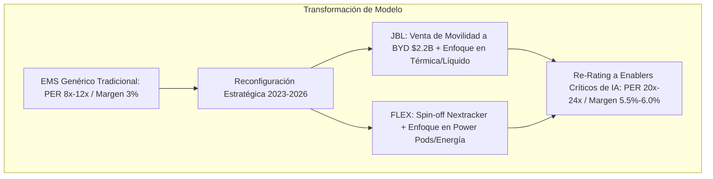
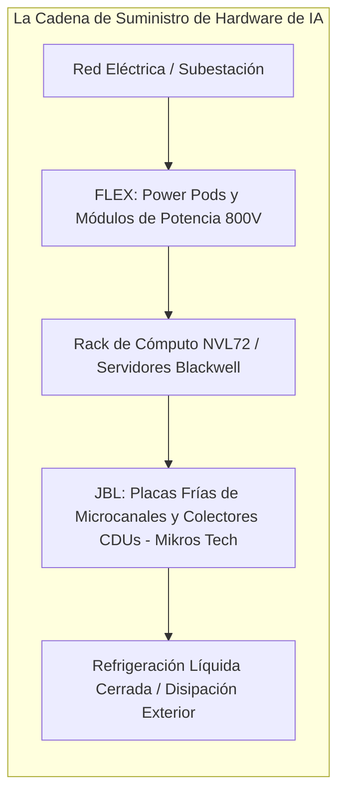
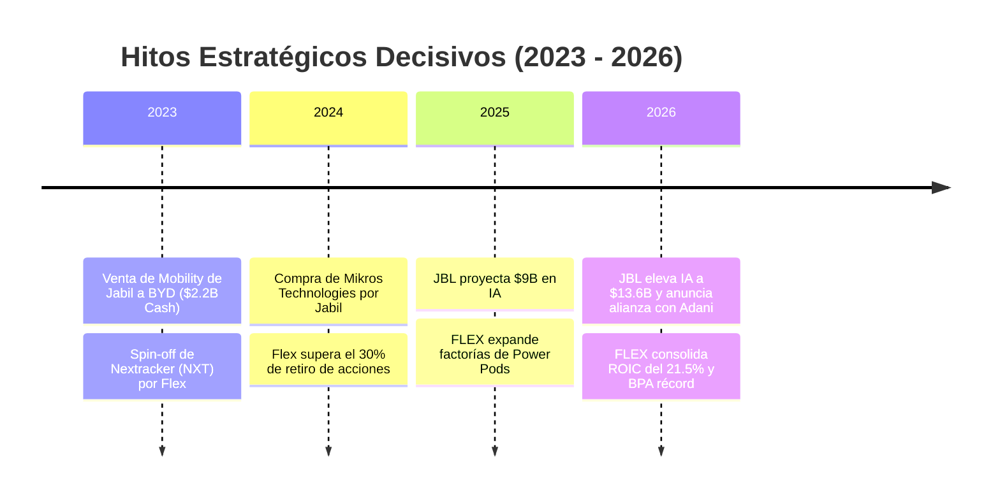
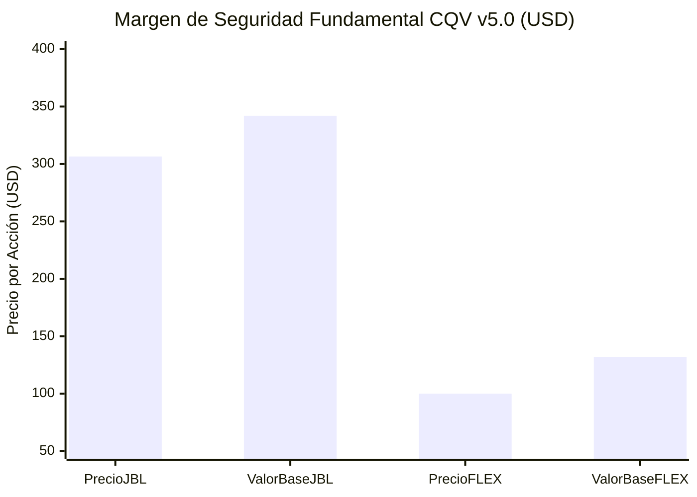

# Análisis Comparativo Exhaustivo: Jabil Inc. (JBL) vs. Flex Ltd. (FLEX)
## La Batalla de los Enablers de la Inteligencia Artificial: Refrigeración Líquida vs. Distribución de Potencia, Asignación de Capital y Valoración CQV v5.0

**Fecha de Emisión:** 11 de Septiembre de 2026  
**Ubicación:** `tesis/JBL/JBL_vs_FLEX_Comparativa_Estructural_2026.md` (Espejo sincronizado en `inform/tesis/JBL/`)  
**Metodología Aplicada:** CQV v5.0 (Calidad Fundamental, Moat, Resiliencia y Valuación del Propietario)  
**Activos Analizados:**  
* **Jabil Inc. (NYSE: JBL)** — Precio Ref.: **$306.50 USD** | Market Cap: **$31.57B** | CQV Score: **8.85 / 10** | Value Score: **6.85 / 10**
* **Flex Ltd. (NASDAQ: FLEX)** — Precio Ref.: **$100.01 USD** | Market Cap: **$39.50B** | CQV Score: **8.99 / 10** | Value Score: **8.90 / 10**

---

## 1. Resumen Ejecutivo: La Gran Metamorfosis de la Manufactura Avanzada

Históricamente, tanto **Jabil (JBL)** como **Flex (FLEX)** eran percibidas por el mercado como simples ensambladoras de contratos (*Electronic Manufacturing Services - EMS*): negocios intensivos en mano de obra, con márgenes operativos anémicos (2.5%–3.5%), escaso poder de fijación de precios y múltiplos deprimidos (PER 8x–12x).

Entre 2023 y 2026, **ambas compañías ejecutaron la reconfiguración estratégica más exitosa de su historia**, deshaciéndose de activos comoditizados y convirtiéndose en los **socios indispensables de los hiperescaladores de nube (Microsoft, AWS, Google, Meta) y de NVIDIA** para diseñar y fabricar la infraestructura física de la Inteligencia Artificial:



---

## 2. Matriz Cuantitativa Integral y Métricas CQV v5.0

| Dimensión / Métrica Fundamental | Jabil Inc. (NYSE: JBL) | Flex Ltd. (NASDAQ: FLEX) | Diagnóstico Comparativo y Ventaja |
| :--- | :---: | :---: | :--- |
| **Score CQV Calidad Fundamental (F1-F8)** | **8.85 / 10.00** | **8.99 / 10.00** | 🟢 **FLEX (+14 bps)**: Leve ventaja en foso de potencia y ROIC. |
| **Value Score v5.0 (Capa de Valoración)** | **6.85 / 10.00** | **8.90 / 10.00** | 🟢 **FLEX (+205 bps)**: Valoración significativamente más atractiva. |
| **Capitalización Bursátil** | ~$31,570 Millones ($31.57B) | ~$39,500 Millones ($39.50B) | Flex presenta una escala de mercado ligeramente superior. |
| **Ingresos Totales (TTM / FY2026)** | **$33,590M – $35,000M** | $29,267M – $30,000M | 🟢 **JBL**: Mayor volumen absoluto de facturación consolidada. |
| **Margen Operativo Core/Ajustado** | **5.80%** (en P1 2026) | 5.54% (en P2 2026) | 🟢 **JBL (+26 bps)**: Mayor conversión operativa tras salir de China. |
| **Retorno sobre Capital Invertido (ROIC)**| 19.8% | **21.5%** | 🟢 **FLEX (+170 bps)**: Mayor eficiencia y rotación de capital fijo. |
| **BPA Diluido Estimado Forward (NTM)** | ~$12.70 – $13.20 USD | ~$4.80 USD | Ambas compañías proyectan crecimiento de doble dígito alto. |
| **Crecimiento Estimado BPA NTM (YoY)** | +20.0% – +22.4% | **+24.7%** | 🟢 **FLEX**: Aceleración relativa ligeramente superior en NTM. |
| **PER Forward NTM** | ~23.5x – 24.1x | **~20.8x** | 🟢 **FLEX**: Cotiza con un descuento de ~3 puntos de múltiplo. |
| **Owner Earnings / FCF Ajustado Anual** | **$1,420 Millones** | $1,370 Millones | 🟢 **JBL**: Mayor flujo de caja libre absoluto disponible. |
| **FCF Yield Real** | **4.50%** | 3.47% | 🟢 **JBL (+103 bps)**: Genera más caja libre por cada dólar invertido. |
| **Retiro de Acciones (Share Buybacks)** | **>22%** en 3 años (~103M acc.) | **>30%** en 5 años (~395M acc.) | 🟢 **FLEX**: Mayor canibalización histórica de su flotante. |
| **Apalancamiento (Deuda Neta / EBITDA)** | **1.1x** | **1.1x** | ⚖️ **Empate**: Balances impecables con perfil Grado de Inversión. |
| **Valor Intrínseco Estimado Base (DCF)** | **$342.00 USD** | **$132.00 USD** | Estimación multiescenario a 10 años (WACC: 8.5%-8.75%). |
| **Precio de Mercado Actual** | $306.50 USD | $100.01 USD | Cotizaciones oficiales auditadas a septiembre 2026. |
| **Margen de Seguridad Base (MoS %)** | **+10.38%** | **+24.23%** | 🟢 **FLEX (+1,385 bps)**: Mucho mayor colchón de seguridad. |
| **Veredicto Final Operativo CQV v5.0** | **ACUMULAR EN CORRECCIONES** | **COMPRAR / REVISAR COMPRA** | **FLEX por ratio riesgo/recompensa actual**. |

---

## 3. Desglose Factorial CQV v5.0 (F1 a F8)

$$\text{CQV Calidad} = (F_1 \times 0.20) + (F_2 \times 0.15) + (F_3 \times 0.15) + (F_4 \times 0.15) + (F_5 \times 0.10) + (F_6 \times 0.10) + (F_7 \times 0.05) + (F_8 \times 0.10)$$

```mermaid
radar
    title "Comparativa Factores CQV v5.0: JBL vs FLEX"
    F1_Rentabilidad: [8.80, 8.90]
    F2_Solidez_Balance: [9.10, 9.25]
    F3_Crecimiento: [8.90, 9.10]
    F4_Moat: [8.70, 8.80]
    F5_Asignacion_Capital: [9.30, 9.00]
    F6_Gestion_Directiva: [9.00, 9.15]
    F7_Opcionalidad: [8.50, 8.85]
    F8_Antifragilidad: [8.60, 8.80]
```

### Análisis Factor por Factor:
1. **F1: Rentabilidad y Economía del Negocio (JBL: 8.80 | FLEX: 8.90):**
   * *Jabil* exhibe un margen operativo superior (**5.80%** en P1 2026 vs. 5.54% de Flex), fruto de abandonar el negocio de carcasas de teléfonos.
   * *Flex* logra un **ROIC más elevado (21.5% vs. 19.8%)**, demostrando mayor capacidad para exprimir beneficios por cada unidad de capital de trabajo invertido.
2. **F2: Solidez Financiera y Balance (JBL: 9.10 | FLEX: 9.25):**
   * Ambas compañías tienen balances con un apalancamiento mínimo de **1.1x Deuda Neta / EBITDA**. Flex cuenta con una liquidez no dispuesta ligeramente superior (\$2,500M en líneas de crédito disponibles más \$2,450M en caja).
3. **F3: Crecimiento Durable (JBL: 8.90 | FLEX: 9.10):**
   * *JBL* proyecta \$13,600M en ventas directas de infraestructura de IA en FY2026 (+51% YoY).
   * *FLEX* muestra un crecimiento de BPA estimado NTM ligeramente más agresivo (**+24.7% vs. +20.0%-22.4%**) debido a la aceleración de su división de centros de datos de energía y automatización industrial.
4. **F4: Moat Competitivo y Foso Estructural (JBL: 8.70 | FLEX: 8.80):**
   * *JBL* posee patentes exclusivas de microcanales para enfriamiento líquido de silicio a través de **Mikros Technologies**.
   * *FLEX* tiene un foso más amplio en **distribución eléctrica de alta potencia y subestaciones modulares (*Power Pods*)**, donde los clientes enfrentan barreras de homologación de red extremadamente rígidas.
5. **F5: Asignación de Capital (JBL: 9.30 | FLEX: 9.00):**
   * **Victoria de Jabil:** La venta del negocio de movilidad a BYD por **$2,200M en efectivo** es la mejor operación de desinversión ejecutada en el sector en la última década, financiando recompras masivas sin emitir un solo bono adicional.
6. **F6: Dirección y Ejecución Operativa (JBL: 9.00 | FLEX: 9.15):**
   * **Revathi Advaithi (CEO de Flex)** es catalogada de forma unánime como una de las mejores ejecutivas industriales del mercado por su implacable disciplina de márgenes y capital. **Mike Dastoor (CEO de Jabil)** ha mantenido una ejecución casi impecable como sucesor de Mark Mondello.

---

## 4. Comparativa Tecnológica: Los Cuellos de Botella de la Inteligencia Artificial



### 4.1. Jabil: El Amo del Cuello de Botella Térmico (Liquid Cooling)
* A través de **Mikros Technologies**, Jabil fabrica placas frías de cobre micro-mecanizado que se colocan directamente encima del procesador (*direct-to-chip*). Jabil integra los servidores, las mangueras de grado aeronáutico, los colectores y las unidades de distribución de refrigerante (CDUs), entregando racks probados con gas helio para garantizar fuga cero.

### 4.2. Flex: El Amo del Cuello de Botella Eléctrico (Power Distribution)
* Flex desarrolló los **Power Pods**: subestaciones y salas de control eléctrico modulares construidas y probadas en sus fábricas. Se envían en camión al centro de datos y se instalan en semanas en lugar de años, reduciendo drásticamente el tiempo de puesta en marcha del centro de datos.

---

## 5. Las Dos Grandes Jugadas Corporativas que Revalorizaron las Acciones



1. **Jabil (Diciembre 2023):** Vendió su negocio de movilidad a **BYD Electronic por $2,200M limpios**. Desaparecieron las factorías intensivas en CapEx de China y la servidumbre a los ciclos de Apple. Ese dinero recompró el 22% de la empresa.
2. **Flex (2023–2024):** Completó la escisión total de **Nextracker (NXT)**, el líder en seguidores solares. Flex entregó las acciones de Nextracker a sus accionistas, destrabando miles de millones de valor y dejando a Flex 100% enfocada en tecnología e industria de alta complejidad.

---

## 6. Comparativa de Valoración y Modelos DCF



* **Jabil (JBL):** Precio actual: **$306.50 USD** | Valor Base: **$342.00 USD** | Margen de Seguridad: **+10.38%** | FCF Yield: **4.50%**.
* **Flex (FLEX):** Precio actual: **$100.01 USD** | Valor Base: **$132.00 USD** | Margen de Seguridad: **+24.23%** | FCF Yield: **3.47%** | PER Fwd: **20.8x**.

---

## 7. Matriz de Decisión Operativa: ¿Cuál Comprar Hoy?

| Si tu objetivo o perfil como inversor es: | La mejor elección es: | Razonamiento Financiero y Operativo |
| :--- | :---: | :--- |
| **Maximizar el Margen de Seguridad y Asimetría** | **FLEX** | Ofrece un margen de seguridad del **+24.23%**, un Value Score de **8.90/10** y cotiza a un PER Forward menor (20.8x) con mayor ROIC (21.5%). |
| **Maximizar el Retorno por Flujo de Caja (FCF Yield)** | **JBL** | Presenta un **FCF Yield del 4.50%** (frente al 3.47% de FLEX) y genera \$1,420M de caja libre neta ajustada. |
| **Exposición Pura al Boom de Refrigeración Líquida** | **JBL** | Su división Mikros Technologies domina el diseño y fabricación de placas frías para chips de >1,000W. |
| **Exposición a la Infraestructura y Entrega de Energía** | **FLEX** | Lidera la fabricación de *Power Pods* modulares para desatascar las esperas de conexión a la red eléctrica. |
| **Estrategia Combinada "Picos y Palas" de IA** | **50% JBL / 50% FLEX** | Captura simultáneamente la solución a los dos cuellos de botella de los centros de datos (potencia y refrigeración) con un ROIC medio superior al 20% y balances desapalancados. |

---

## 8. Veredicto Final Operativo

1. **Flex Ltd. (FLEX) — COMPRAR / REVISAR COMPRA:** Es la **opción preferente de compra inmediata hoy** por su Value Score de 8.90 y MoS del +24.23%.
2. **Jabil Inc. (JBL) — ACUMULAR EN CORRECCIONES:** Franquicia de altísima calidad y FCF Yield del 4.50%, pero aconsejable esperar recortes a **$270 – $285 USD** tras triplicar su precio.
