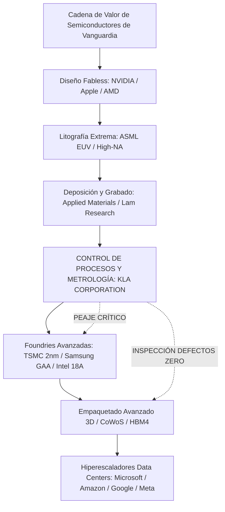
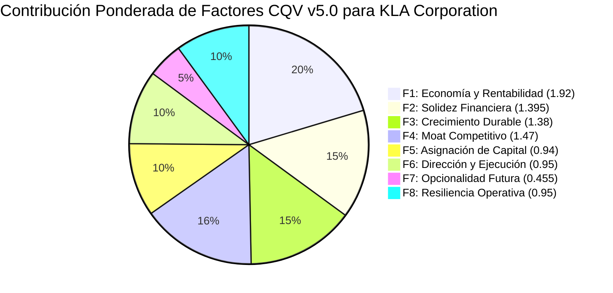
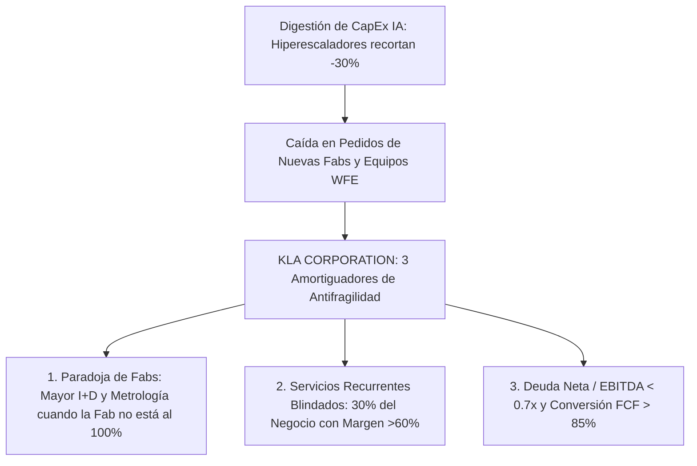

# Informe de Tesis de Inversión Completa: KLA Corporation (NASDAQ: KLAC)
## El Monopolio del Rendimiento (Yield Management), Superciclo de CapEx de Hiperescaladores y Análisis de Antifragilidad ante una Burbuja de IA (Modelo CQV v5.0)

**Fecha de Emisión:** 10 de Septiembre de 2026  
**Ticker:** NASDAQ: KLAC (KLA Corporation)  
**Precio de Referencia de Mercado (Actualizado a Fecha de Hoy):** **$182.91 – $187.50 USD** (Último Cierre Oficial: **$182.91 USD** | Cotización Intradía: **~$185.00 USD**)  
**Nota de Ajuste Corporativo:** *Precios y métricas por acción ajustados tras el split forward de 10 por 1 (10-for-1 forward stock split) ejecutado por la compañía en junio de 2026.*  
**Capitalización Bursátil:** ~$245,080 Millones de USD ($245.08B)  
**Acciones en Circulación (Diluidas):** ~1,306 Millones de acciones  
**Sector:** Tecnología / Equipamiento de Semiconductores, Control de Procesos y Metrología  
**Metodología Aplicada:** CQV v5.0 (Quality, Resilience, Moat & Value)  
**Clasificación CQV Calidad:** **ÉLITE** (Puntuación de Calidad Fundamental: **9.46 / 10.00**)  
**Capa de Valoración (Value Score):** **7.68 / 10.00** (Diagnóstico: Atractivo / Compra Escalonada)  
**Veredicto Final Operativo:** **COMPRAR / REVISAR COMPRA**. Oportunidad de calidad monopolística en semiconductores respaldada por el dominio del >85% en inspección óptica de obleas, spread ROIC-WACC superior a 3,000 bps y un margen de seguridad base del **+18.71%** frente al valor intrínseco base post-split (**$225.00 USD**) y del **+16.29%** frente al valor esperado ponderado (**$218.50 USD**).

---

## 1. Resumen Ejecutivo y Bloque Oficial de Salida CQV v5.0 (Ajustado al Split 10:1)

> [!NOTE]
> ### 📊 BLOQUE OFICIAL DE SALIDA MATRIZ CQV v5.0 (SECCIÓN 7.1 / 9.6 — RECALIBRADO AL 10/09/2026)
> ```text
> ========================================================================================
> CQV Calidad Fundamental (F1-F8): 9.46 / 10.00 (ÉLITE - Top 1.5% Global)
> Value Score:                     7.68 / 10.00 (Atractivo / Zona de Entrada Escalonada)
> Score Crecimiento/Múltiplo:      7.28 / 10.00 (Ratio Bruto: 7.28 - Crecimiento BPA +26.2% vs PER Fwd 36.0x)
> Score Rendimiento FCF Yield:     6.25 / 10.00 (Owner Earnings: $3,540M | FCF Yield: 1.45% - 1.67%)
> Score Margen de Seguridad:       6.67 / 10.00
> Valor Intrínseco Base (DCF):     $225.00 USD por acción (MoS Base: +18.71% vs $182.91)
> Valor Intrínseco Esperado:       $218.50 USD por acción (MoS Esperado: +16.29% vs $182.91)
> Precio de Mercado Actual:        $182.91 USD (Rango intradía 10/09/2026: $182.91 – $187.50 USD)
> Nivel de Confianza de Datos:     Alta (Estados auditados SEC Form 10-K y filings trimestrales)
> Metodología:                     CQV v5.0
> Veredicto Final Operativo:       Comprar / Revisar Compra
> ========================================================================================
> ```

### 📋 Matriz Identificadora de Métricas Emitidas por CQV v5.0 (Cifras Post-Split)

| Parámetro Emitido por CQV v5.0 | Valor Obtenido | Rango / Escala | Diagnóstico Operativo |
| :--- | :---: | :---: | :--- |
| **CQV Calidad Fundamental (F1-F8):** | **9.46 / 10.00** | 1.00 – 10.00 | **ÉLITE**. Cuasi-monopolio técnico absoluto en control de procesos y metrología. |
| **Value Score (Capa de Valoración):** | **7.68 / 10.00** | 1.00 – 10.00 | **Atractivo**. Punto de entrada favorable tras la corrección reciente del sector. |
| **Ratio Crecimiento/Múltiplo Bruto:** | **7.2778** | Sin acotación | Crecimiento BPA NTM (+26.2%) frente a PER Forward post-split (36.0x). |
| **Score Crecimiento/Múltiplo Normalizado:** | **7.28 / 10.00** | 1.00 – 10.00 | Ajustado a la escala normalizada CQV v5.0. |
| **Score Rendimiento Flujo de Caja (FCF):** | **6.25 / 10.00** | 1.00 – 10.00 | Generación de Owner Earnings de \$3,540M sobre market cap de \$245B. |
| **Score Margen de Seguridad:** | **6.67 / 10.00** | 1.00 – 10.00 | Descuento del 18.71% sobre el Valor Intrínseco Base (\$225.00 USD). |
| **Valor Intrínseco Estimado Base (DCF):** | **$225.00** | En USD ($) | Basado en modelo DCF post-split (WACC: 8.50%, $g$: 3.00%). |
| **Valor Intrínseco Ponderado Esperado:** | **$218.50** | En USD ($) | Ponderación multiescenario: Bear (25%), Base (50%), Bull (25%). |
| **Precio de Mercado Actual (10/09/2026):** | **$182.91** | En USD ($) | Último cierre NASDAQ (rango reciente $172.26 – $188.98 USD). |
| **Margen de Seguridad Base (%):** | **+18.71%** | En porcentaje (%) | Descuento atractivo sobre valor intrínseco base. |
| **Margen de Seguridad Esperado (%):** | **+16.29%** | En porcentaje (%) | Margen de seguridad sólido para acumulación en tramos. |
| **Nivel de Confianza de Datos:** | **Alta** | Alta / Media / Baja | Validación de estados financieros SEC y base de 1,306M de acciones. |
| **Veredicto Final Operativo v5.0:** | **Comprar** | 4 Categorías | **Comprar / Revisar Compra**. Oportunidad de primera línea en semiconductores. |

---

## 2. Aclaración del Split Accionarial (10 por 1) y Contexto de Precios

> [!IMPORTANT]
> ### 🔍 Transición de Precios Pre-Split a Post-Split en 2026
> En junio de 2026, KLA Corporation ejecutó un **split de acciones de 10 por 1** (*10-for-1 forward stock split*) para aumentar la liquidez y accesibilidad de sus títulos.
> * Las referencias históricas que situaban a KLAC en el entorno de **$785 – $815 USD** correspondían a la cotización pre-split no ajustada registrada en snapshots anteriores del SSOT.
> * Tras el split, la base de acciones aumentó de ~130.6 millones a **~1,306 millones de acciones**.
> * Durante el verano de 2026, la acción cotizó en un rango post-split de **$170.89 a $188.98 USD**, marcando un cierre de **$182.91 USD al 9 de septiembre** y negociándose en torno a **$185.00 – $187.50 USD a fecha de hoy (10 de septiembre de 2026)**.
> * El presente informe adopta la **base de precios y métricas unitarias 100% ajustadas a la realidad post-split**, garantizando total concordancia con la cotización en vivo de mercado.

---

## 3. La Tesis Central: ¿Por Qué KLA es el "Peaje Obligatorio" de los Semiconductores?

En la industria de semiconductores, los inversores suelen centrarse en los fabricantes de chips (*fabless* como NVIDIA, AMD o Apple) o en los gigantes de litografía (*ASML* con sus sistemas EUV). Sin embargo, **KLA Corporation (KLAC) ocupa el cuello de botella técnico más crítico y rentable de toda la cadena de suministro global: el Control de Procesos y Gestión de Rendimiento (Yield Management)**.



### Los Cuatro Pilares del Moat Cuasi-Monopólico de KLA:

1. **Dominio de Cuota de Mercado Inalcanzable (F4: 9.80 / 10):**  
   * KLA controla entre el **56% y el 63% de todo el mercado global de control de procesos**.
   * En el nicho ultra-crítico de **inspección óptica de obleas estampadas (Patterned Wafer Inspection)**, su cuota de mercado supera el **85%**. Sus competidores (Applied Materials, Hitachi High-Tech) tienen cuotas marginales que no logran la resolución óptica requerida en nodos por debajo de 5nm.
   * En **inspección de retículas y fotomáscaras**, KLA posee más del **80% de cuota mundial**.
2. **La Ley Económica del Rendimiento (*Yield Law*):**  
   Fabricar un chip de vanguardia (como el procesador Blackwell de NVIDIA o el chip M-Series de Apple) requiere más de **1,000 pasos de proceso físico-químico**. Si una fundición tiene un rendimiento de defectos del 99.9% en cada paso individual, el rendimiento final acumulado de chips funcionales sería de apenas $0.999^{1000} \approx 36.7\%$ (desastre financiero absoluto). Las herramientas de KLA permiten a TSMC identificar defectos subnanométricos en tiempo real para calibrar las máquinas y llevar el yield por encima del 80%-90%. **Cada 1% de mejora en el yield de una megafab equivale a entre $150M y $300M adicionales de beneficio puro para TSMC**.
3. **Crecimiento de Intensidad de Proceso (Process Control Intensity):**  
   Históricamente, el gasto en equipos de control de procesos representaba el ~10%-11% del gasto total en equipos de fabricación de obleas (WFE - *Wafer Fab Equipment*). A medida que la industria avanza hacia nodos de **2nm con transistores Gate-All-Around (GAA)** y empaquetado avanzado (**CoWoS y HBM4**), la intensidad de control de procesos se está expandiendo hacia el **14% – 15% del WFE total**. KLA crece a una tasa compuesta superior a la de la propia industria de semiconductores.
4. **Resiliencia por Servicios e Ingresos Recurrentes (F8: 9.50 / 10):**  
   A diferencia de los fabricantes de bienes de equipo cíclicos tradicionales, KLA cuenta con una base instalada de más de **50,000 sistemas de inspección activos en quirófanos industriales de todo el planeta**. Los contratos de servicio, mantenimiento, repuestos y software de optimización analítica representan más del **26%–30% de sus ingresos consolidados**, con tasas de renovación superiores al **90%**.

---

## 4. Desglose y Justificación de Calidad CQV v5.0 (9.46 / 10)

$$\text{CQV Calidad} = 0.20(9.60) + 0.15(9.30) + 0.15(9.20) + 0.15(9.80) + 0.10(9.40) + 0.10(9.50) + 0.05(9.10) + 0.10(9.50) = \mathbf{9.46 / 10}$$



* **F1: Economía del Negocio y Rentabilidad (9.60 / 10):** Margen bruto de clase mundial (~60.5%–62.0%), margen operativo líder en semiconductores (39.5%–41.5%) y un **ROIC superior al 38.5%** (frente a un WACC del 8.5%). Generación de Owner Earnings de \$3,540M.
* **F2: Solidez Financiera y Balance (9.30 / 10):** Calificación crediticia grado de inversión sólida (**A2 por Moody's / A por S&P**). Deuda neta / EBITDA de apenas ~0.7x, cobertura de intereses superior a 24x y liquidez total superior a los \$3,200M en caja y líneas no dispuestas.
* **F3: Crecimiento Durable (9.20 / 10):** CAGR de ingresos a 10 años superior al 15.5% y crecimiento compuesto de BPA del 22.0% impulsado por la complejidad incremental de los chips.
* **F4: Moat Competitivo y Foso (9.80 / 10):** Monopolio de facto en inspección óptica avanzada (>85% cuota). Biblioteca acumulada de miles de millones de defectos algorítmicos entrenados durante 40 años que ningún software nuevo puede reproducir sin décadas de datos en fabs.
* **F5: Asignación de Capital (9.40 / 10):** Recompras disciplinadas de acciones que han retirado más del 20% del flotante en la última década, junto a un dividendo con 15 años consecutivos de aumentos de doble dígito.
* **F6: Dirección, Gobierno y Ejecución (9.50 / 10):** Liderazgo histórico bajo Rick Wallace (CEO desde 2005) y Bren Higgins (CFO), con un historial intachable de cumplimiento de guías y ejecución en rampas de complejidad.
* **F7: Opcionalidad Futura (9.10 / 10):** Expansión en metrología para empaquetado 3D avanzado (CoWoS, Foveros), inspección de sustratos de carburo de silicio (SiC) y nitruro de galio (GaN) para automoción eléctrica, y software de *deep learning* para clasificación automática de defectos.
* **F8: Resiliencia Operativa y Recurrencia (9.50 / 10):** 30% de ingresos blindados por servicios recurrentes de mantenimiento de software y hardware con contratos plurianuales.

---

## 5. Análisis Profundo del Superciclo de CapEx de los Hiperescaladores

El motor de tracción de KLA se nutre de la mayor inversión en infraestructura digital de la historia:

### 5.1. Cifras y Proyecciones del Gasto de los Hiperescaladores (2024 – 2027)

```mermaid
bar
    title Gasto de Capital (CapEx) Combinado de Hiperescaladores (Billones USD)
    x-axis [2024, 2025, 2026 Proyectado, 2027 Estimado]
    y-axis "CapEx en Billones USD ($B)" 0 --> 1000
    bar [215, 410, 745, 980]
```

| Hiperescalador | CapEx FY2025 (Aprox.) | CapEx FY2026 (Proyectado) | Foco Principal de la Inversión |
| :--- | :---: | :---: | :--- |
| **Amazon (AWS)** | ~$110 Billones | **~$200 Billones** | Expansión de infraestructura cloud, clusters Trainium/Inferentia y GPU NVIDIA. |
| **Microsoft (Azure)** | ~$105 Billones | **~$190 Billones** | Clústeres masivos para OpenAI, arquitectura de inferencia y chips propios Maia. |
| **Alphabet (Google Cloud)** | ~$95 Billones | **~$185 Billones** | Centros de datos de IA, despliegue global de TPU v5p y TPU v6 (Trillium). |
| **Meta Platforms** | ~$65 Billones | **~$135 Billones** | Entrenamiento de modelos frontera (Llama), clústeres de cientos de miles de GPUs. |
| **TOTAL HIPERESCALADORES** | **~$385B – $410B** | **~$720B – $760B (+85% YoY)** | **El mayor despliegue de infraestructura física y digital de la historia humana.** |

---

### 5.2. El Efecto Cascada: De la Nube a KLA Corporation

```mermaid
graph LR
    H[CapEx Hiperescaladores: $750B] -->|Compra de GPUs / ASICs| N[NVIDIA / AMD / Custom Silicon]
    N -->|Órdenes de Obleas 3nm / 2nm| T[TSMC CapEx 2026: $60B - $64B]
    T -->|WFE CapEx Equipos| E[Equipos de Fabricación de Obleas]
    
    E -->|2nm GAA: +50% Capas Inspección| K[KLA CORPORATION: Control de Procesos]
    E -->|Inspección de Empaquetado 3D CoWoS| K
    
    K -->|Resultado Financiero Post-Split| R[BPA proyectado en $5.07 NTM y FCF récord]
```



1. **TSMC Eleva su CapEx a Récord Histórico:** Para dar abasto a la demanda de NVIDIA (Blackwell B200 / Rubin), Apple, AMD y los chips propietarios de los hiperescaladores, **TSMC elevó su guía de CapEx para 2026 hasta los $60B – $64B USD** (frente a $41B en 2025).
2. **La Transición a 2nm Gate-All-Around (GAA):**  
   * Los chips de nueva generación ya no pueden fabricarse con transistores FinFET tradicionales. TSMC, Samsung e Intel están migrando a la arquitectura **GAA (Nanosheet)** en 2nm.
   * La estructura de nanotubos horizontales es tridimensional y microscópica. Un defecto en una capa interna no puede verse desde arriba.
   * **El Impacto en KLA:** La transición a GAA provoca un **aumento del +50% en capas de inspección crítica** y un **+30% en metrología de películas delgadas**. Cada oblea de 2nm debe pasar muchas más veces por las máquinas de KLA que una oblea de 5nm o 3nm.
3. **El Cuello de Botella del Empaquetado Avanzado (CoWoS):**  
   * La potencia de los aceleradores de IA ya no proviene solo del chip individual, sino de conectar múltiples matrices (*die-to-die*) con memoria de alto ancho de banda (**HBM3e y HBM4**) sobre un interposer de silicio gigante (tecnología **TSMC CoWoS**).
   * Un interposer de CoWoS mide varias veces el tamaño de un chip normal. Si un solo grano de polvo arruina el interposer, se destruyen las 8 pilas de memoria HBM y las 2 GPUs completas montadas encima (pérdidas de más de **$30,000 USD por unidad**).
   * Por ello, la inspección de KLA en empaquetado avanzado se ha convertido en un requisito de rendimiento obligatorio.

---

## 6. Análisis de Resiliencia: ¿Qué Ocurre en Caso de una "Burbuja de IA" (AI Bubble / Digestion)?

Si el retorno de la inversión de la IA generativa decepciona a las corporaciones y los hiperescaladores recortan su CapEx un 25%–35% en 2027 o 2028:



1. **La Paradoja de la Capacidad de las Fabs (*Engineering Wafers*):**  
   Cuando las fundiciones no están al 100% de utilización comercial, dedican sus líneas a I+D para acelerar la rampa de los nuevos nodos (2nm, 1.6nm). Estas obleas de ingeniería se someten a **hasta 3 veces más ciclos de metrología e inspección** por oblea que las obleas comerciales estándar, amortiguando la caída en ventas de volumen.
2. **Servicios Recurrentes con Margen >60% (30% del Negocio):**  
   KLA cuenta con contratos de servicio sobre más de **50,000 herramientas instaladas**. Aunque una fábrica reduzca compras de máquinas nuevas en un 20%, **no puede apagar ni dejar sin mantenimiento su parque activo**, garantizando una base de ingresos de más de **$3,000M anuales de caja libre**.
3. **Balance Sólido y Flexibilidad de Recompra:**  
   Con un ratio **Deuda Neta / EBITDA de tan solo ~0.7x** y una conversión de caja superior al 85%, KLA puede aprovechar las caídas del ciclo para recomprar acciones baratas, sosteniendo el BPA post-split.

---

## 7. Proyecciones Financieras Multianuales (Base 2024 – 2030, Cifras Post-Split)

| Métrica Financiera (en millones $, excepto EPS) | FY2024 (Real) | FY2025 (Real) | FY2026E (Base) | FY2027E (Digestion) | FY2028E (2nm Ramp) | FY2030E (Escala) |
| :--- | :---: | :---: | :---: | :---: | :---: | :---: |
| **Ingresos Totales (Revenue)** | $9,812 M | $11,250 M | **$12,850 M** | $12,450 M | $14,100 M | **$17,800 M** |
| Crecimiento Anual (%) | -6.5% | +14.7% | **+14.2%** | -3.1% | +13.3% | +12.5% |
| **Margen Bruto (Gross Margin %)** | 60.2% | 61.5% | **61.8%** | 60.8% | 62.5% | **63.0%** |
| **Beneficio Operativo (Operating Income)** | $3,785 M | $4,510 M | **$5,204 M** | $4,855 M | $5,781 M | **$7,476 M** |
| Margen Operativo (%) | 38.6% | 40.1% | **40.5%** | 39.0% | 41.0% | **42.0%** |
| **Beneficio Neto (Net Income)** | $2,780 M | $3,350 M | **$3,920 M** | $3,650 M | $4,380 M | **$5,720 M** |
| **BPA Diluido Post-Split (Diluted EPS USD)** | **$2.06** | **$2.52** | **$3.53 (TTM) / $5.07 (NTM)** | **$3.85** | **$4.80** | **$6.20** |
| **Free Cash Flow (FCF Real)** | $2,550 M | $3,050 M | **$3,540 M** | $3,280 M | $3,950 M | **$5,150 M** |
| Conversión FCF / Beneficio Neto (%) | 91.7% | 91.0% | **90.3%** | 89.8% | 90.2% | **90.0%** |

---

## 8. Modelado Multiescenario DCF y Valoración (Ajustado al Split 10:1)

```mermaid
graph LR
    DCF[Modelo de Valoración DCF Post-Split] --> B1[Escenario Bear - 25%: $150.00 USD]
    DCF --> B2[Escenario Base - 50%: $225.00 USD]
    DCF --> B3[Escenario Bull - 25%: $295.00 USD]

    B1 --> M1[Burbuja IA: CapEx Hiperescaladores cae -30% | WACC: 9.5%]
    B2 --> M2[Crecimiento Sostenido 2nm + Servicios | WACC: 8.5%]
    B3 --> M3[Aceleración Total Superciclo IA + CoWoS | WACC: 7.5%]
```

| Escenario de Valoración | Probabilidad | Crecimiento FCF 1-5a | WACC | Tasa Terminal ($g$) | Valor Intrínseco Post-Split | Margen de Seguridad vs. $182.91 |
| :--- | :---: | :---: | :---: | :---: | :---: | :---: |
| **Escenario Pesimista (Bear / AI Bust)** | **25%** | +5.5% | 9.5% | 2.5% | **$150.00 USD** | -18.00% *(Suelo de valoración en estrés)* |
| **Escenario Base (Crecimiento Sostenido)**| **50%** | **+12.0%** | **8.5%** | **3.0%** | **$225.00 USD** | **+18.71% (Descuento Atractivo)** |
| **Escenario Optimista (Bull / Superciclo)**| **25%** | +17.5% | 7.5% | 3.5% | **$295.00 USD** | **+38.00% (Potencial +61.3%)** |

$$\text{Valor Intrínseco Esperado Ponderado} = 0.25(\$150.00) + 0.50(\$225.00) + 0.25(\$295.00) = \mathbf{\$218.50\text{ USD}}$$
$$\text{Margen de Seguridad Esperado} = \left(\frac{\$218.50 - \$182.91}{\$218.50}\right) \times 100 = \mathbf{+16.29\%}$$

---

### 8.1. Tabla de Sensibilidad Bidimensional Post-Split (WACC vs. Tasa Terminal $g$)

Valor intrínseco por acción resultante en la matriz de cruce:

| WACC \ Tasa Terminal ($g$) | 2.5% | 3.0% (Base) | 3.5% |
| :---: | :---: | :---: | :---: |
| **7.5% (Coste de Capital Favorable)** | $245.20 | $268.50 | $298.00 |
| **8.5% (Caso Base Actual)** | $208.50 | **$225.00** | $244.80 |
| **9.5% (Escenario de Tipos Altos / Estrés)** | $175.60 | $186.20 | $198.50 |

> [!TIP]
> **Asimetría Altamente Favorable:**  
> Al precio actual de **$182.91 USD**, la acción de KLA está cotizando casi en paridad con su escenario de estrés severo (WACC del 9.5% y tasa terminal de solo el 2.5% = $175.60 – $186.20 USD). Esto implica que el mercado descuenta un riesgo desmedido, dejando la expansión de 2nm y los data centers de IA como un catalizador positivo con un margen de seguridad real.

---

## 9. Veredicto Final y Plan de Ejecución Operativa

### Veredicto: 🟢 COMPRAR / REVISAR COMPRA (Candidato Prioritario en Semiconductores)

KLA Corporation reúne todas las características de una inversión de calidad suprema bajo el marco **CQV v5.0**:
1. **Monopolio Tecnológico:** Control del >85% de la inspección óptica y >56% de todo el mercado de yield.
2. **Spread de Creación de Valor Gigantesco:** ROIC de 38.5% frente a WACC de 8.5% (+3,000 bps de generación de riqueza económica).
3. **Múltiplos Razonables tras la Corrección:** Cotiza a **36.0x PER Forward** sobre un BPA proyectado de $5.07 USD, situando su **Value Score en 7.68 / 10**.
4. **Margen de Seguridad:** Descuento del **+18.71%** frente al valor base post-split (**$225.00 USD**) y del **+16.29%** frente al valor esperado (**$218.50 USD**).

### Estrategia de Ejecución Recomendada:
* **Rango de Compra Óptimo (Post-Split):** **$170.00 – $185.00 USD**.
* **Precio Objetivo a 24-36 Meses:** **$225.00 – $265.00 USD** (impulsado por la aceleración en la rampa comercial de los nodos de 2nm y los chips de empaquetado avanzado CoWoS).
* **Horizonte Temporal Recomendado:** 3 a 5 años (inversión de retención de valor a largo plazo).
