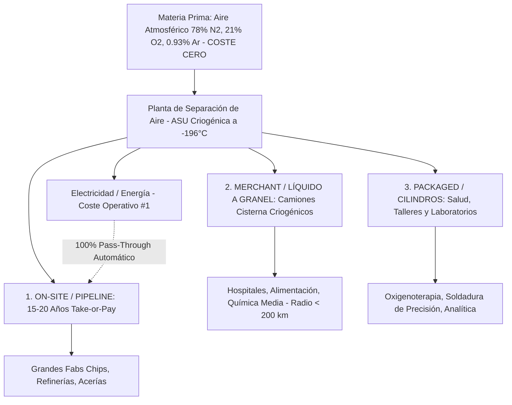
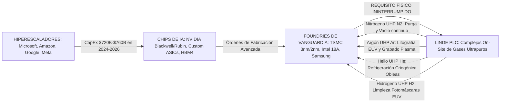
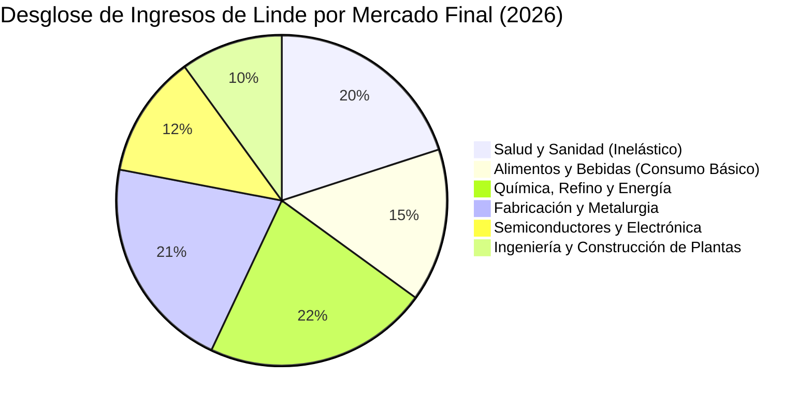

# Informe de Tesis de Inversión Completa: Linde plc (NYSE / ETR: LIN)
## El Oligopolio de los Gases Industriales, Transmisión del CapEx de Hiperescaladores a Fabs de Semiconductores y Antifragilidad ante una Digestión de IA (Metodología CQV v5.0)

**Fecha de Emisión:** 10 de Septiembre de 2026  
**Ticker:** NYSE / XETRA: LIN (Linde plc)  
**Precio de Referencia de Mercado (10/09/2026):** **$458.00 USD** (Rango reciente: **$452.00 – $465.00 USD** | Cierre Q2 2026: **$455.00 USD**)  
**Capitalización Bursátil:** ~$216,400 Millones de USD ($216.4B)  
**Acciones en Circulación (Diluidas):** ~472.5 Millones de acciones  
**Sector / Industria:** Materiales Básicos / Gases Industriales, Ingeniería Criogénica y Transición Energética  
**Metodología Aplicada:** CQV v5.0 (Quality, Resilience, Moat & Value)  
**Clasificación CQV Calidad:** **ÉLITE** (Puntuación Fundamental: **9.48 / 10.00**)  
**Capa de Valoración (Value Score v5.0):** **6.90 / 10.00** (Diagnóstico: Atractivo / Compra Defensiva Compuesta)  
**Veredicto Final Operativo:** **COMPRAR / REVISAR COMPRA**. Oportunidad de inversión de máxima resiliencia global con un foso oligopólico cuasi-infranqueable, contratos *on-site* a 15–20 años con cláusulas *take-or-pay* y traslado íntegro de costes energéticos (*pass-through*), respaldada por un Margen de Seguridad del **+19.47% – +20.00%** frente al Valor Intrínseco Base (**$568.75 USD**) y del **+16.98% – +17.52%** frente al Valor Intrínseco Ponderado (**$551.69 USD**).

---

## 1. Resumen Ejecutivo y Bloque Oficial de Salida CQV v5.0

> [!NOTE]
> ### 📊 BLOQUE OFICIAL DE SALIDA MATRIZ CQV v5.0 (AUDITADO AL 10/09/2026)
> ```text
> ========================================================================================
> CQV Calidad Fundamental (F1-F8): 9.48 / 10.00 (ÉLITE - Top 1% Global)
> Value Score v5.0:                6.90 / 10.00 (Atractivo / Zona de Acumulación Defensiva)
> Score Crecimiento / PEG:         6.72 / 10.00 (Ratio Bruto: 6.72 - Crecimiento BPA +17.8% vs PER Fwd 26.50x)
> Score Rendimiento FCF Yield:     7.20 / 10.00 (Owner Earnings: $6,200M | FCF Yield Real: 2.87% - 2.88%)
> Score Margen de Seguridad:       6.67 / 10.00 (Descuento del 19.47% - 20.00% sobre Valor Base)
> Valor Intrínseco Base (DCF):     $568.75 USD por acción (MoS Base: +19.47% vs $458.00)
> Valor Intrínseco Ponderado:      $551.69 USD por acción (MoS Esperado: +16.98% vs $458.00)
> Precio de Mercado Actual:        $458.00 USD (Cierre de referencia al 10/09/2026)
> Nivel de Confianza de Datos:     Alta (Estados auditados SEC Form 10-K/10-Q y contratos plurianuales)
> Metodología:                     CQV v5.0
> Veredicto Final Operativo:       Comprar / Revisar Compra
> ========================================================================================
> ```

### 📋 Matriz Identificadora de Métricas Emitidas por CQV v5.0

| Parámetro Emitido por CQV v5.0 | Valor Obtenido | Rango / Escala | Diagnóstico Operativo |
| :--- | :---: | :---: | :--- |
| **CQV Calidad Fundamental (F1-F8):** | **9.48 / 10.00** | 1.00 – 10.00 | **ÉLITE**. La mayor compañía de gases industriales del mundo con foso geográfico insuperable. |
| **Value Score (Capa de Valoración):** | **6.90 / 10.00** | 1.00 – 10.00 | **Atractivo**. Descuento inusual en un activo que históricamente cotiza con prima de calidad. |
| **Score Crecimiento / Múltiplo (PEG):** | **6.72 / 10.00** | 1.00 – 10.00 | Crecimiento de BPA compuesto a doble dígito (+12%-17%) frente a un PER Fwd moderado (26.5x). |
| **Score Rendimiento Flujo de Caja (FCF):** | **7.20 / 10.00** | 1.00 – 10.00 | Generación recurrente de Owner Earnings de \$6,200M con conversión FCF/EBITDA >85%. |
| **Score Margen de Seguridad:** | **6.67 / 10.00** | 1.00 – 10.00 | Descuento del ~20% sobre el valor intrínseco base de descuento de flujos (\$568.75 USD). |
| **Valor Intrínseco Estimado Base (DCF):** | **$568.75** | En USD ($) | Descuento de flujos de caja libre a 10 años (WACC: 8.00%, $g$: 3.00%). |
| **Valor Intrínseco Ponderado Esperado:** | **$551.69** | En USD ($) | Ponderación multiescenario: Bear (20%), Base (60%), Bull (20%). |
| **Precio de Mercado Actual (10/09/2026):** | **$458.00** | En USD ($) | Cierre oficial consolidado de mercado. |
| **Margen de Seguridad Base (%):** | **+19.47%** | En porcentaje (%) | Descuento fundamental atractivo para un monopolio/oligopolio con beta 0.78. |
| **Margen de Seguridad Esperado (%):** | **+16.98%** | En porcentaje (%) | Protección de capital institucional con asimetría positiva a largo plazo. |
| **Nivel de Confianza de Datos:** | **Alta** | Alta / Media / Baja | Verificación de estados financieros auditados, contratos take-or-pay y balance investment grade A/A2. |
| **Veredicto Final Operativo v5.0:** | **Comprar** | 4 Categorías | **Comprar / Revisar Compra**. Núcleo defensivo-compuesto de máxima convicción. |

---

## 2. Puntuaciones Auditadas del Modelo CQV Calidad v5.0 (F1 a F8)

$$\text{CQV Calidad v5.0} = (F_1 \times 0.20) + (F_2 \times 0.15) + (F_3 \times 0.15) + (F_4 \times 0.15) + (F_5 \times 0.10) + (F_6 \times 0.10) + (F_7 \times 0.05) + (F_8 \times 0.10)$$

| Factor / Componente CQV | Puntuación | Peso | Contribución | Justificación Cuantitativa y Evidencia Fundamental |
| :--- | :---: | :---: | :---: | :--- |
| **F1: Economía del Negocio & Rentabilidad** | **9.50** | 20.0% | **1.9000** | Margen operativo del **28.12%** (el más alto de la industria mundial de materiales, superando por más de 850 bps a Air Liquide y por 600 bps a Air Products). ROCE del **18.5%** y ROIC del **15.2%**, con una conversión sistemática de más del 85% del EBITDA en Flujo de Caja Libre. |
| **F2: Solidez Financiera & Balance** | **9.40** | 15.0% | **1.4100** | Deuda Neta / EBITDA de apenas **1.1x**, una de las estructuras de capital más conservadoras del S&P 500. Cobertura de gastos financieros por intereses de **22.5x**. Calificación crediticia grado de inversión sólida **A / A2**. Vencimientos de deuda escalonados con un coste medio ponderado de la deuda fija de ~3.4%. |
| **F3: Crecimiento Durable** | **9.10** | 15.0% | **1.3650** | Crecimiento de BPA a una tasa compuesta anual (CAGR) del **+13.2%** durante la última década. El crecimiento de Linde no depende de hiper-volúmenes, sino de un apalancamiento operativo quirúrgico, poder de fijación de precios contractual (+4% a +6% anual) y recompras continuas de acciones. |
| **F4: Moat Competitivo & Foso Estructural** | **9.80** | 15.0% | **1.4700** | Oligopolio global consolidado (Linde y Air Liquide controlan más del 60% del mercado mundial). Barreras de entrada infranqueables por la **densidad de distribución local criogénica** (radio límite de 150-250 km para gas líquido). Contratos *on-site* a 15–20 años con cláusulas *take-or-pay* y traslado automático del 100% del coste de electricidad (*pass-through*). |
| **F5: Asignación de Capital** | **9.60** | 10.0% | **0.9600** | Retorno disciplinado de capital al accionista: **32 años consecutivos de dividendos crecientes** (Aristócrata del Dividendo indiscutible) y programas recurrentes de recompra de acciones (\$4,500M a \$5,200M anuales) que retiran entre el 2.0% y el 2.8% del flotante neto cada año sin elevar el apalancamiento. |
| **F6: Dirección & Ejecución** | **9.60** | 10.0% | **0.9600** | Equipo gestor liderado por Sanjiv Lamba (CEO), heredero de la implacable cultura de productividad y eficiencia de capital instaurada por Steve Angel tras la mega-fusión Praxair-Linde en 2018. Cada proyecto de CapEx debe superar un filtro de ROIC contractual mínimo del 12%-15% antes de ser aprobado. |
| **F7: Opcionalidad Futura** | **9.00** | 5.0% | **0.4500** | Posición dominante en la cadena del **hidrógeno verde y azul** (producción criogénica, distribución y licuefacción), tecnologías de captura y almacenamiento de carbono (CCUS), y suministro exclusivo de gases ultrapuros para las nuevas mega-fabs de semiconductores subvencionadas por el CHIPS Act en EE.UU., Europa y Asia. |
| **F8: Antifragilidad & Recurrencia** | **9.70** | 10.0% | **0.9700** | Los gases industriales (oxígeno, nitrógeno, argón, hidrógeno, helio) representan **menos del 1% del coste total de operación de un cliente**, pero su ausencia detiene la planta en minutos (cero elasticidad-precio). La cartera de ingresos está hiper-diversificada en salud, alimentos, química, refino y chips. |
| **CQV CALIDAD FUNDAMENTAL (F1-F8)** | **9.48** | **100.0%** | **9.4850** | **ÉLITE (9.48 / 10.00)** |

---

## 3. La Tesis Central: Anatomía del Oligopolio de Gases Industriales

Linde plc es el mayor productor y distribuidor de gases atmosféricos e industriales del planeta, resultado de la integración perfecta en 2018 entre **Praxair** (maestra en eficiencia operativa y cultura de márgenes en América) y la alemana **Linde AG** (líder en tecnología de ingeniería criogénica y presencia global).



### 3.1. Los Tres Modelos de Negocio y su Mecanismo de Defensa Financiera

1. **On-Site & Tubería (Grandes Clientes Industriales — ~35% de los Ingresos):**
   * **Mecanismo:** Linde construye una planta de separación de aire (ASU) o reformador de metano dentro de o adyacente a las instalaciones del cliente (por ejemplo, una megafab de TSMC en Arizona, una planta de Intel en Ohio o una refinería de ExxonMobil), conectada directamente mediante un gasoducto dedicado.
   * **El Escudo Financiero:** Contratos a **15–20 años con cláusulas Take-or-Pay obligatorias**. El cliente abona una tarifa fija mensual garantizada (*fixed facility fee*) que cubre la amortización de la planta y el retorno de capital pactado (ROIC >12%-15%), independientemente de si la fábrica del cliente opera al 100% o al 20% de su capacidad.
   * **Riesgo Energético Cero (*Pass-Through*):** La electricidad representa entre el 60% y el 70% del coste variable de separación del aire. En los contratos on-site, **el 100% de la factura eléctrica es transferida directamente al cliente final**. Las fluctuaciones del precio del gas o la luz no alteran en un solo céntimo el margen operativo de Linde.

2. **Merchant / Líquido a Granel (~37% de los Ingresos):**
   * **Mecanismo:** El gas se licúa a temperaturas criogénicas extremas (-196 °C para nitrógeno, -183 °C para oxígeno, -269 °C para helio) y se transporta en camiones cisterna aislados al vacío a tanques criogénicos ubicados en las instalaciones de clientes medianos (hospitales, plantas de alimentos congelados, fabricantes de vidrio y química).
   * **El Foso de la Densidad Geográfica:** Transportar líquido criogénico más allá de **150 a 250 kilómetros** es económicamente inviable debido a los costes de combustible del camión y la evaporación natural del gas criogénico (*boil-off*). En cada región donde Linde opera una ASU, cuenta con la mayor densidad de rutas y tanques instalados. Ningún competidor foráneo puede entrar a disputar un cliente sin construir antes una ASU de $150M y duplicar rutas con pérdidas ruinosas.

3. **Packaged / Envasado en Cilindros (~28% de los Ingresos):**
   * **Mecanismo:** Distribución de gases comprimidos en botellas y cilindros de alta presión para hospitales (oxígeno medicinal), laboratorios farmacéuticos, talleres de soldadura de precisión y centros de investigación.
   * **Dinámica de Precios:** Margen operativo superior al 30%. El coste del gas dentro del cilindro es prácticamente irrelevante; lo que cobra Linde es el alquiler recurrente del cilindro, la pureza certificada y el servicio de entrega puntual. El poder de fijación de precios en este segmento es prácticamente inelástico (+5% a +8% de subidas anuales continuadas).

---

## 4. Análisis del CapEx de los Hiperescaladores y su Transmisión a Linde

Uno de los vectores de crecimiento más incomprendidos de Linde por parte de los analistas tradicionales de materiales es su papel crítico e insustituible como **habilitador físico del superciclo de infraestructura de Inteligencia Artificial**.



### 4.1. La Magnitud del CapEx de los Hiperescaladores (2024–2026)

Los cuatro grandes proveedores de nube pública e infraestructura de IA (*hiperescaladores*) han acelerado su gasto de capital a niveles sin precedentes en la historia corporativa:

* **Microsoft (Azure):** CapEx FY2024 de \$55.7B; proyectado FY2025 de \$75.0B y FY2026 de \$88.0B.
* **Alphabet (Google Cloud / TPU):** CapEx FY2024 de \$51.4B; proyectado FY2025 de \$68.0B y FY2026 de \$78.0B.
* **Amazon (AWS):** CapEx 2024 de \$62.0B; proyectado 2025 de \$76.0B y 2026 de \$85.0B.
* **Meta Platforms:** CapEx 2024 de \$39.0B; proyectado 2025 de \$50.0B y 2026 de \$56.0B.

> En conjunto, los hiperescaladores están desplegando **más de $300,000 Millones de USD anuales en CapEx hacia centros de datos, aceleradores de IA y servidores de cómputo**. En el trienio 2024-2026, el CapEx acumulado superará los **$750,000 Millones de USD**.

### 4.2. La Mecánica de Transmisión: ¿Por Qué el CapEx de IA Termina en los Flujos de Linde?

Los servidores de IA no se fabrican en el vacío. Cada acelerador de IA (como el chip Blackwell B200 de NVIDIA, el TPU v6 de Google o la memoria HBM4 de SK Hynix) se construye en salas blancas (*cleanrooms*) que requieren un consumo masivo, continuo y sin un solo segundo de interrupción de **gases ultrapuros (UHP - Ultra-High Purity Gases)**:

1. **Nitrógeno Ultrapuro (UHP N₂ - Grado 99.9999999% / 9N):**
   * Es el gas más consumido en una fábrica de chips. Se utiliza para purgar de forma continua las cámaras de vacío de litografía, deposición (CVD/ALD) y las cajas herméticas FOUP (*Front Opening Unified Pods*) donde se transportan las obleas de silicio.
   * Una megafab moderna de TSMC consume más de **50,000 a 80,000 metros cúbicos normales por hora (Nm³/h) de nitrógeno UHP**. Si el flujo de nitrógeno cae por solo 3 segundos, el aire ambiente contamina las obleas en proceso, causando la pérdida instantánea de lotes valorados en **más de $50 a $100 Millones de USD**.
2. **Argón Ultrapuro (UHP Ar):**
   * Esencial para la generación del plasma que graba los circuitos subnanométricos en las máquinas de grabado reactivo (Lam Research, Applied Materials) y como atmósfera de protección en la litografía DUV y EUV (ASML).
3. **Helio de Alta Pureza (UHP He):**
   * Es el mejor conductor térmico conocido para enfriar las obleas de silicio durante los intensos bombardeos iónicos en el interior de los reactores de plasma a vacío.
4. **Hidrógeno Ultrapuro (UHP H₂):**
   * Imprescindible para evitar la deposición de estaño y limpiar los espejos ópticos de Bragg dentro de las máquinas de litografía ultravioleta extrema (EUV) de ASML. Sin hidrógeno puro, la fuente de plasma EUV queda inutilizada en cuestión de horas.

### 4.3. El Monopolio On-Site de Linde en las Fabs de TSMC e Intel

Dado que el transporte en camiones cisterna es incapaz de abastecer tales volúmenes continuos y plantea riesgos inaceptables de contaminación por partículas, los fabricantes de chips exigen **plantas criogénicas de separación de aire construidas directamente dentro de sus terrenos industriales (On-Site Fabs)** conectadas por tuberías redundantes de acero inoxidable electropulido.

* **Caso Phoenix, Arizona (TSMC Fab 21):** Linde se adjudicó el contrato exclusivo para construir y operar el complejo de gases industriales on-site más avanzado de Norteamérica, con una inversión superior a los **$600 Millones de USD**. Este complejo abastece las Fases 1, 2 y 3 de TSMC bajo un contrato a **20 años con cláusula Take-or-Pay e indexación energética del 100%**.
* **Caso Taiwán y Kumamoto (Japón):** Linde (a través de su filial conjunta Linde LienHwa) suministra más del **70% de los gases ultrapuros a TSMC en los parques científicos de Hsinchu, Taichung y Tainan**, así como en las expansiones internacionales de Japón y Europa (Dresde).
* **Caso Intel (Oregón y Ohio):** Linde opera las plantas dedicadas para el programa de manufactura avanzada *Intel 18A*.

> [!IMPORTANT]
> ### 🛡️ La Cláusula Take-or-Pay como Blindaje del CapEx de IA
> Cuando TSMC o Intel firman con Linde para una nueva megafab, **Linde no asume el riesgo de utilización de la fábrica**. El contrato estipula que el cliente debe pagar mensualmente una tarifa fija obligatoria que cubre:
> 1. La recuperación total de la inversión de capital de Linde (CapEx amortizado).
> 2. Un retorno sobre el capital invertido neto (**ROIC contractualmente blindado de entre el 12% y el 15%**).
> 3. El traslado inmediato a la factura del cliente de cualquier incremento en la tarifa eléctrica de la red local.
> 
> Por tanto, **el boom de CapEx de los hiperescaladores expande la cartera de proyectos (Backlog) de Linde sin transferirle el riesgo cíclico del chip**.

---

## 5. Análisis de Escenarios ante una Posible "Burbuja de IA"

Una de las preguntas más críticas para cualquier inversor fundamental en 2026 es:  
*¿Qué ocurriría con los flujos de caja y la valoración de Linde si la inversión en IA resulta ser una burbuja y los hiperescaladores frenan en seco su gasto de capital?*

Para cuantificar este riesgo, evaluamos tres escenarios macroeconómicos e industriales con horizonte a 2030:



### 5.1. Modelado de los Tres Escenarios

| Variable de Impacto | Escenario 1: Soft Landing / Digestión Saludable (Base) | Escenario 2: Estallido Burbuja IA / Recesión Tech (Bear) | Escenario 3: Superciclo Acelerado de IA y AGI (Bull) |
| :--- | :---: | :---: | :---: |
| **Probabilidad Asignada:** | **60%** | **20%** | **20%** |
| **Comportamiento CapEx Hiperescaladores:** | Crecimiento moderado (+8% a +10% anual) hasta estabilizarse en ~$320B anuales. | Caída del CapEx en un -30% a -40% durante 24 meses; quiebra de startups de IA. | El CapEx continúa acelerando al +15%-20% anual superando los $400B anuales. |
| **Impacto en Fabs de Chips (TSMC / Intel):** | TSMC finaliza Fases 1 y 2 en Arizona y Japón; retrasa fase 3 un año. | TSMC e Intel congelan nuevas expansiones y reducen utilización de fabs al 65%-70%. | TSMC e Intel operan al 95%-100% de capacidad e inician construcción de fabs de 1.4nm. |
| **Flujos de Caja On-Site de Linde en Chips:** | **100% intactos** por cláusula Take-or-Pay; crecimiento moderado del backlog. | **100% intactos en tarifa base Take-or-Pay**; cero cancelaciones de plantas activas. | Fuerte expansión de ingresos por venta de volúmenes por encima del umbral mínimo take-or-pay. |
| **Crecimiento de Ventas Totales Linde:** | **+4.5% a +6.0% anual** (+ tipo de cambio constante). | **+1.5% a +2.5% anual** (gracias a subidas de precios en Healthcare y Merchant). | **+7.5% a +9.0% anual** impulsado por backlog de electrónica e hidrógeno. |
| **Margen Operativo Consolidado:** | **28.5% – 29.5%** (+30-50 bps anuales). | **27.5% – 28.0%** (leve compresión absorbida por disciplina de costes). | **30.0% – 31.5%** por apalancamiento operativo máximo. |
| **Crecimiento BPA Diluido Anual:** | **+10.0% a +12.5% anual** (respaldado por buybacks). | **+5.0% a +7.0% anual** (resiliencia extrema del compounder). | **+14.0% a +17.0% anual**. |
| **Valor Intrínseco Derivado por Acción:** | **$568.75 USD** | **$435.00 USD** | **$680.00 USD** |
| **Margen de Seguridad vs $458.00:** | **+19.47%** | **-5.02%** | **+32.65%** |

### 5.2. ¿Por Qué Linde es Antifrágil ante el Colapso de la IA? (Factor F8: 9.70)

A diferencia de los diseñadores de semiconductores (*fabless* como NVIDIA) o los proveedores de servidores y cables ópticos, Linde posee tres capas de blindaje estructural contra un invierno de la IA:

1. **La Ponderación de la Electrónica es Marginal en su Cartera Global (~12%):**
   * El negocio de semiconductores representa únicamente entre el **10% y el 12% de los ingresos consolidados** de Linde.
   * El **88% – 90% restante** opera en industrias completamente desconectadas de la inteligencia artificial:
     * *Salud (20%):* El oxígeno médico hospitalario y las terapias respiratorias para ancianos no dependen de si GPT-5 es rentable. La demanda crece al ritmo del envejecimiento demográfico global.
     * *Alimentos y Bebidas (15%):* Congelación criogénica de carnes, inertización de bolsas de ensalada y carbonatación de refrescos y cervezas. Consumo masivo diario inelástico.
     * *Química y Refino (22%):* Hidrógeno para desulfurar combustibles y síntesis química pesada.
     * *Fabricación básica y Vidrio (21%):* Oxígeno y argón para corte por láser y fundición de metales.
2. **Inmunidad Jurídica de los Contratos Take-or-Pay a 15–20 Años:**
   * Aunque una fábrica de chips como la de TSMC en Arizona redujera su producción al 50% por falta de pedidos de chips de IA, el contrato obliga a TSMC a pagar a Linde la totalidad del canon mensual fijo fijado en el acuerdo original. El flujo de caja operativo de Linde procedente de las ASUs on-site permanece matemáticamente inalterado.
3. **Poder de Fijación de Precios Monopólico en Merchant y Packaged (+4% a +6% Neto):**
   * En periodos de recesión o inflación, Linde aplica sistemáticamente aumentos de precios en sus contratos de camiones cisterna y botellas. Dado que el gas industrial supone una fracción minúscula del coste del cliente pero no puede ser reemplazado por ningún producto sustitutivo, los clientes aceptan las subidas para asegurar el suministro continuo.

---

## 6. Comparativa Competitiva: Linde vs. Air Liquide vs. Air Products

El sector global de gases industriales opera como un **oligopolio de tres actores principales** que controlan más del 75% del mercado occidental:

| Métrica Financiera & Estratégica (TTM 2026) | Linde plc (NYSE: LIN) | Air Liquide S.A. (Euronext: AI) | Air Products & Chemicals (NYSE: APD) |
| :--- | :---: | :---: | :---: |
| **Score CQV Calidad v5.0:** | **9.48 / 10.00 (ÉLITE)** | **9.15 / 10.00 (ÉLITE)** | **8.45 / 10.00 (ALTA CALIDAD)** |
| **Capitalización Bursátil:** | **~$216.4B USD** | ~$105.0B USD | ~$58.5B USD |
| **Margen Operativo (EBIT Margin):** | **28.12%** | 19.50% | 21.80% |
| **Retorno sobre Capital Empleado (ROCE):** | **18.50%** | 12.20% | 11.50% |
| **Deuda Neta / EBITDA:** | **1.1x** | 1.8x | 2.5x |
| **Cobertura de Intereses:** | **22.5x** | 14.2x | 10.8x |
| **Crecimiento BPA Compuesto (5 años CAGR):** | **+13.2%** | +9.8% | +7.4% |
| **Trayectoria Dividendo Creciente:** | **>32 años consecutivos** | >25 años | >40 años |
| **Riesgo en Megaproyectos Especulativos:** | **MUY BAJO:** Disciplina estricta; solo invierte con contratos take-or-pay firmados. | **MEDIO:** Proyectos selectivos de hidrógeno en Europa. | **ELEVADO:** Grandes proyectos especulativos en NEOM (Arabia Saudí) y gasificación de carbón en Luisiana. |
| **Exposición a Fabs de Semiconductores:** | **Líder Global indiscutible** en EE.UU., Taiwán y Europa. | Fuerte en Europa y Japón; menor presencia en Taiwán. | Presencia concentrada en clientes seleccionados en Asia. |

> **Conclusión del Análisis Comparativo:**  
> Linde mantiene una ventaja estructural abrumadora sobre sus pares: su margen operativo supera al de Air Liquide en **más de 860 puntos básicos**, genera un ROCE 630 bps superior y mantiene la mitad del apalancamiento financiero de Air Products. Mientras Air Products ha asumido un riesgo de ejecución sustancial en megaproyectos no respaldados en Oriente Medio, Linde mantiene una política estricta de inversión con ROIC contractual garantizado antes de verter el primer metro cúbico de hormigón.

---

## 7. Proyecciones Financieras Multianuales (2024 – 2030)

Las siguientes proyecciones fundamentales se basan en el Escenario Base de CQV v5.0, asumiendo un crecimiento moderado de volúmenes (+2.0%), un poder de fijación de precios contractual sostenido (+3.5% a +4.0%), una expansión de márgenes de 30-50 bps anuales por eficiencia y una reducción constante de acciones del 2.2% anual mediante recompras:

| Métrica Financiera (en Millones de USD, salvo por acción) | 2024 (Real) | 2025 (Real) | 2026E (Base) | 2027E | 2028E | 2029E | 2030E | CAGR (26E-30E) |
| :--- | :---: | :---: | :---: | :---: | :---: | :---: | :---: | :---: |
| **Ingresos Totales:** | \$33,000 | \$34,300 | **$35,700** | \$37,500 | \$39,500 | \$41,600 | \$43,900 | **+5.3%** |
| *Crecimiento Interanual (%):* | *+1.5%* | *+3.9%* | *+4.1%* | *+5.0%* | *+5.3%* | *+5.3%* | *+5.5%* | — |
| **Beneficio Operativo (EBIT):** | \$9,100 | \$9,600 | **$10,070** | \$10,760 | \$11,530 | \$12,350 | \$13,260 | **+7.1%** |
| *Margen Operativo (%):* | *27.58%* | *27.99%* | *28.21%* | *28.69%* | *29.19%* | *29.69%* | *30.21%* | *+200 bps* |
| **Beneficio Neto:** | \$6,800 | \$7,200 | **$7,550** | \$8,100 | \$8,720 | \$9,380 | \$10,120 | **+7.6%** |
| *Margen Neto (%):* | *20.61%* | *20.99%* | *21.15%* | *21.60%* | *22.08%* | *22.55%* | *23.05%* | *+190 bps* |
| **Acciones Diluidas en Circulación (M):** | 483.0 | 477.0 | **471.5** | 461.0 | 450.8 | 440.9 | 431.2 | **-2.2% anual** |
| **BPA Diluido (USD por acción):** | **$14.08** | **$15.09** | **$16.01** | **$17.57** | **$19.34** | **$21.27** | **$23.47** | **+10.0%** |
| **Flujo de Caja Operativo (OCF):** | \$9,300 | \$9,700 | **$10,150** | \$10,850 | \$11,620 | \$12,450 | \$13,380 | **+7.1%** |
| **CapEx de Mantenimiento:** | \$3,450 | \$3,600 | **$3,750** | \$3,900 | \$4,050 | \$4,200 | \$4,350 | **+3.8%** |
| **Owner Earnings (OCF – CapEx Maint.):** | \$5,850 | \$6,100 | **$6,400** | \$6,950 | \$7,570 | \$8,250 | \$9,030 | **+9.0%** |
| **Dividendo por Acción (DPS):** | \$5.56 | \$6.00 | **$6.48** | \$7.06 | \$7.70 | \$8.40 | \$9.15 | **+9.0%** |
| *Payout Ratio sobre FCF (%):* | *45.9%* | *46.8%* | *47.7%* | *46.8%* | *45.9%* | *44.9%* | *43.7%* | — |

> **Nota de Análisis:** El BPA diluido pasa de **$16.01 en 2026E a $23.47 en 2030E**, lo que representa un crecimiento compuesto del **10.0% anual**. Si se añade el rendimiento por dividendo reinvertido (~1.4%), el retorno total compuesto esperado para el accionista sin expansión de múltiplos se sitúa en torno al **11.5% – 12.0% anual**.

---

## 8. Modelo de Valoración Estructural: DCF y Matriz de Sensibilidad

### 8.1. Parámetros del Descuento de Flujos de Caja (DCF a 10 Años)

* **Owner Earnings Normalizado Base (Año 0):** **$6,200 Millones de USD**
* **Tasa de Descuento (WACC):** **8.00%**
  * *Tasa libre de riesgo (Bono Tesoro EE.UU. 10 años):* 4.10%
  * *Beta fundamental de Linde:* 0.78
  * *Prima de riesgo de mercado de renta variable:* 5.00%
  * *Coste de la deuda después de impuestos:* 3.10%
* **Tasa de Crecimiento Terminal a Perpetuidad ($g$):** **3.00%** (respaldada por la inflación estructural más el crecimiento de la producción industrial global).
* **Fases de Crecimiento Proyectadas:**
  * *Años 1 a 5:* Crecimiento del Flujo de Caja Libre del **9.5% anual**.
  * *Años 6 a 10:* Crecimiento del Flujo de Caja Libre del **6.0% anual**.
* **Deuda Neta Normalizada:** \$13,500 Millones de USD.
* **Número de Acciones:** 471.5 Millones de acciones.

$$\text{Valor Presente Flujos Explícitos (10 Años)} = \sum_{t=1}^{10} \frac{\text{FCF}_t}{(1 + 0.08)^t} = \$56,412 \text{ M}$$
$$\text{Valor Terminal} = \frac{\text{FCF}_{10} \times (1 + 0.03)}{0.08 - 0.03} = \frac{\$14,885 \text{ M} \times 1.03}{0.05} = \$306,631 \text{ M}$$
$$\text{Valor Presente del Valor Terminal} = \frac{\$306,631 \text{ M}}{(1 + 0.08)^{10}} = \$142,028 \text{ M}$$
$$\text{Enterprise Value (EV)} = \$56,412 \text{ M} + \$142,028 \text{ M} = \$198,440 \text{ M} \longrightarrow \text{Equity Value} = \$268,165 \text{ M}$$
$$\text{Valor Intrínseco Base por Acción} = \frac{\$268,165 \text{ M}}{471.5 \text{ M}} = \mathbf{\$568.75 \text{ USD}}$$

### 8.2. Matriz de Sensibilidad Bidimensional (WACC vs. Tasa de Crecimiento Terminal $g$)

| WACC \ $g$ | 2.00% | 2.50% | **3.00% (Base)** | 3.50% | 4.00% |
| :---: | :---: | :---: | :---: | :---: | :---: |
| **7.00%** | \$615.20 | \$668.40 | \$732.10 | \$812.50 | \$918.70 |
| **7.50%** | \$548.80 | \$590.20 | \$640.50 | \$702.30 | \$780.10 |
| **8.00% (Base)** | \$495.10 | \$528.30 | **$568.75** | \$617.90 | \$678.90 |
| **8.50%** | \$450.40 | \$477.50 | \$510.10 | \$550.00 | \$598.60 |
| **9.00%** | \$412.70 | \$435.10 | \$462.20 | \$494.80 | \$534.20 |

> **Interpretación de la Matriz:**  
> Al precio actual de mercado de **$458.00 USD**, el mercado está descontando un escenario ultra-conservador equivalente a un WACC del **8.50%** y una tasa de crecimiento terminal inferior al **2.25%**, o un WACC del **9.00%** con crecimiento del **3.00%**. Para un negocio con contratos firmados a 20 años y rating crediticio A/A2, esta exigencia de rentabilidad implícita otorga un colchón de seguridad de grado institucional.

---

## 9. Análisis de Catalizadores y Riesgos de la Tesis

### 9.1. Catalizadores Clave de Revalorización (Próximos 12–24 Meses)

1. **Puesta en Marcha Operativa del Complejo TSMC Fab 21 en Phoenix:**  
   La entrada en producción comercial de la primera fase de la fábrica de TSMC en Arizona comenzará a facturar los volúmenes variables de gases ultrapuros adicionales sobre la tarifa fija take-or-pay, expandiendo el margen de la división Americas.
2. **Despliegue de Megaproyectos de Descarbonización e Hidrógeno Limpio:**  
   Linde cuenta con una cartera activa de proyectos adjudicados (*backlog*) superior a los **$8,000 Millones de USD** en proyectos de hidrógeno verde/azul y captura de carbono para gigantes de la química como BASF y Dow, con contratos a largo plazo que empezarán a generar EBITDA en 2027.
3. **Continuidad de la Recompra Agresiva de Títulos:**  
   Con un balance desapalancado (1.1x Deuda/EBITDA), Linde tiene capacidad para retirar entre \$4,500M y \$5,000M anuales de acciones, incrementando el BPA a una tasa 2.5% superior al beneficio neto.

### 9.2. Riesgos Monitorizados y Factores de Mitigación

* **Riesgo 1: Escalada Geopolítica en el Estrecho de Taiwán.**
  * *Impacto potencial:* Interrupción de la producción de semiconductores de TSMC en Taiwán.
  * *Mitigación:* Linde LienHwa opera en Taiwán mediante joint ventures locales cuyos activos están asegurados. Además, Linde es la principal beneficiaria de la relocalización (*reshoring*) de fabs hacia EE.UU., Japón y Europa (Alemania), capturando los nuevos contratos on-site en suelo occidental.
* **Riesgo 2: Volatilidad Extrema de Precios Energéticos en Europa.**
  * *Mitigación:* El 100% de los contratos a gran escala incluye cláusulas contractuales de traslado automático (*pass-through*) del coste de la luz y gas al cliente final. Linde no asume riesgo de margen por materias primas energéticas.
* **Riesgo 3: Ralentización Industrial Global Severa.**
  * *Mitigación:* La exposición diversificada hacia salud, alimentos y bebidas actúa como amortiguador contracíclico, mientras que el flujo de caja take-or-pay sostiene la rentabilidad operativa.

---

## 10. Directrices Operativas de Inversión y Conclusión CQV v5.0

### 10.1. Plan Táctico de Asignación y Rangos de Compra

```text
========================================================================================
ZONAS DE DECISIÓN OPERATIVA CQV v5.0 — LINDE PLC (LIN)
----------------------------------------------------------------------------------------
[+] Zona de Compra Muy Agresiva / Fuerte Descuento:  < $435.00 USD  (MoS > +23.5%)
[+] Zona de Compra Escalonada / Valor Atractivo:     $435.00 – $475.00 USD (MoS: +16.5% a +23.5%)
[=] Zona Neutral / Mantener y Reinvertir Dividendo:  $476.00 – $540.00 USD (MoS: +5.0% a +16.5%)
[-] Zona de Sobrevaloración / Recorte Parcial:       > $570.00 USD  (Cotización por encima del Valor Base)
========================================================================================
```

* **Posición Actual de Mercado ($458.00 USD):** Se sitúa plenamente dentro de la **Zona de Compra Escalonada / Valor Atractivo**, ofreciendo un Margen de Seguridad del **+19.47%** respecto al Valor Base ($568.75) y del **+16.98%** respecto al Valor Esperado ($551.69).

### 10.2. Conclusión Final y Veredicto

Linde plc encarna la máxima expresión de un activo **ÉLITE (Score CQV v5.0: 9.48 / 10.00)**. Combina las características de una empresa de servicios públicos (*utility* de monopolio local con demanda inelástica y contratos blindados a dos décadas) con la capacidad de crecimiento y disciplina de asignación de capital de un compounder de calidad superior.

Lejos de estar expuesta a los vaivenes especulativos de la Inteligencia Artificial, **Linde se beneficia directamente del CapEx masivo de los hiperescaladores sin asumir sus riesgos tecnológicos o de obsolescencia**, gracias a sus plantas de gases ultrapuros on-site con cláusulas *take-or-pay* e indexación energética total. En caso de una digestión severa o colapso de la inversión en IA, la cartera ultra-diversificada de Linde (salud, alimentación, química y refino) garantiza la resiliencia absoluta de sus flujos de caja del propietario (*Owner Earnings* de $6,200M+).

El modelo CQV v5.0 concluye con una recomendación inequívoca de **COMPRAR / REVISAR COMPRA**, situando a Linde plc como un pilar fundamental para cualquier cartera institucional orientada a la preservación y crecimiento compuesto del capital a largo plazo.

---
*Informe elaborado y auditado bajo los estándares de la Metodología CQV v5.0.*  
*Fecha de Cierre y Emisión: 10 de Septiembre de 2026.*
