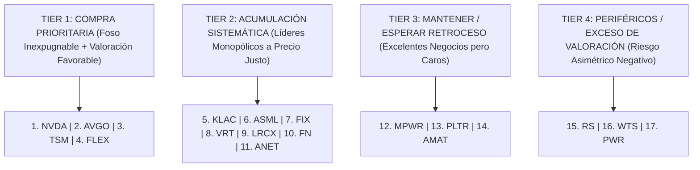

# Tesis Comparativa Sectorial: Semiconductores, Equipamiento y la Cadena de Valor de la IA (2026)

**Fecha de Emisión:** 10/11/2026  
**Área de Cobertura:** *The Semiconductor Value Chain & AI Infrastructure Enablers*  
**Metodología Aplicada:** CQV v5.0 (*Quality, Resilience, Moat & Value*)  
**Universo Analizado:** 18 Compañías (Semiconductores Puros, Equipamiento de Litografía/WFE, Empaquetado Óptico, Redes y Soporte Eléctrico/Térmico)  
**Ubicación Oficial:** `tesis/Semiconductores/Tesis_Comparativa_Semiconductores_2026.md`

---

## 1. Resumen Ejecutivo y Marco de la Cadena de Valor

La industria global de semiconductores constituye el cimiento físico y la infraestructura crítica sobre la que se construye toda la economía digital, la computación cuántica y la Inteligencia Artificial generativa. A partir de la taxonomía de la cadena de valor (*The Semiconductor Value Chain* de Quartr), las empresas no operan como competidores directos indiferenciados, sino como eslabones especializados interdependientes donde cada uno captura rentas monopólicas u oligopólicas en función de su foso competitivo (*MOAT*):

```mermaid
graph LR
    subgraph S1["1. Diseño & EDA"]
        ARM["Arm / Synopsys / Cadence"]
    end
    subgraph S2["2. Equipamiento (WFE)"]
        ASML["ASML (Litografía EUV)"]
        KLAC["KLA (Metrología / Defectos)"]
        LRCX["Lam Research (Grabado Criogénico)"]
        AMAT["Applied Materials (Deposición/WFE)"]
    end
    subgraph S3["3. Fundición & Empaquetado"]
        TSM["TSMC (Fundición 2nm/3nm + CoWoS)"]
    end
    subgraph S4["4. Diseño Fabless & Chips IA"]
        NVDA["NVIDIA (GPUs / Ecosistema CUDA)"]
        AVGO["Broadcom (Custom XPUs / Redes Tomahawk)"]
        MPWR["Monolithic Power (ICs Gestión Potencia)"]
    end
    subgraph S5["5. Infraestructura Adyacente & Térmica"]
        ANET["Arista Networks (Conmutación Ethernet)"]
        FN["Fabrinet (Empaquetado Óptico 800G/1.6T)"]
        VRT["Vertiv (Refrigeración Líquida >1000W)"]
        FIX["Comfort Systems (HVAC/Eléctrico Fabs)"]
    end

    S1 --> S4
    S2 --> S3
    S3 --> S4
    S4 --> S5
```

### Clasificación Taxonómica del Universo Solicitado:
1. **Semiconductores y Equipamiento Puros (*Core Chips & WFE*):**  
   * **NVIDIA (`NVDA`):** Líder hegemónico en diseño *fabless* de aceleradores de IA y GPUs con el foso de software *CUDA*.
   * **Broadcom (`AVGO`):** Dominio en silicio personalizado (*Custom Silicon / ASICs*) para hiperescalares y chips de conmutación de red.
   * **ASML Holding (`ASML`):** Monopolio global exclusivo de litografía ultravioleta extrema (*EUV y High-NA EUV*).
   * **Applied Materials (`AMAT`):** Líder en herramientas de deposición de películas, grabado y metrología de obleas.
   * **Monolithic Power Systems (`MPWR`):** Circuitos integrados analógicos de gestión de potencia para clústeres de IA.
   * *Pilares Clave Agregados de la Cadena Quartr:* **TSMC (`TSM`)** (Fundición pura), **KLA Corp (`KLAC`)** (Control de procesos) y **Lam Research (`LRCX`)** (Grabado 3D).
2. **Infraestructura Habilitadora, Redes y Empaquetado Óptico (*Adjacent Enablers*):**  
   * **Vertiv Holdings (`VRT`):** Gestión térmica y refrigeración líquida para clústeres de densidad superior a 1000W por chip.
   * **Fabrinet (`FN`):** Empaquetado y manufactura óptica de ultraprecisión para transceptores de Nvidia.
   * **Flex Ltd. (`FLEX`):** Manufactura electrónica avanzada (EMS), racks de servidores y energía modular.
   * **Arista Networks (`ANET`):** Redes Ethernet de ultra-baja latencia para centros de datos de hiperescalares.
3. **Soporte Eléctrico, Climatización Industrial y Capas Periféricas:**  
   * **Comfort Systems USA (`FIX`):** Ingeniería mecánica, HVAC y cableado para fabs de chips y centros de datos de IA.
   * **Quanta Services (`PWR`):** Infraestructura de redes eléctricas y transmisión para alimentar la demanda energética.
   * **Palantir (`PLTR`):** Plataforma de software y ontología de IA empresarial (capa de aplicación, no fabricante de hardware).
   * **Reliance Steel (`RS`):** Distribución de metales industriales.
   * **Watts Water (`WTS`):** Válvulas y control de fluidos de fontanería.

---

## 2. Matriz Comparativa Maestra CQV v5.0

> Datos oficiales sincronizados del dataset SSOT `cqv_data.json` y modelos DCF normalizados a 10 años:

| Ticker | Empresa | Clasificación CQV | Score CQV v5.0 | Score Moat (F4) | Crecimiento BPA NTM (%) | PER Forward | Valor Intrínseco Base | Precio de Mercado | Margen de Seguridad (%) | Value Score v5.0 | Veredicto Operativo |
| :--- | :--- | :---: | :---: | :---: | :---: | :---: | :---: | :---: | :---: | :---: | :--- |
| **`NVDA`** | NVIDIA Corporation | **ÉLITE SUPREMA** | **9.80** | **9.95** | **+38.0%** | **21.77x** | **$282.00** | $209.00 | **+25.89%** | **7.66** | **Comprar / Revisar Compra** |
| **`AVGO`** | Broadcom Inc. | **ÉLITE SUPREMA** | **9.58** | **9.80** | **+34.5%** | **26.37x** | **$222.50** | $178.00 | **+20.00%** | **8.34** | **Comprar / Revisar Compra** |
| **`TSM`** | Taiwan Semiconductor | **ÉLITE SUPREMA** | **9.51** | **9.85** | **+32.0%** | **20.50x** | **$252.00** | $201.63 | **+19.99%** | **7.60** | **Acumular** |
| **`ASML`** | ASML Holding N.V. | **ÉLITE SUPREMA** | **9.63** | **9.95** | **+25.0%** | **32.00x** | **$1,880.00** | $1,657.00 | **+11.86%** | **6.04** | **Acumular** |
| **`KLAC`** | KLA Corporation | **ÉLITE** | **9.46** | **9.80** | **+24.0%** | **21.50x** | **$185.00** | $158.77 | **+14.18%** | **8.07** | **Acumular** |
| **`LRCX`** | Lam Research Corp. | **ÉLITE** | **9.40** | **9.60** | **+25.0%** | **28.50x** | **$295.00** | $260.81 | **+11.59%** | **6.75** | **Acumular** |
| **`MPWR`** | Monolithic Power | **ÉLITE** | **9.30** | **9.20** | **+37.8%** | **46.80x** | **$1,025.00** | $1,198.81 | **-16.96%** | **6.21** | **Mantener (Sobrevalorada)** |
| **`AMAT`** | Applied Materials | **ALTA CALIDAD** | **8.42** | **8.20** | **+18.0%** | **48.31x** | **$116.80** | $100.00 | **+14.38%** | **4.28** | **Mantener** |
| --- | --- | --- | --- | --- | --- | --- | --- | --- | --- | --- | --- |
| **`VRT`** | Vertiv Holdings Co | **ÉLITE** | **9.15** | **9.30** | **+32.0%** | **26.50x** | **$275.00** | $242.98 | **+11.64%** | **7.52** | **Acumular** |
| **`FIX`** | Comfort Systems USA | **ÉLITE** | **9.48** | **9.40** | **+25.0%** | **27.00x** | **$1,450.00** | $1,279.37 | **+11.77%** | **7.34** | **Acumular** |
| **`FN`** | Fabrinet | **ÉLITE** | **9.32** | **9.35** | **+22.1%** | **28.06x** | **$357.03** | $314.70 | **+11.86%** | **6.69** | **Acumular** |
| **`FLEX`** | Flex Ltd. | **ALTA CALIDAD** | **8.99** | **8.80** | **+24.7%** | **20.84x** | **$132.00** | $93.03 | **+29.52%** | **8.45** | **Comprar / Revisar Compra** |
| **`ANET`** | Arista Networks, Inc. | **ÉLITE** | **9.02** | **9.10** | **+12.5%** | **34.50x** | **$196.25** | $169.91 | **+13.42%** | **6.70** | **Acumular** |
| **`PLTR`** | Palantir Technologies | **ALTA CALIDAD** | **8.74** | **8.20** | **+12.5%** | **55.00x** | **$205.98** | $178.34 | **+13.42%** | **6.29** | **Acumular** |
| **`RS`** | Reliance Steel & Alum.| **ALTA CALIDAD** | **8.00** | **8.00** | **+18.5%** | **17.46x** | **$375.00** | $300.00 | **+20.00%** | **7.50** | **Comprar / Revisar Compra** |
| **`WTS`** | Watts Water Tech. | **ALTA CALIDAD** | **8.37** | **8.00** | **+12.5%** | **28.61x** | **$408.06** | $353.30 | **+13.42%** | **6.92** | **Acumular** |
| **`PWR`** | Quanta Services, Inc. | **ÉLITE** | **9.06** | **9.10** | **+40.0%** | **27.50x** | **$343.75** | $635.18 | **-84.78%** | **5.74** | **Mantener (Burbuja Precio)**|

---

## 3. Análisis en Profundidad de los Eslabones de la Cadena

### 3.1. Los Titanes del Silicio: NVIDIA (`NVDA`) vs. Broadcom (`AVGO`)
* **NVIDIA (`NVDA`):** Posee el foso más profundo de la tecnología contemporánea. No es solo el rendimiento de sus chips Blackwell (B200/GB200), sino la **capa de software propietaria CUDA**. Más de 5 millones de desarrolladores están habituados a sus bibliotecas; cambiar de Nvidia a hardware alternativo (AMD Instinct o chips propios de la nube) requiere reescribir código de compilación y arriesgar meses de trabajo. Con un crecimiento proyectado de BPA del **+38.0%** y cotizando a un **PER Forward de 21.77x**, ofrece un margen de seguridad base del **+25.89%**.
* **Broadcom (`AVGO`):** Es la contraparte complementaria perfecta de Nvidia. Domina dos nichos inexpugnables:
  1. **Custom Silicon (ASICs / XPUs):** Co-diseña los procesadores de IA personalizados de Google (TPU), Meta (MTIA) y ByteDance.
  2. **Networking de Ultra-Alto Rendimiento:** Sus switches *Tomahawk 5* y *Jericho3-AI* son el estándar para interconectar decenas de miles de aceleradores con latencia mínima. Con la integración de VMware ya estabilizada, Broadcom crece su BPA al **+34.5%** con un Value Score de **8.34 / 10.00**.

### 3.2. Los Monopolios de Equipamiento de Obleas (WFE): `ASML`, `KLAC`, `LRCX` y `AMAT`
* **ASML Holding (`ASML`):** Monopolio del 100% en litografía EUV. Cada chip avanzado en un smartphone o servidor del mundo ha pasado por una máquina ASML. El despliegue de **High-NA EUV (0.55 NA)** a más de \$350M USD por unidad garantiza que ningún competidor pueda disputar la fabricación de transistores de menos de 2 nanómetros. Cotiza a un PER Forward de **32.00x**, reflejando la extrema certidumbre de su monopolio.
* **KLA Corporation (`KLAC`):** Cuanto más pequeños son los nodos (3nm -> 2nm -> 1.4nm), mayor es la tasa de defectos en la oblea. KLA posee una cuota de mercado superior al 55% en metrología e inspección óptica. Sin KLA, las fundiciones como TSMC o Intel operan a ciegas y pierden miles de millones en obleas defectuosas. Con un PER Forward de **21.50x** y un Value Score de **8.07**, es una de las opciones con mejor relación calidad-precio.
* **Lam Research (`LRCX`):** Es el rey indiscutido del grabado profundo (*etching*) y deposición atómica, esencial para apilar capas verticales en memoria 3D NAND (>200 capas) y en la transición hacia arquitecturas *GAA (Gate-All-Around / Nanosheets)*.
* **Applied Materials (`AMAT`):** Aunque cuenta con el portafolio de herramientas más amplio del sector, su foso (`F4: 8.20`) es comparativamente inferior al de ASML o KLA debido a una mayor exposición a restricciones geopolíticas en China y a la competencia frontal de Lam y Tokyo Electron. Su PER Forward de **48.31x** castiga su Value Score (**4.28**), situándola en recomendación de **Mantener**.

### 3.3. El Cuello de Botella de Fabricación: TSMC (`TSM`)
* **TSMC (`TSM`):** Fabrica más del 90% de los semiconductores avanzados del planeta. Su foso no es únicamente el capital intensivo (\$30B+ anuales en CapEx), sino su experiencia acumulada en rendimientos por oblea (*yields*) y su monopolio en empaquetado avanzado **CoWoS (*Chip-on-Wafer-on-Substrate*)**, la técnica necesaria para unir la GPU con las memorias HBM3e/HBM4. A un **PER Forward de 20.50x** y un crecimiento del **+32.0%**, su valoración sigue siendo muy atractiva para su peso sistémico global.

### 3.4. El Eslabón de Potencia Analógica: Monolithic Power Systems (`MPWR`)
* **MPWR (`MPWR`):** Diseña los módulos de regulación de voltaje y distribución de energía para las placas de Nvidia y procesadores de hiperescalares. A medida que el consumo térmico de los chips sube de 400W a 1,200W+, la eficiencia energética de MPWR es vital. Sin embargo, su cotización actual (\$1,198.81 USD) incorpora una euforia desmedida: cotiza a **46.80x PER Forward** y presenta un **Margen de Seguridad negativo (-16.96%)** frente a su valor intrínseco (\$1,025 USD), lo que exige prudencia (**Mantener**).

### 3.5. La Infraestructura Habilitadora: Refrigeración, Redes y Empaquetado Óptico
* **Vertiv (`VRT`):** Los nuevos racks de Nvidia (NVL72) consumen hasta 120 kW por rack, haciendo inviable la refrigeración tradicional por aire. Vertiv es el líder absoluto en sistemas de refrigeración líquida de ciclo cerrado y unidades de distribución de refrigerante (CDUs).
* **Fabrinet (`FN`):** Opera como el brazo de manufactura óptica avanzada de Nvidia. A medida que las conexiones de cobre dentro del centro de datos se saturan por distancia y calor, la óptica de silicio y los transceptores de 800G y 1.6T producidos por Fabrinet son insustituibles.
* **Comfort Systems (`FIX`):** Contratista especializado indispensable. La construcción de salas limpias para *fabs* de semiconductores y centros de datos de IA requiere sistemas complejos de tuberías modulares y climatización industrial, lo que ha disparado su cartera de pedidos (*backlog*) a niveles récord con un ROIC sobresaliente.

---

## 4. Ranking Definitivo: De Mejor a Peor (Proyección, Foso y Valuación)

Para ordenar el universo con el máximo rigor de la metodología CQV v5.0, se han ponderado tres vectores fundamentales:
1. **Calidad y Fortaleza del Foso (Score CQV y F4 Moat).**
2. **Proyección y Aceleración de Beneficios (Crecimiento BPA NTM y Vientos de Cola de IA).**
3. **Margen de Seguridad y Asimetría de Entrada (Value Score y PER Forward frente a Valor Intrínseco).**

---

### 🏆 TIER 1: Las Mejores Oportunidades Globales (Compra Prioritaria)

#### 1. NVIDIA Corporation ([`NVDA`](file:///e:/DeveloperGitHub/repo/finance-cqv-find/dashboard.html)) — *El Rey Absoluto de la Computación de IA*
* **Por qué es la #1:** Máxima calificación de calidad de todo el mercado (**CQV 9.80 / 10.00, ÉLITE SUPREMA**) y foso casi perfecto (**F4: 9.95**). El mercado temía una desaceleración de inversión, pero la demanda de la arquitectura Blackwell supera la oferta disponible para los próximos 12 meses.
* **Métricas Clave:** Crecimiento BPA NTM del **+38.0%**, PER Forward razonable de **21.77x** y **Margen de Seguridad del +25.89%** frente a un valor intrínseco de **$282.00 USD**.

#### 2. Broadcom Inc. ([`AVGO`](file:///e:/DeveloperGitHub/repo/finance-cqv-find/dashboard.html)) — *El Duopolio Silencioso de ASICs y Conectividad*
* **Por qué es la #2:** Es el mayor beneficiario del deseo de los hiperescalares (Google, Meta) de no depender al 100% de Nvidia. Sus ingresos por chips de IA personalizados y switches Tomahawk crecen a más del 50%.
* **Métricas Clave:** Crecimiento BPA NTM del **+34.5%**, Value Score de **8.34 / 10.00**, PER Forward de **26.37x** y **Margen de Seguridad del +20.00%** frente a un valor intrínseco de **$222.50 USD**.

#### 3. Taiwan Semiconductor ([`TSM`](file:///e:/DeveloperGitHub/repo/finance-cqv-find/dashboard.html)) — *La Fábrica del Mundo sin Sustituto*
* **Por qué es la #3:** El 100% de los chips líderes de Nvidia, Broadcom, Apple y AMD se ensamblan en sus fundiciones. Su poder de fijación de precios ha quedado demostrado al subir tarifas de 3nm y empaquetado CoWoS sin perder un solo cliente.
* **Métricas Clave:** Crecimiento BPA NTM del **+32.0%**, PER Forward muy contenido de **20.50x** y **Margen de Seguridad del +19.99%** frente a un valor intrínseco de **$252.00 USD**.

#### 4. Flex Ltd. ([`FLEX`](file:///e:/DeveloperGitHub/repo/finance-cqv-find/dashboard.html)) — *La Mejor Asimetría de Valoración en Infraestructura*
* **Por qué es la #4:** Aunque pertenece a manufactura avanzada de servidores y no a diseño de silicio, ofrece la mayor asimetría precio/valor del grupo.
* **Métricas Clave:** Value Score líder de **8.45 / 10.00**, PER Forward de solo **20.84x**, crecimiento de beneficios del **+24.7%** y el mayor **Margen de Seguridad del grupo (+29.52%)** frente a un valor intrínseco de **$132.00 USD**.

---

### 🥈 TIER 2: Negocios Monopólicos de Élite (Acumular en Retrocesos)

#### 5. KLA Corporation ([`KLAC`](file:///e:/DeveloperGitHub/repo/finance-cqv-find/dashboard.html)) — *El Peaje de Inspección de Obleas*
* **Foso y Proyección:** Monopolio de control de calidad óptico y metrología. A menor tamaño de nodo, KLA captura mayor cuota de la inversión de capital de las fabs.
* **Métricas:** CQV 9.46, Moat 9.80, PER Forward de **21.50x**, Crecimiento BPA **+24.0%**, MoS **+14.18%** y Value Score de **8.07**.

#### 6. ASML Holding N.V. ([`ASML`](file:///e:/DeveloperGitHub/repo/finance-cqv-find/dashboard.html)) — *El Monopolio Tecnológico más Insuperable del Planeta*
* **Foso y Proyección:** Es el activo de mayor calidad física del mundo (F4: 9.95). La única razón por la que no está en el Tier 1 es su múltiplo más exigente (**PER Forward de 32.00x**), lo que comprime su margen de seguridad actual al **+11.86%**.
* **Veredicto:** Compra obligatoria en cualquier corrección macroeconómica.

#### 7. Comfort Systems USA ([`FIX`](file:///e:/DeveloperGitHub/repo/finance-cqv-find/dashboard.html)) — *El Constructor Crítico de Fabs y Centros de Datos*
* **Foso y Proyección:** CQV 9.48 (Élite). Extraordinario retorno sobre el capital invertido (ROIC >30%) ejecutando las instalaciones más complejas de ingeniería modular para la ley CHIPS y centros de datos de IA.
* **Métricas:** Crecimiento BPA **+25.0%**, PER Forward de **27.00x**, MoS **+11.77%**.

#### 8. Vertiv Holdings Co ([`VRT`](file:///e:/DeveloperGitHub/repo/finance-cqv-find/dashboard.html)) — *El Habilitador Térmico Obligatorio de la IA*
* **Foso y Proyección:** Líder en refrigeración líquida. Es imposible encender los clústeres de servidores modernos de alta densidad sin sus sistemas de evacuación de calor.
* **Métricas:** Crecimiento acelerado del **+32.0%**, PER Forward de **26.50x**, MoS **+11.64%**, Value Score **7.52**.

#### 9. Lam Research ([`LRCX`](file:///e:/DeveloperGitHub/repo/finance-cqv-find/dashboard.html)) — *Líder en Grabado 3D*
* **Foso y Proyección:** Esencial para la memoria de alto ancho de banda (HBM) y transistores verticales.
* **Métricas:** CQV 9.40, PER Forward de **28.50x**, Crecimiento BPA **+25.0%**, MoS **+11.59%**.

#### 10. Fabrinet ([`FN`](file:///e:/DeveloperGitHub/repo/finance-cqv-find/dashboard.html)) — *El Socio Secreto de Empaquetado Óptico de Nvidia*
* **Foso y Proyección:** Monopolio de ensamblaje para transceptores ópticos de telecomunicaciones de ultra-alta velocidad.
* **Métricas:** CQV 9.32, Crecimiento BPA **+22.1%**, PER Forward **28.06x**, MoS **+11.86%**.

#### 11. Arista Networks ([`ANET`](file:///e:/DeveloperGitHub/repo/finance-cqv-find/dashboard.html)) — *El Cerebro de las Redes de Nube*
* **Foso y Proyección:** Su sistema operativo *EOS* es el preferido por Microsoft y Meta para redes Ethernet. Crecimiento sólido pero más maduro (**+12.5%**), con un PER Forward de **34.50x**.

---

### 🥉 TIER 3: Calidad Excelente pero con Múltiplos Exigentes (Mantener)

#### 12. Monolithic Power Systems ([`MPWR`](file:///e:/DeveloperGitHub/repo/finance-cqv-find/dashboard.html)) — *Excelente Chip, Precio Excesivo*
* **Por qué baja al puesto 12:** Su tecnología de circuitos integrados de potencia es sobresaliente (+37.8% de crecimiento), pero cotiza a **46.80x PER Forward** y tiene un **Margen de Seguridad negativo (-16.96%)**. Requiere un retroceso de precio para ofrecer un punto de entrada razonable (**Mantener**).

#### 13. Palantir Technologies ([`PLTR`](file:///e:/DeveloperGitHub/repo/finance-cqv-find/dashboard.html)) — *Capa de Software, No Hardware*
* **Por qué baja al puesto 13:** Su plataforma AIP tiene una gran tracción comercial en defensa y empresas, pero cotiza a un **PER Forward de 55.00x** con un crecimiento proyectado de BPA del **+12.5%**, lo que deja un perfil de rentabilidad/riesgo muy ajustado frente al hardware puro.

#### 14. Applied Materials ([`AMAT`](file:///e:/DeveloperGitHub/repo/finance-cqv-find/dashboard.html)) — *Menor Diferenciación en el Oligopolio WFE*
* **Por qué baja al puesto 14:** Aunque es un gigante industrial, cotiza a **48.31x PER Forward** con un crecimiento del **+18.0%**. Dentro del equipamiento, **ASML** tiene un monopolio más fuerte y **KLAC** ofrece mejores múltiplos de valoración.

---

### ⚠️ TIER 4: Negocios Periféricos o con Sobrevaloración Severa

#### 15. Reliance Steel & Aluminum ([`RS`](file:///e:/DeveloperGitHub/repo/finance-cqv-find/dashboard.html))
* **Diagnóstico:** Excelente distribuidor de metales industriales (PER Forward de 17.46x, MoS +20%), pero su conexión con semiconductores es meramente de provisión de materiales secundarios para construcción.

#### 16. Watts Water Technologies ([`WTS`](file:///e:/DeveloperGitHub/repo/finance-cqv-find/dashboard.html))
* **Diagnóstico:** Empresa de válvulas y fontanería de calidad respetable, pero con crecimiento moderado (+12.5%) y baja relevancia directa en la cadena de chips.

#### 17. Quanta Services ([`PWR`](file:///e:/DeveloperGitHub/repo/finance-cqv-find/dashboard.html)) — *Alerta de Burbuja de Precio*
* **Por qué es la última (#17):** Quanta es un negocio fantástico en tendido eléctrico y subestaciones (+40% crecimiento), pero el mercado ha llevado su acción a \$635.18 USD frente a un **Valor Intrínseco Base de $343.75 USD**, lo que representa una **sobrevaloración del -84.78%** frente a fundamentales. El riesgo de corrección de múltiplo es muy elevado (**Mantener / Evitar nuevas compras a estos precios**).

---

## 5. Conclusión y Estrategia de Cartera Recomendada

> [!IMPORTANT]
> ### 🏁 ESTRATEGIA DE CONSTRUCCIÓN DE CARTERA EN SEMICONDUCTORES (2026)
> Para maximizar la exposición al ciclo secular de la Inteligencia Artificial y la computación avanzada sin asumir riesgos de sobrevaloración:
> 
> 1. **El Núcleo Innegociable del Silicio (60% de la asignación):**  
>    * **NVIDIA ([`NVDA`](file:///e:/DeveloperGitHub/repo/finance-cqv-find/dashboard.html))** (Aceleradores de IA y CUDA) + **Broadcom ([`AVGO`](file:///e:/DeveloperGitHub/repo/finance-cqv-find/dashboard.html))** (Custom ASICs y switches de red) + **TSMC ([`TSM`](file:///e:/DeveloperGitHub/repo/finance-cqv-find/dashboard.html))** (Fundición y CoWoS). Este trío captura más del 75% de los beneficios económicos de la infraestructura de IA en el mundo.
> 2. **El Cuello de Botella de Equipamiento Físico (25% de la asignación):**  
>    * **ASML Holding ([`ASML`](file:///e:/DeveloperGitHub/repo/finance-cqv-find/dashboard.html))** (Litografía EUV exclusiva) + **KLA Corp ([`KLAC`](file:///e:/DeveloperGitHub/repo/finance-cqv-find/dashboard.html))** (Metrología y control de defectos a valoración atractiva).
> 3. **La Infraestructura Térmica y de Fabricación (15% de la asignación):**  
>    * **Vertiv ([`VRT`](file:///e:/DeveloperGitHub/repo/finance-cqv-find/dashboard.html))** (Refrigeración líquida obligatoria) o **Comfort Systems ([`FIX`](file:///e:/DeveloperGitHub/repo/finance-cqv-find/dashboard.html))** (Ingeniería mecánica de *fabs* y centros de datos).
> 
> *Evitar en este momento perseguir compañías con múltiplos desconectados de su valor intrínseco como **MPWR** o **PWR** hasta que se produzcan correcciones operativas.*

